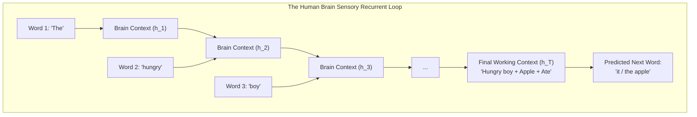

# Module 01: Foundations of Generative AI & Recurrent Neural Networks (RNNs)
### *From Childhood Cognitive Evolution to Staff Backend Distributed Systems Architecture*

---

## 🧠 Tier 1: The Childhood & Class X Sensory Intuition
*(The Feynman Foundation: How the Human Brain Acquires Language and Memory)*

### The Child's Brain: From Static Flashcards to Fluent Storytelling

Imagine a 3-year-old child learning to understand speech:

- **The Static Flashcard Stage (Feed-Forward Neural Networks / MLPs)**:
  When a child sees isolated flashcards showing a picture of an *"apple"*, *"dog"*, or *"car"*, they learn static pattern recognition. But language is NOT a collection of isolated flashcards. If you show the child:
  > *"The hungry boy saw a ripe apple on the tree and ate ___"*
  
  A static flashcard model looks at the last word *"ate"* in complete isolation with no memory of *"hungry boy"* or *"apple"*. It cannot tell whether the boy ate an *"apple"*, a *"stone"*, or a *"car"*.

- **The Conversational Memory Loop (Recurrent Neural Networks - RNNs)**:
  To comprehend stories, the human child develops a **mental recurrent feedback loop**. As each word enters their ears, their brain holds onto a **rolling summary of what came before** (the **Hidden State $\mathbf{h}_t$**). 
  - Word 1 (*"The"*) $\rightarrow$ Memory starts.
  - Word 2 (*"hungry"*) $\rightarrow$ Memory notes the biological state of need.
  - Word 3 (*"boy"*) $\rightarrow$ Memory updates subject: male child.
  - Word 8 (*"apple"*) $\rightarrow$ Memory stores direct object: edible fruit.
  - Word 10 (*"ate"*) $\rightarrow$ Combined memory immediately predicts: *"it"* or *"the apple"*.



---

### The Biological Memory Limit: The Goldfish Dilemma

Why did early RNNs struggle? **The Goldfish Memory Problem**.
A vanilla RNN forces all past history to pass through a single, mutable memory vector ($\mathbf{h}_t$). Every time a new word arrives, the previous memory is multiplied by a weight matrix $\mathbf{W}_{hh}$ and squashed by $\tanh$. 

By word 20 or 30, the initial memory of *"hungry boy"* has been overwritten and diluted 20 times. The network suffers from **catastrophic forgetting**.

---

## ⚙️ Tier 2: The Backend Architect's Rosetta Stone
*(The Distributed Systems Lens: Mapping Neural Foundations to Backend Primitives)*

For a Staff Backend Engineer with 10+ years of experience across Retail, Banking, Insurance, and EdTech, neural networks map directly to foundational distributed systems concepts:

```
┌───────────────────────────────────────────────────────────────────────────────────────────┐
│              DISTRIBUTED SYSTEMS & BACKEND ARCHITECT ROSETTA STONE                        │
├────────────────────────────────┬──────────────────────────────────────────────────────────┤
│ AI / Deep Learning Concept     │ Distributed Systems & Backend Engineering Equivalent     │
├────────────────────────────────┼──────────────────────────────────────────────────────────┤
│ **Neuron / Perceptron**        │ An **Atomic Stream Processor / Filter Function**:        │
│                                │ Ingests a payload vector, calculates a weighted sum,     │
│                                │ applies a non-linear threshold, and emits a score.       │
├────────────────────────────────┼──────────────────────────────────────────────────────────┤
│ **Dense Layer**                │ A **Parallel Microservice Worker Pool**:                 │
│                                │ An array of parallel worker threads transforming an input│
│                                │ payload vector into a higher-dimensional abstraction.    │
├────────────────────────────────┼──────────────────────────────────────────────────────────┤
│ **Recurrent Hidden State h_t** │ A **Mutable In-Memory Session Cache**:                   │
│                                │ Passed sequentially across synchronous microservice hops,│
│                                │ accumulating state until memory corruption/leak occurs.  │
├────────────────────────────────┼──────────────────────────────────────────────────────────┤
│ **Recurrence Loop (h_{t-1})**  │ A **Single-Partition Synchronous Consumer Queue**:       │
│                                │ Message t is blocked waiting for message t-1 to finish.  │
│                                │ Zero horizontal GPU scaling across time steps.           │
├────────────────────────────────┼──────────────────────────────────────────────────────────┤
│ **Embeddings (E in R^{Vxd})**  │ An **Indexed Inverted Database / Key-Value Cache**:      │
│                                │ O(1) hash lookup mapping discrete SKU/Entity IDs to dense│
│                                │ semantic feature coordinate vectors.                     │
├────────────────────────────────┼──────────────────────────────────────────────────────────┤
│ **Backpropagation (BPTT)**     │ A **Distributed Distributed Tracing & Compensation Log**:│
│                                │ Propagating error deltas backwards across the entire     │
│                                │ call graph to adjust configuration knobs (weights).      │
└────────────────────────────────┴──────────────────────────────────────────────────────────┘
```

---

## 📐 Tier 3: Geometric & Tangible Domain Feature Space
*(Demystifying Vectors into Retail, Banking, Insurance, and EdTech Entities)*

Vectors are **coordinates in an $n$-dimensional semantic attribute manifold**:

### 1. Retail / E-Commerce Entity Vector ($\mathbf{x}_t \in \mathbb{R}^4$)
When a customer browses a high-scale fashion catalog (e.g., Myntra):

$$\mathbf{x}_{\text{Retail}} = \begin{bmatrix} \text{Formality Index} & (+1.0 = \text{Tuxedo/Bridal Lehenga}, -1.0 = \text{Casual T-Shirt}) \\ \text{Seasonal Warmth} & (+1.0 = \text{Heavy Winter Down Jacket}, -1.0 = \text{Summer Linen Shirt}) \\ \text{Price Elasticity} & (+1.0 = \text{Luxury Tier / Designer}, -1.0 = \text{Budget Clearance}) \\ \text{Category Domain} & (+1.0 = \text{Footwear}, 0.0 = \text{Apparel}, -1.0 = \text{Accessories}) \end{bmatrix}$$

### 2. Banking / FinTech Sequential Transaction Vector ($\mathbf{x}_t \in \mathbb{R}^4$)
$$\mathbf{x}_{\text{Banking}} = \begin{bmatrix} \text{Velocity Delta} & (\text{Standard deviations from user 30-day baseline}) \\ \text{Geo-Distance} & (\text{Kilometers from previous transaction location}) \\ \text{Time Unusualness} & (+1.0 = \text{Off-hours 3:00 AM}, 0.0 = \text{Business Hours}) \\ \text{MCC Risk Multiplier}& (+1.0 = \text{Crypto/Offshore Wire}, -1.0 = \text{Verified Supermarket}) \end{bmatrix}$$

### 3. Insurance Claim Risk Vector ($\mathbf{x}_t \in \mathbb{R}^4$)
$$\mathbf{x}_{\text{Insurance}} = [\text{Claim Frequency Past 24M}, \text{Loss Severity Ratio}, \text{Documentation Integrity}, \text{Third-Party Liability}]^T$$

### 4. EdTech Student Learning Trajectory Vector ($\mathbf{x}_t \in \mathbb{R}^4$)
$$\mathbf{x}_{\text{EdTech}} = [\text{Concept Retention Score}, \text{Problem Solving Latency}, \text{Hint Dependency Index}, \text{Prerequisite Mastery}]^T$$

---

## 🔬 Tier 4: First-Principles Mathematical & Activation Rigor

```
          Output Logits: \hat{y}_t
                    ▲
                    │ W_hy  (V x d_h)
               ┌─────────┐
h_{t-1} ──────►│ Hidden  │──────► h_t  (Passed to next time step)
 (d_h x 1)     │ State   │  (d_h x 1)
               └─────────┘
                    ▲
                    │ W_xh  (d_h x d_in)
          Input Vector: x_t (d_in x 1)
```

---

### A. The Core Governing Equations

At each discrete time step $t \in \{1, 2, \dots, T\}$:

#### 1. Hidden State Update Equation:
$$\mathbf{h}_t = \tanh\left(\mathbf{W}_{xh} \mathbf{x}_t + \mathbf{W}_{hh} \mathbf{h}_{t-1} + \mathbf{b}_h\right)$$

- $\mathbf{x}_t \in \mathbb{R}^{d_{in} \times 1}$: Input embedding vector at step $t$.
- $\mathbf{h}_{t-1} \in \mathbb{R}^{d_h \times 1}$: Hidden context vector from step $t-1$ ($\mathbf{h}_0 = \mathbf{0}$).
- $\mathbf{W}_{xh} \in \mathbb{R}^{d_h \times d_{in}}$: Projection matrix mapping input features into hidden space.
- $\mathbf{W}_{hh} \in \mathbb{R}^{d_h \times d_h}$: Recurrent state transition matrix mapping previous memory to current state.
- $\mathbf{b}_h \in \mathbb{R}^{d_h \times 1}$: Hidden layer bias vector.
- $\tanh$: Squashes state values strictly into $(-1.0, +1.0)$.

#### 2. Output Prediction Equation:
$$\mathbf{\hat{y}}_t = \text{Softmax}\left(\mathbf{W}_{hy} \mathbf{h}_t + \mathbf{b}_y\right)$$

- $\mathbf{W}_{hy} \in \mathbb{R}^{V \times d_h}$: Projection matrix mapping hidden state to vocabulary size $V$.
- $\mathbf{b}_y \in \mathbb{R}^{V \times 1}$: Output vocabulary bias.
- $\text{Softmax}$: Normalizes logits into a valid probability distribution ($\sum p_i = 1.0$).

---

### B. Activation Function Physics: Why $\tanh$ over $\text{ReLU}$ or $\text{Sigmoid}$?

1. **Unbounded Explosion with $\text{ReLU}$**:
   In recurrent networks, the state at step $t$ is effectively $(\mathbf{W}_{hh})^t \mathbf{h}_0$. If an unbounded activation like $\text{ReLU}(z) = \max(0, z)$ is used, repeated multiplication causes activations to grow exponentially toward $+\infty$, resulting in numeric `NaN` overflows within 15 steps.
2. **Zero-Centered Gradients in $\tanh$**:
   $\text{Sigmoid}(\sigma) \in (0, 1)$ is strictly positive, which forces all weight gradients in a layer to share the same sign during backpropagation, causing severe **gradient zigzagging**. $\tanh \in (-1, +1)$ is zero-centered, allowing gradients to update weights in positive and negative directions freely.
3. **Inhibitory Memory Signals**:
   $\tanh$ can output negative numbers, allowing the network to encode **inhibitory features** (negation, cancellation, or opposite sentiment).

---

### C. The Vanishing Gradient Derivation (Backpropagation Through Time)

During training, the loss at step $T$ must update the initial weights at step $1$. By the multivariable chain rule:

$$\frac{\partial \mathcal{L}_T}{\partial \mathbf{h}_1} = \frac{\partial \mathcal{L}_T}{\partial \mathbf{h}_T} \prod_{k=2}^T \frac{\partial \mathbf{h}_k}{\partial \mathbf{h}_{k-1}} = \frac{\partial \mathcal{L}_T}{\partial \mathbf{h}_T} \prod_{k=2}^T \mathbf{W}_{hh}^T \cdot \text{diag}\left(1 - \tanh^2(\mathbf{z}_k)\right)$$

- Because $|1 - \tanh^2(z)| \le 1.0$, and the spectral radius of $\mathbf{W}_{hh}$ is typically $< 1.0$, multiplying these matrices $T$ times causes the gradient magnitude to decay **exponentially toward zero**:
  $$\left\| \frac{\partial \mathcal{L}_T}{\partial \mathbf{h}_1} \right\| \xrightarrow{T \ge 15} 0$$
- Result: The network cannot learn long-term dependencies.

---

## 💻 Tier 5: Dual-Language Implementation (Python + Java)

### 1. Pure Python (Zero-Dependency) Implementation
Available at: [`01-class-notes/01-rnns-and-genai-history/rnn_from_scratch.py`](file:///Users/damodhar/Documents/Workspace/Learnings/Vizuara%20-%20Minor%20in%20AI/01-class-notes/01-rnns-and-genai-history/rnn_from_scratch.py)

```python
# The Core Vanilla RNN Forward Step in Pure Python
def rnn_step(x_t, h_prev, W_xh, W_hh, b_h, W_hy, b_y):
    # 1. Linear Input + Memory Projection
    linear_h = [
        sum(W_xh[i][j] * x_t[j] for j in range(len(x_t))) +
        sum(W_hh[i][k] * h_prev[k] for k in range(len(h_prev))) +
        b_h[i]
        for i in range(len(b_h))
    ]
    # 2. tanh Squashing
    h_t = [math.tanh(v) for v in linear_h]
    
    # 3. Output Projection Logits
    logits = [
        sum(W_hy[i][k] * h_t[k] for k in range(len(h_t))) + b_y[i]
        for i in range(len(b_y))
    ]
    # 4. Softmax Probabilities
    max_l = max(logits)
    exp_l = [math.exp(v - max_l) for v in logits]
    sum_exp = sum(exp_l)
    probs = [v / sum_exp for v in exp_l]
    
    return h_t, probs
```

---

### 2. Enterprise Java 17+ Implementation
Available at: [`01-class-notes/01-rnns-and-genai-history/RNNFromScratch.java`](file:///Users/damodhar/Documents/Workspace/Learnings/Vizuara%20-%20Minor%20in%20AI/01-class-notes/01-rnns-and-genai-history/RNNFromScratch.java)

```java
package com.vizuara.genai.rnn;

public record RNNStepResult(double[] hiddenState, double[] probabilities) {}

public class VanillaRNNService {
    public RNNStepResult step(double[] x_t, double[] h_prev, double[][] W_xh, double[][] W_hh, double[] b_h, double[][] W_hy, double[] b_y) {
        int hiddenDim = b_h.length;
        double[] h_t = new double[hiddenDim];
        
        for (int i = 0; i < hiddenDim; i++) {
            double sum = b_h[i];
            for (int j = 0; j < x_t.length; j++) sum += W_xh[i][j] * x_t[j];
            for (int k = 0; k < h_prev.length; k++) sum += W_hh[i][k] * h_prev[k];
            h_t[i] = Math.tanh(sum);
        }
        
        int vocabSize = b_y.length;
        double[] logits = new double[vocabSize];
        double maxLogit = Double.NEGATIVE_INFINITY;
        for (int i = 0; i < vocabSize; i++) {
            double sum = b_y[i];
            for (int k = 0; k < hiddenDim; k++) sum += W_hy[i][k] * h_t[k];
            logits[i] = sum;
            if (sum > maxLogit) maxLogit = sum;
        }
        
        double sumExp = 0.0;
        double[] probs = new double[vocabSize];
        for (int i = 0; i < vocabSize; i++) {
            probs[i] = Math.exp(logits[i] - maxLogit);
            sumExp += probs[i];
        }
        for (int i = 0; i < vocabSize; i++) probs[i] /= sumExp;
        
        return new RNNStepResult(h_t, probs);
    }
}
```

---

## 🏢 Tier 6: Enterprise Retail Production Systems Blueprint & GenAI Frontier

### 1. Production Use-Case: Real-Time Clickstream Intent in Retail E-Commerce
In a high-throughput retail platform (e.g., Myntra / Amazon) handling **200+ TPS**:
- **Problem**: When a customer searches *"linen shirt"* $\to$ views a *"formal blazer"* $\to$ views *"leather formal shoes"*, their browsing path forms a temporal sequence.
- **The RNN Engine**: Ingests the sequence of product clickstream IDs from an Apache Kafka partition in real-time, updating session state $\mathbf{h}_t$ to immediately boost formal wedding bundles on the next page view.

---

### 2. The Recurrence Bottleneck & The Bridge to 2017 Transformers

Why did Vanilla RNNs get replaced in modern enterprise AI?

```
The Sequential Execution Wall:
Token 1 (t=1) ──► Token 2 (t=2) ──► Token 3 (t=3) ──► ... ──► Token 10,000 (t=10,000)
(GPU Core 0 must finish before Core 1 can start; 99% of parallel GPU cores sit idle)
```

1. **GPU Underutilization**: Recurrence forces $O(T)$ sequential steps on hardware designed for $O(1)$ massive matrix parallelism.
2. **Information Bottleneck**: Compressing entire paragraphs into a single fixed vector $\mathbf{h}_T$ causes catastrophic forgetting.
3. **The 2017 Evolution**:
   - **LSTMs (1997)** fixed vanishing gradients via additive Cell States.
   - **Bahdanau Attention (2014)** allowed looking back at all hidden states.
   - **Transformers (Vaswani et al., 2017 - *"Attention Is All You Need"* )** completely deleted recurrence, computing all tokens simultaneously across thousands of GPU cores in parallel.
