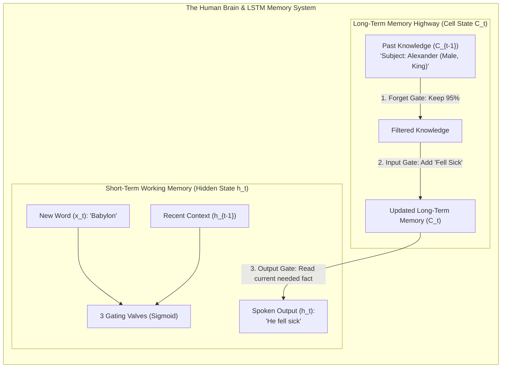

# Lecture 05: Introduction to LSTM Networks
## Long Short-Term Memory, Internal Neuron Anatomy, The 3 Gating Mechanisms, Sigmoid vs. $\tanh$ Dynamics, and Gradient Control

---

## 🧠 Section 1: Class X / Layman Explanation
*(Bridging complex AI with the evolution of the Human Brain and Memory)*

### The Goldfish Memory vs. The Human Brain with a Diary

Imagine you are listening to a 500-page historical novel being read aloud. 

- **The Vanilla RNN (The "Goldfish Brain")**:
  A goldfish has an estimated memory span of just a few seconds. If you tell a goldfish: *"Alexander was a Greek king. He conquered many lands. Decades later, in Babylon, ___ fell sick."*
  Because the goldfish only keeps a single short-term memory buffer that gets overwritten on every new word, by the time it reaches "Babylon", it has completely forgotten that "Alexander" was the subject! It might guess "she" or "they" because the initial memory has faded.

- **The LSTM (The "Human Brain with a Long-Term Diary")**:
  Human beings do not rely solely on what they heard 2 seconds ago. Your brain maintains **two distinct memory systems**:
  1. **Working Memory (Short-Term Memory - $h_t$)**: The words you just heard 3 seconds ago to complete the current sentence.
  2. **The Long-Term Archival Diary (Cell State - $C_t$)**: A notebook in your mind that carries the big picture (e.g., *"The protagonist is Alexander, he is male, and he is a king"*). This notebook runs untouched across pages unless you deliberately choose to write or erase something.



---

### The Three Brain Instincts (The Gating Valves)

Inside every LSTM neuron, there are three intelligent security guards called **Gates**. Every gate uses a **Sigmoid valve ($\sigma$)** which acts like a dimmer switch from **$0\%$ (completely blocked/forget)** to **$100\%$ (fully allowed/remember)**:

1. **The Forget Gate ($f_t$) — *"What useless trivia should I erase?"***
   - *Brain Analogy*: When the story switches chapters from *"Alexander in Greece"* to *"Priya in modern Mumbai"*, your brain's forget gate closes the valve on "Alexander's gender/era" so your memory doesn't get cluttered.
2. **The Input Gate ($i_t$) & Candidate Thought ($\tilde{C}_t$) — *"What new facts are worth writing into the diary?"***
   - *Brain Analogy*: The teacher says, *"Priya is an aerospace engineer."* Your brain recognizes this is an important fact. The input gate opens to $100\%$ and writes `[Career: Engineer, Gender: Female]` into the long-term diary.
3. **The Output Gate ($o_t$) — *"What part of my diary is needed right now to answer the question?"***
   - *Brain Analogy*: The teacher asks, *"What does Priya do for a living?"* Your brain scans the diary, ignores where she lives, filters out unrelated facts, and retrieves only the occupation feature to speak out loud: *"She is an engineer!"*

---

## 📐 Section 2: Demystifying Matrix Dimensions as Real-World Features

In neural networks, vectors and matrices are not just abstract lists of numbers; **every dimension represents a tangible physical or semantic attribute**.

### Real-World Feature Mapping in a 4-Dimensional Language Vector

Suppose our hidden state $\mathbf{h}_t \in \mathbb{R}^{4 \times 1}$ and cell state $\mathbf{C}_t \in \mathbb{R}^{4 \times 1}$ have dimension $d = 4$:

$$\mathbf{C}_t = \begin{bmatrix} c_1 \\ c_2 \\ c_3 \\ c_4 \end{bmatrix} = \begin{bmatrix} \text{Subject Gender} & (+1.0 = \text{Male}, -1.0 = \text{Female}) \\ \text{Plurality} & (-1.0 = \text{Singular}, +1.0 = \text{Plural}) \\ \text{Grammatical Tense} & (-1.0 = \text{Past}, 0.0 = \text{Present}, +1.0 = \text{Future}) \\ \text{Emotional Sentiment} & (-1.0 = \text{Negative}, +1.0 = \text{Positive}) \end{bmatrix}$$

```
When the network reads "Kings ruled happily":
  Dimension 1 (Gender)      = +0.92  (Male royalty)
  Dimension 2 (Plurality)   = +0.95  (Plural: 'Kings')
  Dimension 3 (Tense)       = -0.88  (Past tense: 'ruled')
  Dimension 4 (Sentiment)   = +0.90  (Positive: 'happily')
```

When the **Forget Gate** $\mathbf{f}_t = [0.05, 0.99, 0.95, 0.90]^T$ operates:
- Dimension 1 is multiplied by $0.05$ $\rightarrow$ **Erases the gender memory** (ready for a new subject).
- Dimension 2 is multiplied by $0.99$ $\rightarrow$ **Retains plurality** (still remembers the subject was plural).

---

## 🔬 Section 3: Deep Technical & Mathematical Rigor

```
                    Cell State Highway: C_{t-1} ──────────────────[ x ]────────────────(+)──────────────► C_t
                                                                   ▲                  ▲
                                                                   │ (f_t)            │ (i_t * \tilde{C}_t)
                                                           ┌───────┴──────┐   ┌───────┴──────┐
                                                           │ Forget Gate  │   │  Input Gate  │
                                                           │  σ(W_f...)   │   │  σ(W_i...)   │
                                                           └───────┬──────┘   └───────┬──────┘
                                                                   ▲                  ▲
                                                                   │                  │ (\tilde{C}_t)
                                                                   │          ┌───────┴──────┐
                                                                   │          │ Candidate    │
                                                                   │          │ tanh(W_c...) │
                                                                   │          └───────┬──────┘
                                                                   │                  │
                                           h_{t-1} ──┐             │                  │
                                                     ├───► [ Gating Network (W_f, W_i, W_c, W_o) ]
                                            x_t   ───┘             │
                                                                   │          ┌──────────────┐
                                                                   └─────────►│ Output Gate  │
                                                                              │  σ(W_o...)   │──┐ (o_t)
                                                                              └──────────────┘  ▼
                                                                  tanh(C_t) ──────────────────[ x ]──────► h_t
```

---

### A. The 6 Governing Mathematical Equations of an LSTM

At each time step $t$, given input $\mathbf{x}_t \in \mathbb{R}^{d_{in}}$, previous hidden state $\mathbf{h}_{t-1} \in \mathbb{R}^{d_h}$, and previous cell state $\mathbf{C}_{t-1} \in \mathbb{R}^{d_h}$:

#### 1. The Forget Gate ($\mathbf{f}_t$):
$$\mathbf{f}_t = \sigma\left(\mathbf{W}_f \mathbf{x}_t + \mathbf{U}_f \mathbf{h}_{t-1} + \mathbf{b}_f\right) \quad (\in (0, 1)^{d_h})$$
- Determines what fraction of each dimension in $\mathbf{C}_{t-1}$ to keep ($1$) or forget ($0$).

#### 2. The Input Gate ($\mathbf{i}_t$):
$$\mathbf{i}_t = \sigma\left(\mathbf{W}_i \mathbf{x}_t + \mathbf{U}_i \mathbf{h}_{t-1} + \mathbf{b}_i\right) \quad (\in (0, 1)^{d_h})$$
- Determines which dimensions of the new candidate memory to write into the cell state.

#### 3. The Candidate Cell State ($\mathbf{\tilde{C}}_t$):
$$\mathbf{\tilde{C}}_t = \tanh\left(\mathbf{W}_c \mathbf{x}_t + \mathbf{U}_c \mathbf{h}_{t-1} + \mathbf{b}_c\right) \quad (\in (-1, +1)^{d_h})$$
- Creates new candidate memory features extracted from the current input $\mathbf{x}_t$.

#### 4. The Cell State Update ($\mathbf{C}_t$ — The Additive Highway):
$$\mathbf{C}_t = \mathbf{f}_t \odot \mathbf{C}_{t-1} + \mathbf{i}_t \odot \mathbf{\tilde{C}}_t \quad (\in \mathbb{R}^{d_h})$$
- $\odot$ represents element-wise (Hadamard) product.
- **Critical Innovation**: The update is **linear and additive** ($+$), which eliminates vanishing gradients.

#### 5. The Output Gate ($\mathbf{o}_t$):
$$\mathbf{o}_t = \sigma\left(\mathbf{W}_o \mathbf{x}_t + \mathbf{U}_o \mathbf{h}_{t-1} + \mathbf{b}_o\right) \quad (\in (0, 1)^{d_h})$$
- Determines which parts of the cell state $\mathbf{C}_t$ should be emitted into the working memory $\mathbf{h}_t$.

#### 6. The Hidden State Output ($\mathbf{h}_t$):
$$\mathbf{h}_t = \mathbf{o}_t \odot \tanh\left(\mathbf{C}_t\right) \quad (\in (-1, +1)^{d_h})$$
- The final working memory passed to the next time step and to upper network layers.

---

### B. Why Sigmoid for Gates vs. $\tanh$ for State Updates

| Property | $\text{Sigmoid}(\sigma) = \frac{1}{1 + e^{-z}}$ | $\tanh(z) = \frac{e^z - e^{-z}}{e^z + e^{-z}}$ |
| :--- | :---: | :---: |
| **Output Range** | $(0, 1)$ (Strictly Positive) | $(-1, +1)$ (Zero-Centered) |
| **Physical Interpretation** | **A Valve / Multiplier Percentage** ($0.0 = 0\%$ pass, $1.0 = 100\%$ pass) | **A Value / Attribute Signal** (Can be negative or positive) |
| **Why used in Gates?** | Perfect for gating: multiplying by $0.8$ means "keep 80% of information". Multiplying by $0$ means "delete". | Unsuitable for gates (negative multiplier would invert the memory concept instead of filtering it). |
| **Why used in Candidate $\mathbf{\tilde{C}}_t$?** | Unsuitable (cannot represent negative/inhibitory features like negation). | Perfect for memory: allows adding positive or negative attributes while strictly bounding values in $[-1, 1]$. |

---

### C. How LSTMs Solve the Vanishing Gradient Problem

In a Vanilla RNN, the gradient backpropagates via repeated matrix multiplications:

$$\frac{\partial \mathbf{h}_T}{\partial \mathbf{h}_1} = \prod_{k=2}^T \mathbf{W}_h^T \text{diag}(1 - \tanh^2(\cdot)) \xrightarrow{T \ge 20} \mathbf{0}$$

In an LSTM, the gradient flows directly along the **Cell State Highway ($\mathbf{C}_t$)**:

$$\frac{\partial \mathbf{C}_t}{\partial \mathbf{C}_{t-1}} = \mathbf{f}_t$$

$$\frac{\partial \mathcal{L}}{\partial \mathbf{C}_1} = \frac{\partial \mathcal{L}}{\partial \mathbf{C}_T} \prod_{k=2}^T \mathbf{f}_k$$

- If the network learns to set the forget gate $\mathbf{f}_k \approx 1.0$ for a critical memory dimension, the derivative is:
  $$\frac{\partial \mathbf{C}_t}{\partial \mathbf{C}_{t-1}} \approx 1.0$$
- The gradient flows backwards across 100+ time steps **with zero attenuation** (**The Constant Error Carousel**).

---

## 4. Summary: Vanilla RNN vs. LSTM

| Feature | Vanilla RNN | Long Short-Term Memory (LSTM) |
| :--- | :--- | :--- |
| **Memory Streams** | 1 stream ($\mathbf{h}_t$ only) | **2 streams** ($\mathbf{C}_t$ Long-Term + $\mathbf{h}_t$ Short-Term) |
| **State Transition** | Multiplicative non-linear: $\tanh(\mathbf{W}_h \mathbf{h}_{t-1} + \dots)$ | **Additive linear highway**: $\mathbf{C}_t = \mathbf{f}_t \odot \mathbf{C}_{t-1} + \mathbf{i}_t \odot \mathbf{\tilde{C}}_t$ |
| **Gating Control** | None (100% memory mixed every step) | **3 Gates** (Forget Gate, Input Gate, Output Gate) |
| **Effective Context Window** | ~5–10 tokens | **~100–300 tokens** |
| **Gradient Flow** | Vanishes exponentially | Uninterrupted error carousel along $\mathbf{C}_t$ |
| **GPU Parallelization** | No (Sequential) | No (Sequential — paved the way for Transformers in 2017) |
