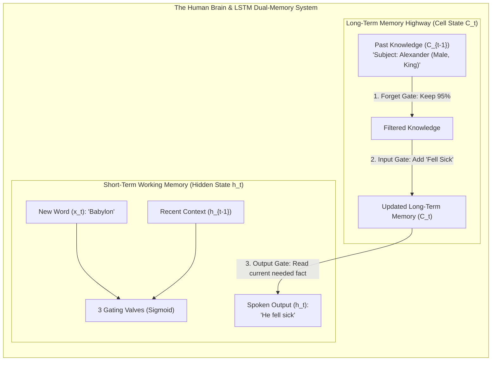

# Lecture 05: Introduction to LSTM Networks
### *From 10th-Grade Brain Intuition to Staff Backend Distributed Systems Architecture*

---

## 🧠 Stage 1: Class X / Layman Sensory Intuition
*(The Feynman Foundation: The Human Brain & The Story of Memory)*

### The Goldfish Brain vs. The Human Brain with a Long-Term Diary

Imagine listening to a 500-page historical saga being read aloud:

- **The Vanilla RNN (The "Goldfish Brain")**:
  A goldfish has an estimated memory span of just a few seconds. If you tell a goldfish: 
  > *"Alexander was a Greek king. He conquered many lands across continents. Decades later, in Babylon, ___ fell sick."*
  
  Because the goldfish only keeps a single short-term memory buffer that gets rewritten on every single word, by the time the sentence reaches *"Babylon"*, the memory of *"Alexander"* from 15 words ago has been completely washed away. It might guess "she" or "they" because the subject was lost.

- **The LSTM (The "Human Brain with a Long-Term Diary")**:
  The human brain does not rely solely on what it heard 2 seconds ago. Your cognitive architecture manages **two distinct memory streams**:
  1. **Working Memory (Short-Term Working State - $\mathbf{h}_t$)**: The words you heard in the last 3 seconds to parse the immediate sentence structure.
  2. **The Long-Term Archival Diary (Cell State - $\mathbf{C}_t$)**: A notebook in your mind that carries the big-picture context (*"The subject is Alexander, he is male, and he is a monarch"*). This notebook runs untouched across chapters unless you deliberately choose to write or erase something.



---

### The Three Brain Instincts (The Gating Valves)

Inside every LSTM memory cell, three security guards called **Gates** control the flow of information. Each gate uses a **Sigmoid valve ($\sigma$)** which acts like a dimmer switch from **$0\%$ (completely blocked/erased)** to **$100\%$ (fully preserved/written)**:

1. **The Forget Gate ($\mathbf{f}_t$) — *"What stale trivia should I erase?"***
   - *Brain Analogy*: When the story transitions from *"Alexander in ancient Greece"* to *"Priya in modern Mumbai"*, your brain closes the valve on "Alexander's royal attributes" so memory does not get cluttered.
2. **The Input Gate ($\mathbf{i}_t$) & Candidate Thought ($\mathbf{\tilde{C}}_t$) — *"What new facts are worth writing into the diary?"***
   - *Brain Analogy*: The speaker says, *"Priya is an aerospace engineer."* Your brain flags this as an important fact, opens the input valve to $100\%$, and writes `[Career: Engineer, Gender: Female]` into the long-term diary.
3. **The Output Gate ($\mathbf{o}_t$) — *"What part of my diary is needed right now to answer the question?"***
   - *Brain Analogy*: When asked, *"What does Priya do for a living?"*, your brain scans the diary, ignores unrelated facts (e.g., where she lives), and retrieves only the occupation attribute to speak out loud: *"She is an engineer!"*

---

## ⚙️ Stage 2: The Distributed Systems & Backend Architect Lens
*(The Engineer's Rosetta Stone: Mapping Neural Mechanics to Enterprise Distributed Systems)*

For a backend engineer with 10+ years of experience in distributed systems, high-scale transactional databases, and event-driven architectures, an LSTM is simply a **Fault-Tolerant, Event-Sourced In-Memory State Machine**:

```
                       ┌────────────────────────────────────────────────────────┐
                       │  LSTM CELL STATE (C_t) = APPEND-ONLY WRITE-AHEAD LOG   │
                       └────────────────────────────────────────────────────────┘
                                                    ▲
                             ┌──────────────────────┴──────────────────────┐
                             │                                             │
               ┌───────────────────────────┐                 ┌───────────────────────────┐
               │  FORGET GATE (f_t)        │                 │  INPUT GATE (i_t * C_t)   │
               │  = Topic Compaction /     │                 │  = Validated Ingestion /  │
               │    Cache Eviction Policy  │                 │    Append Event to WAL    │
               └───────────────────────────┘                 └───────────────────────────┘
```

### The Architectural Rosetta Stone:

| Machine Learning / LSTM Primitive | Distributed Systems / Backend Equivalent |
| :--- | :--- |
| **Vanilla RNN Hidden State ($\mathbf{h}_t$)** | A **Mutable In-Memory Session Cache** mutated in-place by every API call, leading to state corruption and memory loss over time. |
| **LSTM Cell State ($\mathbf{C}_t$)** | An **Append-Only Write-Ahead Log (WAL)** or **Persistent Event Stream (Kafka Topic)** that preserves state across time with zero non-linear corruption. |
| **Forget Gate ($\mathbf{f}_t$)** | A **Tombstone / Retention Compaction Policy** deciding which stale cache keys or expired database records to evict. |
| **Input Gate ($\mathbf{i}_t \odot \mathbf{\tilde{C}}_t$)** | An **Ingestion Validator & Event Appender** committing sanitized, relevant new transactions into the WAL. |
| **Output Gate ($\mathbf{o}_t$) & $\mathbf{h}_t$** | A **Materialized View / CQRS Read-Model Projection** querying the internal WAL state to serve an external API payload. |
| **Recurrence Bottleneck ($O(T)$ serial)** | A **Single-Partition Serial Consumer Queue** where event $t$ is strictly blocked waiting on event $t-1$ (cannot scale horizontally on multi-core GPU clusters). |
| **Self-Attention / Transformers ($O(1)$)** | A **Massive Distributed Scatter-Gather / MapReduce** broadcasting state lookups across all nodes concurrently with zero serial blocking. |

---

## 📐 Stage 3: Geometric & Tangible Feature Space
*(Demystifying Matrices into Real-World Domain Entity Vectors)*

Vectors in an LSTM are **high-dimensional coordinate spaces** measuring tangible domain attributes:

### 1. Banking / FinTech Anomaly Vector ($\mathbf{x}_t \in \mathbb{R}^4$)
When a bank's fraud detection engine processes a sequence of credit card transactions:

$$\mathbf{x}_t = \begin{bmatrix} \text{Transaction Velocity} & (\text{Std deviations from user mean: } +2.4) \\ \text{Geolocation Anomaly} & (\text{Distance from home IP: } +1.8) \\ \text{Time-of-Day Unusualness} & (\text{Night hours: } +1.0) \\ \text{Merchant Risk Multiplier} & (\text{Crypto Exchange: } +0.95) \end{bmatrix}$$

- When $\mathbf{x}_t$ indicates an overseas transaction, the **Input Gate** writes high fraud-risk values into the **Cell State ($\mathbf{C}_t$)**.
- If the user later enters an OTP, the **Forget Gate** evicts the temporary fraud flag from $\mathbf{C}_t$.

### 2. Retail / E-Commerce Session State ($\mathbf{h}_t \in \mathbb{R}^4$)
$$\mathbf{h}_t = \begin{bmatrix} \text{Formality Score} & (+1.0 = \text{Tuxedo/Bridal}, -1.0 = \text{Streetwear}) \\ \text{Seasonal Warmth} & (+1.0 = \text{Winter Parka}, -1.0 = \text{Summer Linen}) \\ \text{Price Sensitivity} & (+1.0 = \text{Luxury Tier}, -1.0 = \text{Budget Discount}) \\ \text{Category Affinity} & (+1.0 = \text{Footwear}, -1.0 = \text{Apparel}) \end{bmatrix}$$

---

## 🔬 Stage 4: First-Principles Mathematical Rigor & Derivations

```
                    Cell State Highway: C_{t-1} ──────────────────[ x ]────────────────(+)──────────────► C_t
                                                                   ▲                  ▲
                                                                   │ (f_t)            │ (i_t * \tilde{C}_t)
                                                           ┌───────┴──────┐   ┌───────┴──────┐
                                                           │ Forget Gate  │   │  Input Gate  │
                                                           │  σ(W_f...)   │   │  σ(W_i...)   │
                                                           └───────┬──────┘   └───────┬──────┘
                                                                   ▲                  ▲
                                                                   │                  │ (\tilde{C}_t)
                                                                   │          ┌───────┴──────┐
                                                                   │          │ Candidate    │
                                                                   │          │ tanh(W_c...) │
                                                                   │          └───────┬──────┘
                                                                   │                  │
                                           h_{t-1} ──┐             │                  │
                                                     ├───► [ Gating Weights (W_f, W_i, W_c, W_o) ]
                                            x_t   ───┘             │
                                                                   │          ┌──────────────┐
                                                                   └─────────►│ Output Gate  │
                                                                              │  σ(W_o...)   │──┐ (o_t)
                                                                              └──────────────┘  ▼
                                                                  tanh(C_t) ──────────────────[ x ]──────► h_t
```

---

### A. The 6 Governing Equations

Given input $\mathbf{x}_t \in \mathbb{R}^{d_{in}}$, hidden state $\mathbf{h}_{t-1} \in \mathbb{R}^{d_h}$, and cell state $\mathbf{C}_{t-1} \in \mathbb{R}^{d_h}$:

1. **Forget Gate**: $\mathbf{f}_t = \sigma\left(\mathbf{W}_f \mathbf{x}_t + \mathbf{U}_f \mathbf{h}_{t-1} + \mathbf{b}_f\right) \in (0, 1)^{d_h}$
2. **Input Gate**: $\mathbf{i}_t = \sigma\left(\mathbf{W}_i \mathbf{x}_t + \mathbf{U}_i \mathbf{h}_{t-1} + \mathbf{b}_i\right) \in (0, 1)^{d_h}$
3. **Candidate State**: $\mathbf{\tilde{C}}_t = \tanh\left(\mathbf{W}_c \mathbf{x}_t + \mathbf{U}_c \mathbf{h}_{t-1} + \mathbf{b}_c\right) \in (-1, +1)^{d_h}$
4. **Cell State Update (Additive Highway)**:
   $$\mathbf{C}_t = \mathbf{f}_t \odot \mathbf{C}_{t-1} + \mathbf{i}_t \odot \mathbf{\tilde{C}}_t \in \mathbb{R}^{d_h}$$
5. **Output Gate**: $\mathbf{o}_t = \sigma\left(\mathbf{W}_o \mathbf{x}_t + \mathbf{U}_o \mathbf{h}_{t-1} + \mathbf{b}_o\right) \in (0, 1)^{d_h}$
6. **Hidden State Output**: $\mathbf{h}_t = \mathbf{o}_t \odot \tanh(\mathbf{C}_t) \in (-1, +1)^{d_h}$

---

### B. Why Sigmoid for Valves vs. $\tanh$ for State Energy

- **Sigmoid ($\sigma \in [0, 1]$)**: Outputs strictly non-negative ratios. Multiplying a memory vector by $0.9$ scales down its intensity by $10\%$; multiplying by $0.0$ deletes it. Negative multipliers would invert the meaning of the concept, which is why $\tanh$ cannot be used for gating.
- **Hyperbolic Tangent ($\tanh \in [-1, +1]$)**: Symmetric around zero with bounded range. When accumulating millions of matrix additions into $\mathbf{C}_t$, squashing candidate features into $[-1, +1]$ prevents gradient blowup while allowing negative/inhibitory memory subtraction.

---

### C. Gradient Calculus & The Constant Error Carousel

In a Vanilla RNN, backpropagating loss $\mathcal{L}$ from step $T$ to step $1$ requires computing:

$$\frac{\partial \mathbf{h}_T}{\partial \mathbf{h}_1} = \prod_{k=2}^T \mathbf{W}_h^T \text{diag}(1 - \tanh^2(\cdot)) \xrightarrow{T \ge 20} \mathbf{0} \quad \text{(Vanishing Gradient)}$$

In an LSTM, error flows backwards along the linear **Cell State Highway ($\mathbf{C}_t$)**:

$$\frac{\partial \mathbf{C}_t}{\partial \mathbf{C}_{t-1}} = \mathbf{f}_t$$

$$\frac{\partial \mathcal{L}}{\partial \mathbf{C}_1} = \frac{\partial \mathcal{L}}{\partial \mathbf{C}_T} \prod_{k=2}^T \mathbf{f}_k$$

When the network keeps $\mathbf{f}_k \approx 1.0$, the gradient derivative is $\frac{\partial \mathbf{C}_t}{\partial \mathbf{C}_{t-1}} \approx 1.0$. Gradients pass backwards through time across hundreds of steps **with zero attenuation** (**The Constant Error Carousel**).

---

## 💻 Stage 5: Microscopic Python Trace & Code
*(The Karpathy Standard: Zero-Dependency Pure Python Implementation)*

You can execute the pure Python LSTM implementation directly in terminal:

```bash
python3 "01-class-notes/04-lecture-05-lstm-networks/lstm_from_scratch.py"
```

```python
# The Core LSTM Step in Pure Python
def lstm_step(x_t, h_prev, C_prev, W_f, U_f, b_f, W_i, U_i, b_i, W_c, U_c, b_c, W_o, U_o, b_o):
    # 1. Forget Gate (Compaction Policy)
    f_t = [sigmoid(sum(W_f[i][j] * x_t[j] for j in range(len(x_t))) + 
                   sum(U_f[i][k] * h_prev[k] for k in range(len(h_prev))) + b_f[i]) 
           for i in range(len(b_f))]
    
    # 2. Input Gate (Ingestion Filter)
    i_t = [sigmoid(sum(W_i[i][j] * x_t[j] for j in range(len(x_t))) + 
                   sum(U_i[i][k] * h_prev[k] for k in range(len(h_prev))) + b_i[i]) 
           for i in range(len(b_i))]
    
    # 3. Candidate State (New Event)
    c_tilde = [math.tanh(sum(W_c[i][j] * x_t[j] for j in range(len(x_t))) + 
                         sum(U_c[i][k] * h_prev[k] for k in range(len(h_prev))) + b_c[i]) 
               for i in range(len(b_c))]
    
    # 4. Cell State Update (Additive Write-Ahead Log)
    C_t = [f_t[i] * C_prev[i] + i_t[i] * c_tilde[i] for i in range(len(C_prev))]
    
    # 5. Output Gate (CQRS Read Projection)
    o_t = [sigmoid(sum(W_o[i][j] * x_t[j] for j in range(len(x_t))) + 
                   sum(U_o[i][k] * h_prev[k] for k in range(len(h_prev))) + b_o[i]) 
           for i in range(len(b_o))]
    
    # 6. Hidden State (Working Memory Output)
    h_t = [o_t[i] * math.tanh(C_t[i]) for i in range(len(C_t))]
    
    return C_t, h_t
```

---

## 🏢 Stage 6: Enterprise Production Architecture & GenAI Frontier

### 1. Production Use-Cases Across Enterprise Domains

1. **Banking / FinTech (10,000+ TPS Transaction Anomaly Detection)**:
   - Ingesting raw streaming user transaction sequences from Apache Kafka.
   - The cell state maintains the user's spending profile across months, flagging anomalous card velocity in $<15\text{ms}$.
2. **Retail / E-Commerce (Real-Time Clickstream Intent Prediction)**:
   - Modeling user session sequences (views, add-to-cart, search queries) to predict purchase intent and prevent cart abandonment.
3. **Insurance (Multi-Event Claim Trajectory Modeling)**:
   - Processing sequential medical claims and vehicular accident history to compute actuarial risk scores.
4. **EdTech (Student Knowledge Tracing)**:
   - Tracking whether a student has mastered prerequisite concepts based on their sequence of right/wrong quiz responses.

---

### 2. The Recurrence Bottleneck & The Bridge to Transformers (2017)

While LSTMs solved the **vanishing gradient problem**, they hit a hard physical wall in enterprise production:

```
Sequential Recurrence Wall:
Step t=1 ──► Step t=2 ──► Step t=3 ──► ... ──► Step t=10,000
 (GPU Core 1 must wait for Core 0 to finish; 99% of GPU parallel compute capacity sits IDLE)
```

- **The Problem**: Modern NVIDIA GPUs have thousands of parallel CUDA/Tensor cores. LSTMs force GPUs to process tokens **one-by-one sequentially**, taking days to train on large internet datasets.
- **The 2017 Breakthrough ("Attention Is All You Need")**:
  Transformers completely eliminated recurrent loops ($h_{t-1} \to h_t$). By replacing recurrence with **Self-Attention ($Q, K, V$)**, all $T$ tokens are computed **simultaneously in parallel across all GPU cores**, paving the direct path to GPT-4, Claude, and modern Foundation Models!
