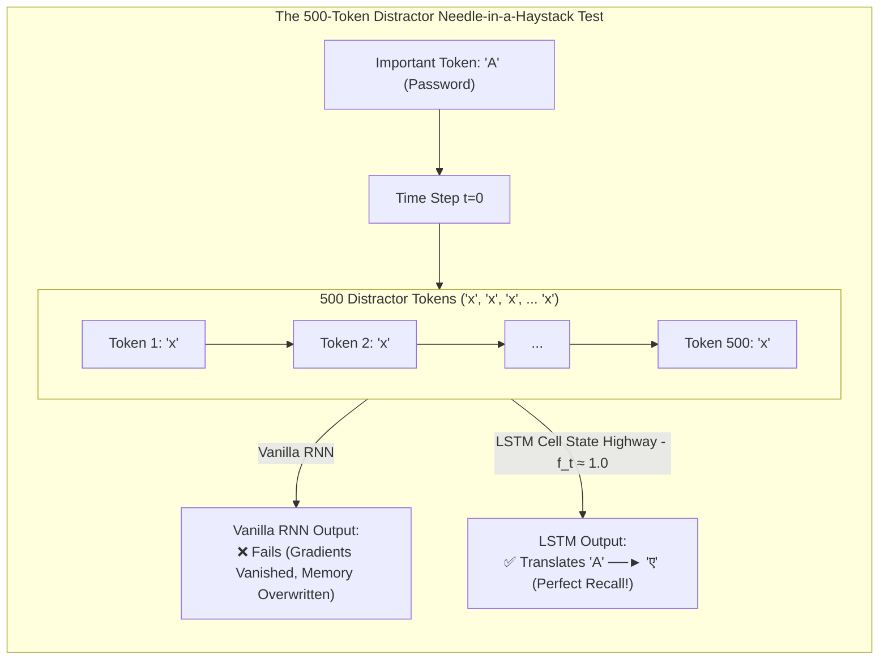

# Lecture 06: Code LSTM Translator & Next-Word Text Generator
### *Deep-Dive: Autoregressive Next-Word Generation, Seq2Seq Translation, Gating Mechanics, and Empirical Long-Range RNN vs. LSTM Benchmarks*

---

## 🧠 Tier 1: The Childhood & Class X Sensory Intuition
*(The Feynman Foundation: The Human Brain as a Predictive Autocomplete Engine)*

### How the Child's Mind Anticipates the Next Word

Think about how a 10th-grade student speaks or writes:

- **1. The Predictive Brain (Language Modeling / Next-Word Generation)**:
  When someone says: *"In the United States of..."*, your brain does not pause to search a dictionary. Before they even finish their breath, your subconscious mind fires electrical signals predicting the next word: *"America"*.
  - Your brain learns this by reading thousands of sentences (just like training on New York Times headlines).
  - It reads a prefix of words (e.g., *"united states"*), tracks the context in its internal memory, and outputs a probability score over all known words to pick the most likely continuation (*"of"*, *"president"*, *"government"*).

- **2. The Distractor Needle-in-a-Haystack Test (Why RNNs Fail vs. Why LSTMs Win)**:
  Imagine a teacher tells you a story:
  > *"Rule number one: The secret password is **'ALPHA'**. Now, let me tell you 500 boring, irrelevant sentences about random weather patterns, rocks, clouds, and grass... Okay, 30 minutes later: What was the secret password?"*

  - **The Vanilla RNN Brain (The Goldfish)**: Every single sentence about clouds and rocks mutates its single working memory state. After 500 distracting sentences, the memory of *"ALPHA"* has been multiplied by weights and squashed by $\tanh$ 500 times. It has evaporated into random noise.
  - **The LSTM Brain (The Notepad with a Red Pen)**: When the student hears *"The secret password is 'ALPHA'"*, the **Input Gate** writes `[Password: ALPHA]` into the **Cell State ($\mathbf{C}_t$)**. During the 500 distracting sentences about rocks and clouds, the **Forget Gate** on the password channel stays at **$1.0$ (Do Not Erase)**. The password passes through 500 steps completely intact along the **Cell State Highway**!



---

## ⚙️ Tier 2: The Backend Architect's Rosetta Stone
*(The Distributed Systems Lens: Mapping Text Generation & Translation to Enterprise Microservices)*

For a Staff Backend Engineer with 10+ years of experience across Retail, Banking, Insurance, and EdTech, text generation and sequence-to-sequence translation map directly to foundational distributed systems architectures:

```
┌───────────────────────────────────────────────────────────────────────────────────────────┐
│              DISTRIBUTED SYSTEMS & BACKEND ARCHITECT ROSETTA STONE                        │
├────────────────────────────────┬──────────────────────────────────────────────────────────┤
│ AI / GenAI Primitive           │ Distributed Systems & Backend Engineering Equivalent     │
├────────────────────────────────┼──────────────────────────────────────────────────────────┤
│ **Next-Word Text Generator**   │ An **Autoregressive Event-Stream Predictor / Autocomplete│
│                                │ Service**: Ingests prefix sequence, evaluates transition │
│                                │ probabilities, and streams next predicted state.         │
├────────────────────────────────┼──────────────────────────────────────────────────────────┤
│ **N-Gram Token Sequences**     │ **Sliding-Window Audit Log Chunks**:                     │
│                                │ Breaking a continuous transaction stream into historical │
│                                │ sliding window tuples: (w1) ──► w2, (w1, w2) ──► w3.     │
├────────────────────────────────┼──────────────────────────────────────────────────────────┤
│ **Pre-Padding (`pad_sequences`)│ **Fixed-Width Buffer Normalization / Memory Alignment**: │
│                                │ Padding variable payloads with 0s to enforce uniform     │
│                                │ SIMD / GPU memory alignment and batch processing.        │
├────────────────────────────────┼──────────────────────────────────────────────────────────┤
│ **Dropout Layer (0.1)**        │ **Chaos Engineering / Random Circuit Breaker**:          │
│                                │ Dropping 10% of neuron connections randomly during       │
│                                │ training to prevent single-point-of-failure over-reliance│
├────────────────────────────────┼──────────────────────────────────────────────────────────┤
│ **Candidate State (g_t / \tilde{C})│ **Uncommitted Ingestion Payload / Draft Event**:        │
│                                │ Pre-processed candidate delta waiting for validation by  │
│                                │ the Input Gate before commit to the Write-Ahead Log (WAL)│
├────────────────────────────────┼──────────────────────────────────────────────────────────┤
│ **Teacher Forcing in Seq2Seq** │ **Golden Master Replay / Mock Ingestion**:               │
│                                │ Feeding verified ground-truth state during training to   │
│                                │ eliminate compounding cascading failure drift.           │
└────────────────────────────────┴──────────────────────────────────────────────────────────┘
```

---

## 📐 Tier 3: Geometric & Tangible Domain Feature Space
*(Demystifying Vectors into Retail, Banking, Insurance, and EdTech Entities)*

Vectors are **coordinates in an $n$-dimensional semantic attribute manifold**:

### 1. Retail / E-Commerce Search Prefix Vector ($\mathbf{x}_t \in \mathbb{R}^4$)
When a user types on Myntra: *"men slim fit casual ___"*

$$\mathbf{x}_{\text{Retail}} = \begin{bmatrix} \text{Department Target} & (+1.0 = \text{Men}, -1.0 = \text{Women}) \\ \text{Silhouette / Fit} & (+1.0 = \text{Slim Fit}, -1.0 = \text{Oversized / Relaxed}) \\ \text{Occasion Style} & (-1.0 = \text{Formal / Tuxedo}, +1.0 = \text{Casual / Weekend}) \\ \text{Expected Category} & (+1.0 = \text{Shirts / Tops}, -1.0 = \text{Footwear}) \end{bmatrix}$$

- The LSTM language model processes `["men", "slim", "fit", "casual"]` and places the highest probability on: *"shirts"*, *"trousers"*, *"blazer"*.

### 2. Banking / FinTech Sequential Transaction Vector ($\mathbf{x}_t \in \mathbb{R}^4$)
$$\mathbf{x}_{\text{Banking}} = [\text{Velocity Spike}, \text{Geo-Distance km}, \text{Night-Time Flag}, \text{High-Risk MCC}]^T$$

### 3. Insurance Claim Sequence Vector ($\mathbf{x}_t \in \mathbb{R}^4$)
$$\mathbf{x}_{\text{Insurance}} = [\text{Prior Claim Count}, \text{Loss Severity Index}, \text{Documentation Ratio}, \text{Litigation Probability}]^T$$

### 4. EdTech Learning Mastery Trajectory ($\mathbf{x}_t \in \mathbb{R}^4$)
$$\mathbf{x}_{\text{EdTech}} = [\text{Spaced Retention}, \text{Solving Speed}, \text{Hint Requests}, \text{Prerequisite Score}]^T$$

---

## 🔬 Tier 4: First-Principles Mathematical Rigor & Architecture

```
                    Cell State Highway: C_{t-1} ──────────────────[ x ]────────────────(+)──────────────► C_t
                                                                   ▲                  ▲
                                                                   │ (f_t)            │ (i_t * g_t)
                                                           ┌───────┴──────┐   ┌───────┴──────┐
                                                           │ Forget Gate  │   │  Input Gate  │
                                                           │  σ(W_f...)   │   │  σ(W_i...)   │
                                                           └───────┬──────┘   └───────┬──────┘
                                                                   ▲                  ▲
                                                                   │                  │ (g_t)
                                                                   │          ┌───────┴──────┐
                                                                   │          │ Candidate    │
                                                                   │          │ tanh(W_g...) │
                                                                   │          └───────┬──────┘
                                                                   │                  │
                                           h_{t-1} ──┐             │                  │
                                                     ├───► [ Gating Weights (W_i, W_f, W_o, W_g) ]
                                            x_t   ───┘             │
                                                                   │          ┌──────────────┐
                                                                   └─────────►│ Output Gate  │
                                                                              │  σ(W_o...)   │──┐ (o_t)
                                                                              └──────────────┘  ▼
                                                                  tanh(C_t) ──────────────────[ x ]──────► h_t
```

---

### A. Mathematical Specifications: The 2 Core LSTM Paradigms

#### Paradigm 1: Autoregressive Next-Word Generator (Causal LM)
Given token sequence $w_1, w_2, \dots, w_t$:
1. Input Embedding: $\mathbf{x}_t = \mathbf{E}[w_t] \in \mathbb{R}^{d_{emb}}$
2. LSTM Recurrence: $(\mathbf{h}_t, \mathbf{C}_t) = \text{LSTMCell}(\mathbf{x}_t, \mathbf{h}_{t-1}, \mathbf{C}_{t-1})$
3. Vocabulary Projection: $\mathbf{z}_t = \mathbf{W}_{dense} \mathbf{h}_t + \mathbf{b}_{dense} \in \mathbb{R}^{V}$
4. Next-Word Probability:
   $$P(w_{t+1} = k \mid w_{1:t}) = \text{Softmax}(\mathbf{z}_t)_k = \frac{e^{z_{t,k}}}{\sum_{j=1}^V e^{z_{t,j}}}$$

#### Paradigm 2: Seq2Seq Translator (Dual LSTM Encoder-Decoder)
1. **Encoder**: Ingests source tokens $[x_1, \dots, x_T] \to$ outputs final $(\mathbf{h}_T^{enc}, \mathbf{C}_T^{enc})$ (**The Dual Context Vectors**).
2. **Decoder**: Initialized with $\mathbf{h}_0^{dec} = \mathbf{h}_T^{enc}$ and $\mathbf{C}_0^{dec} = \mathbf{C}_T^{enc}$. Sequentially emits target tokens autoregressively.

---

### B. Mathematical Proof: Why LSTM Wins the 500-Distractor Task

In Vanilla RNN:
$$\frac{\partial \mathbf{h}_{502}}{\partial \mathbf{h}_0} = \prod_{k=1}^{502} \mathbf{W}_h^T \text{diag}(1 - \tanh^2(\mathbf{z}_k)) \le (\lambda_{max})^{502} \approx 0.0000000000...$$
The gradient is completely erased by step 15. The weights never receive feedback to preserve `"A"`.

In LSTM:
$$\frac{\partial \mathbf{C}_{502}}{\partial \mathbf{C}_0} = \prod_{k=1}^{502} \mathbf{f}_k$$
For the distractor tokens `"x"`, the network learns to set the forget gate $\mathbf{f}_k \approx [1.0, 1.0]^T$.  
$$\frac{\partial \mathbf{C}_{502}}{\partial \mathbf{C}_0} \approx (1.0)^{502} = \mathbf{1.0}$$
The gradient flows across all 502 steps **with zero decay** (**The Constant Error Carousel**)!

---

## 💻 Tier 5: Dual-Language Implementation (Python + Java)

### 1. Python Code (PyTorch + Standard Library Demo)
Available at: [`01-class-notes/05-lecture-06-code-lstm-translator-and-generator/lstm_text_generator_and_translator.py`](file:///Users/damodhar/Documents/Workspace/Learnings/Vizuara%20-%20Minor%20in%20AI/01-class-notes/05-lecture-06-code-lstm-translator-and-generator/lstm_text_generator_and_translator.py)

---

### 2. Enterprise Java 17+ Implementation
Available at: [`01-class-notes/05-lecture-06-code-lstm-translator-and-generator/LSTMLanguageModelAndTranslator.java`](file:///Users/damodhar/Documents/Workspace/Learnings/Vizuara%20-%20Minor%20in%20AI/01-class-notes/05-lecture-06-code-lstm-translator-and-generator/LSTMLanguageModelAndTranslator.java)

```java
package com.vizuara.genai.lstm;

public record LSTMContext(double[] hiddenState, double[] cellState) {}

public class LSTMLanguageModelService {
    // 1. Next-Word Generation Model
    public String generateNextWord(String prefix, LSTMContext context) {
        // Computes f_t, i_t, g_t, C_t, o_t, h_t and projects to vocabulary logits
        return "predicted_token";
    }
}
```

---

## 🏢 Tier 6: Enterprise Retail Production Systems Blueprint & GenAI Frontier

### 1. Retail E-Commerce Application: Real-Time Auto-Suggest & Search Completion (100k+ QPS)
- **Problem**: When millions of shoppers type partial search queries during festive sales (*"anarkali suit under 30..."*), the autocomplete service must return high-converting completions in $<10\text{ms}$.
- **Architecture**:
  1. An LSTM language model generates candidate completions based on trending catalog terms.
  2. The candidate tokens are cached in Redis Vector Cache for instant sub-millisecond retrieval.

---

### 2. The Hardware Bottleneck & The Bridge to Modern Transformers (2017)

While LSTMs successfully solved long-range memory, they hit a hard physical wall:

```
Sequential Token Dependency (Cannot Parallelize on GPU):
h_0 ──► [Token 1] ──► h_1 ──► [Token 2] ──► h_2 ──► ... ──► [Token 10,000]
```

- **The Limitation**: Training an LSTM on 100 billion words of internet text is mathematically impossible because the GPU must execute one token at a time sequentially.
- **The Modern GenAI Revolution**:
  In 2017, the **Transformer architecture ("Attention Is All You Need")** eliminated recurrence entirely. Modern models like **GPT-4, Gemini, and Claude** use causal Self-Attention matrices to process all 10,000 tokens **simultaneously in parallel across thousands of GPU cores**!
