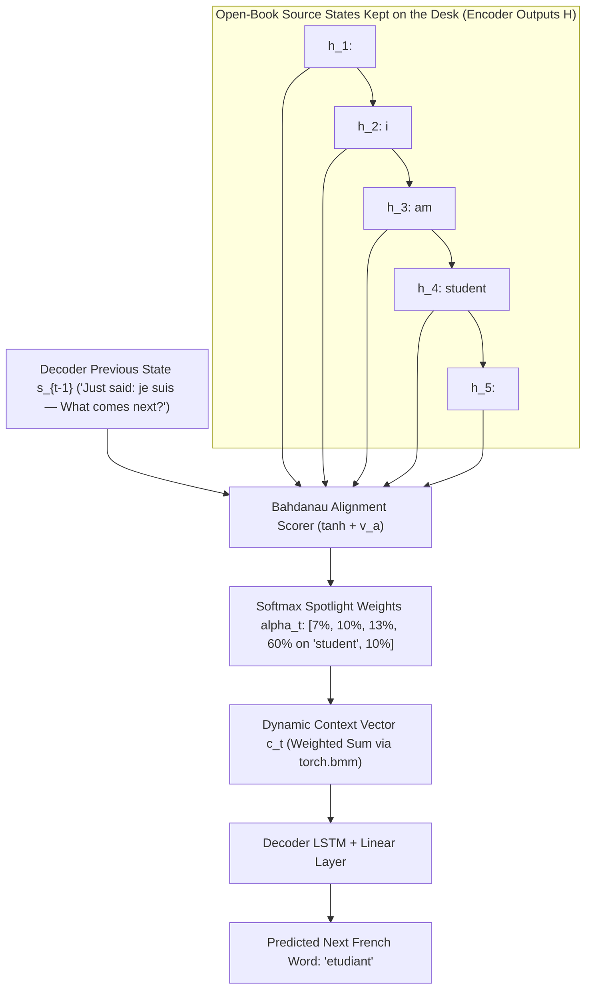

# Lectures 07 & 08: Attention Mechanism — Theory & Coding LSTM with Bahdanau Attention from Scratch
### *From the Human Brain's Selective Spotlight to Staff Backend Query Engines, Tensor Forensics & the Bridge to 2017 Transformers*

---

## 📂 Deliverables in This Module

- **Original Lecture Notebook (Untouched)**: [`GenAI_Fundamentals_Attention_Mechanism_Lec_7,_8.ipynb`](file:///Users/damodhar/Documents/Workspace/Learnings/Vizuara%20-%20Minor%20in%20AI/01-class-notes/06-lecture-07-08-attention-mechanism/GenAI_Fundamentals_Attention_Mechanism_Lec_7,_8.ipynb)
- **Pure Python Microscopic Trace & Mathematical Proof**: [`bahdanau_attention_from_scratch.py`](file:///Users/damodhar/Documents/Workspace/Learnings/Vizuara%20-%20Minor%20in%20AI/01-class-notes/06-lecture-07-08-attention-mechanism/bahdanau_attention_from_scratch.py)
- **Enterprise Java 17+ Implementation**: [`BahdanauAttentionSeq2Seq.java`](file:///Users/damodhar/Documents/Workspace/Learnings/Vizuara%20-%20Minor%20in%20AI/01-class-notes/06-lecture-07-08-attention-mechanism/BahdanauAttentionSeq2Seq.java)

---

## 🧠 Tier 1: The Childhood & Class X Sensory Intuition
*(The Feynman Foundation: How the Human Brain Evolves from Closed-Book Cramming to Selective Spotlight Focus)*

### The Closed-Book Interpreter vs. The Open-Book Interpreter

Imagine a 10th-grade student translating a long English paragraph into French:

1. **The Old Way — Pure Seq2Seq RNN / LSTM (Lectures 02–06): *The Closed-Book Exam***
   - The teacher reads out a 40-word English paragraph **once**, snatches the paper away, and tells the student: *"Hold the entire paragraph inside a single tiny summary thought in your head, and now speak the entire French translation!"*
   - Even though an **LSTM (The Elephant Brain)** fixed the vanishing gradient problem and stopped early words from evaporating like a **Vanilla RNN (The Goldfish Brain)**, you are still forcing 40 distinct nouns, verbs, adjectives, and clauses through **one narrow pinhole**—a single fixed-size final vector $(\mathbf{h}_T, \mathbf{C}_T)$.
   - By word 25 of the translation, fine-grained details from the middle of the paragraph get blurred together. This is the **Fixed-Length Context Bottleneck**.

2. **The Breakthrough — Attention Mechanism (Bahdanau et al., 2014): *The Open-Book Spotlight***
   - Watch how a real human translator works! They **do NOT throw the English page away** after reading it once. They keep the entire English sentence **open on the desk** in front of them:
     $$\text{Source on Desk: } [\text{"<sos>"}, \text{"i"}, \text{"am"}, \text{"student"}, \text{"<eos>"}]$$
   - Before speaking *each individual French word*, the translator's eyes scan back across the English words and shine a **mental spotlight** on whichever word matters *right now*:
     - About to speak **`"je"`**? Eyes lock **$57\%+$ focus onto `"i"`**.
     - About to speak **`"suis"`**? Spotlight shifts onto **`"am"`**.
     - About to speak **`"etudiant"`**? Spotlight shines directly onto **`"student"`**!

### Comparative Biological Memory Evolution Across Our Course

| Stage in Curriculum | Biological Brain Analogy | Core Memory Capability & Remaining Flaw |
| :--- | :--- | :--- |
| **Lectures 01–04: Vanilla RNN** | **The Goldfish Brain** | Single short-term buffer ($\mathbf{h}_t$) overwritten at every step; gradients vanish after ~10–15 words. |
| **Lectures 05–06: Pure LSTM** | **The Elephant with One Sticky Note** | Long-term Cell State ($\mathbf{C}_t$) preserves gradients across 500 steps, **but** Seq2Seq still squeezes the whole sentence into **one static vector** $(\mathbf{h}_T, \mathbf{C}_T)$. |
| **Lectures 07–08: LSTM + Attention** | **The Human Selective Spotlight ("Cocktail Party Effect")** | Keeps **all** Encoder states $[\mathbf{h}_1, \dots, \mathbf{h}_{T_x}]$ alive and computes a **custom dynamic context vector $\mathbf{c}_t$** at every single decoding step! |



---

## ⚙️ Tier 2: The Backend Architect's Rosetta Stone
*(The Distributed Systems Lens: Mapping Bahdanau Attention to Search Engines, Scatter-Gather & In-Memory Indexing)*

For a Senior Backend Engineer with 10+ years of experience across **Retail, Banking, Insurance, and EdTech**, moving from Pure LSTM Seq2Seq to **Attention** is identical to evolving from **passing a lossy pre-aggregated summary DTO** to **querying an indexed in-memory distributed store on demand**:

```text
┌─────────────────────────────────────────────────────────────────────────────────────────────────┐
│                STAFF BACKEND ARCHITECT'S ROSETTA STONE FOR ATTENTION                            │
├──────────────────────────────────────┬──────────────────────────────────────────────────────────┤
│ Neural Attention Primitive           │ Distributed Systems & Backend Engineering Equivalent     │
├──────────────────────────────────────┼──────────────────────────────────────────────────────────┤
│ Pure Seq2Seq Final State (h_T, C_T)  │ Lossy Pre-Aggregated Summary DTO: Compressing 1,000      │
│                                      │ Kafka events into one 32-float summary & dropping raw    │
│                                      │ logs—downstream services can never inspect individual IDs│
├──────────────────────────────────────┼──────────────────────────────────────────────────────────┤
│ `encoder_outputs` [1, src_len, 32]   │ In-Memory Indexed Event Store (Redis / Elasticsearch):   │
│                                      │ Retaining EVERY token's state vector [h_1 .. h_Tx] in    │
│                                      │ random-access memory for O(1) hop distance lookup.       │
├──────────────────────────────────────┼──────────────────────────────────────────────────────────┤
│ `decoder_hidden` s_{t-1} [1, 32]     │ Dynamic Parameterized Search Query:                      │
│                                      │ Runtime query state asking: "Given what I emitted so far,│
│                                      │ which source records match my next output slot?"         │
├──────────────────────────────────────┼──────────────────────────────────────────────────────────┤
│ `BahdanauAttention` (W_a, tanh, v_a) │ Neural Learning-to-Rank (L2R) Scorer:                    │
│                                      │ Evaluates pairwise compatibility score e_{t,j} between   │
│                                      │ active query s_{t-1} and every indexed record h_j.       │
├──────────────────────────────────────┼──────────────────────────────────────────────────────────┤
│ `attn_weights = softmax(attention)`  │ Normalized Scatter-Gather Routing Weights:               │
│                                      │ Converts raw relevance scores into a convex combination  │
│                                      │ (sum = 1.0) across all source partitions.                │
├──────────────────────────────────────┼──────────────────────────────────────────────────────────┤
│ `context = torch.bmm(attn, enc_out)` │ On-Demand Materialized Read Projection:                  │
│                                      │ Dynamically aggregates values weighted by relevance      │
│                                      │ specifically tailored for step t (Zero static bottleneck)│
├──────────────────────────────────────┼──────────────────────────────────────────────────────────┤
│ `cat(output, context, embedded)`     │ Enriched API Gateway Payload / Residual Highway:         │
│                                      │ Bypasses the LSTM bottleneck so loss gradients update    │
│                                      │ encoder, attention, and embeddings simultaneously!       │
└──────────────────────────────────────┴──────────────────────────────────────────────────────────┘
```

---

## 📐 Tier 3: Geometric & Tangible Domain Feature Space
*(Grounding Encoder States, Queries & Attention Weights in Real Enterprise Domains)*

Why do we compute an alignment score between Decoder state $\mathbf{s}_{t-1}$ and each Encoder state $\mathbf{h}_j$? Because both live in tangible **semantic attribute spaces**:

### 1. Retail / E-Commerce (Current Domain — Myntra Outfit & Cross-Catalog Search)
Suppose a shopper enters a multi-attribute query:
> *"breathable pastel linen kurta with tan kolhapuri sandals for Goa summer wedding"*

Each word token $j$ in the shopper's prompt produces an Encoder state $\mathbf{h}_j \in \mathbb{R}^4$:
$$\mathbf{h}_j = \begin{bmatrix} \text{Apparel vs. Footwear Axis} & (+1.0 = \text{Topwear}, -1.0 = \text{Footwear}) \\ \text{Fabric Breathability / Season} & (+1.0 = \text{Summer Linen}, -1.0 = \text{Heavy Velvet}) \\ \text{Color Palette Tone} & (+1.0 = \text{Pastel/Earthy}, -1.0 = \text{Dark Neon}) \\ \text{Occasion Formality} & (+1.0 = \text{Festive Wedding}, -1.0 = \text{Gymwear}) \end{bmatrix}$$

- When the recommendation decoder generates **Slot 1 (Topwear SKU)**, its query state $\mathbf{s}_0$ attends heavily ($\alpha_{1,j} \approx 0.78$) to *"pastel"*, *"linen"*, *"kurta"*.
- When it moves to **Slot 2 (Matching Footwear SKU)**, its updated query state $\mathbf{s}_1$ shifts the attention spotlight ($\alpha_{2,j} \approx 0.81$) onto *"tan"*, *"kolhapuri"*, *"sandals"*!
- A single static LSTM vector would have blurred *"pastel linen"* and *"tan leather"* into muddy averages!

### 2. Banking / FinTech (Fraud Investigation Over 500-Swipe Ledger)
- **Encoder States $\mathbf{h}_1 \dots \mathbf{h}_{500}$**: 90-day card swipe vectors $[\text{Velocity Spike}, \text{Geo-Anomaly km}, \text{3AM Night Flag}, \text{High-Risk MCC}]^T$.
- **Attention Spotlight**: Instead of diluting 2 fraudulent 3:00 AM offshore swipes inside 498 normal grocery purchases, the Fraud Decoder places $\alpha_{t, 142} = 0.48$ and $\alpha_{t, 143} = 0.46$ directly on those two anomalous transactions—giving **explainable auditability** for RBI/compliance teams!

### 3. Insurance (40-Page Hospital Claim Adjudication)
- **Encoder States**: Line-item medical billing and diagnosis embeddings $[\text{Claim Freq}, \text{Procedure Cost Ratio}, \text{Pre-Existing Flag}, \text{Policy Coverage Match}]^T$.
- **Attention Spotlight**: Pinpoints exact discharge-summary lines triggering sub-limit exclusions while ignoring 38 pages of routine nursing notes.

### 4. EdTech (Adaptive Knowledge Tracing)
- **Encoder States**: Historical student attempt vectors $[\text{Concept Retention}, \text{Solve Latency}, \text{Hint Count}, \text{Prerequisite Mastery}]^T$.
- **Attention Spotlight**: When generating the next algebra hint, Attention looks back specifically at past *quadratic factoring* attempts rather than unrelated *geometry* quizzes.

---

## 🔬 Tier 4: First-Principles Mathematical Rigor & Line-by-Line Notebook Forensics

Let's trace the exact mathematics and **every single tensor dimension** inside [`GenAI_Fundamentals_Attention_Mechanism_Lec_7,_8.ipynb`](file:///Users/damodhar/Documents/Workspace/Learnings/Vizuara%20-%20Minor%20in%20AI/01-class-notes/06-lecture-07-08-attention-mechanism/GenAI_Fundamentals_Attention_Mechanism_Lec_7,_8.ipynb)!

### Hyperparameters in the Lecture Notebook
- Source vocabulary size: $V_{\text{src}} = 13$, Target vocabulary size: $V_{\text{tgt}} = 12$
- Source sequence (`"<sos> i am student <eos>"`): $T_x = \text{src\_len} = 5$, Batch size $B = 1$
- Target sequence (`"<sos> je suis etudiant <eos>"`): $T_y = \text{tgt\_len} = 5$
- Embedding dimensions: $E_{\text{enc}} = 16$, $E_{\text{dec}} = 16$
- Hidden dimensions: $H_{\text{enc}} = 32$, $H_{\text{dec}} = 32$

```text
====================================================================================================
           COMPLETE TENSOR SHAPE ARCHITECTURE OF LECTURE 7-8 BAHDANAU SEQ2SEQ MODEL
====================================================================================================

  SOURCE IDS: [1, 3, 4, 6, 2]  ──► Shape: [1, 5]
        │
        ▼  Encoder.embedding (13 x 16)
  EMBEDDED SOURCE              ──► Shape: [1, 5, 16]
        │
        ▼  Encoder.rnn: Unidirectional LSTM (16 -> 32)
  ENCODER OUTPUTS H = [h_1..h_5] ► Shape: [1, 5, 32]   (ALL 5 states saved! Not discarded!)
  FINAL (h_0^dec, c_0^dec)     ──► Shape: [1, 1, 32] each
        │
        ▼  FOR EACH DECODING STEP t = 1 .. 4:
  ┌────────────────────────────────────────────────────────────────────────────────────────────┐
  │ 1. Query Expansion:                                                                        │
  │    dec_hidden s_{t-1}: [1, 32] ──► unsqueeze(1).repeat(1, 5, 1) ──► [1, 5, 32]             │
  │                                                                                            │
  │ 2. Bahdanau Additive Alignment (`BahdanauAttention`):                                      │
  │    cat(dec_hidden_expanded, encoder_outputs, dim=2) ──────────────► [1, 5, 64]             │
  │    energy = tanh(Linear_64_to_32(...))              ──────────────► [1, 5, 32]             │
  │    scores = v_32_to_1(energy).squeeze(2)            ──────────────► [1, 5]                 │
  │    attn_weights α_t = softmax(scores, dim=1)        ──────────────► [1, 5] ──► [1, 1, 5]   │
  │                                                                                            │
  │ 3. Dynamic Context Vector (`torch.bmm`):                                                   │
  │    context c_t = bmm([1, 1, 5], [1, 5, 32])         ──────────────► [1, 1, 32]             │
  │                                                                                            │
  │ 4. Decoder LSTM Step:                                                                      │
  │    embedded y_{t-1}: [1, 1, 16]                                                            │
  │    rnn_input = cat(embedded, context, dim=2)        ──────────────► [1, 1, 48]  (16 + 32)  │
  │    output s_t, (h_t, c_t) = Decoder.rnn(rnn_input)  ──────────────► [1, 1, 32]             │
  │                                                                                            │
  │ 5. Triple-Skip Output Projection (`fc_out`):                                               │
  │    concat_input = cat(s_t [1,32], c_t [1,32], y_{t-1} [1,16]) ────► [1, 80]     (32+32+16) │
  │    logits = Linear_80_to_12(concat_input)           ──────────────► [1, 12]                │
  └────────────────────────────────────────────────────────────────────────────────────────────┘
```

---

### A. Step-by-Step Governing Equations & Tensor Shapes

#### 1. Unidirectional LSTM Encoder ([`Encoder`](file:///Users/damodhar/Documents/Workspace/Learnings/Vizuara%20-%20Minor%20in%20AI/01-class-notes/06-lecture-07-08-attention-mechanism/GenAI_Fundamentals_Attention_Mechanism_Lec_7,_8.ipynb#L98-L111))
Given source token sequence $x = (x_1, \dots, x_{T_x})$:
$$\mathbf{e}_j = \text{Embedding}_{\text{enc}}(x_j) \in \mathbb{R}^{16}, \qquad (\mathbf{h}_j, \mathbf{C}_j^{\text{enc}}) = \text{LSTM}_{\text{enc}}(\mathbf{e}_j, \mathbf{h}_{j-1}, \mathbf{C}_{j-1}^{\text{enc}})$$
- Unlike Lectures 02–06 where $\mathbf{h}_1 \dots \mathbf{h}_{T_x - 1}$ were garbage-collected, the Encoder returns the **entire tensor of annotations**:
  $$\mathbf{H} = [\mathbf{h}_1, \mathbf{h}_2, \dots, \mathbf{h}_{T_x}] \in \mathbb{R}^{1 \times 5 \times 32}$$
- And initializes the Decoder with $\mathbf{s}_0 = \mathbf{h}_{T_x} \in \mathbb{R}^{1 \times 1 \times 32}$ and $\mathbf{C}_0^{\text{dec}} = \mathbf{C}_{T_x}^{\text{enc}} \in \mathbb{R}^{1 \times 1 \times 32}$.

#### 2. Bahdanau Additive Alignment Model ([`BahdanauAttention`](file:///Users/damodhar/Documents/Workspace/Learnings/Vizuara%20-%20Minor%20in%20AI/01-class-notes/06-lecture-07-08-attention-mechanism/GenAI_Fundamentals_Attention_Mechanism_Lec_7,_8.ipynb#L117-L135))
At decoding step $t$, before generating the $t$-th French word, we hold the previous decoder hidden state $\mathbf{s}_{t-1} \in \mathbb{R}^{32}$ (the **Query**) and compare it against every source hidden state $\mathbf{h}_j \in \mathbb{R}^{32}$ for $j \in \{1, \dots, 5\}$:

1. **Concatenate & Compute Alignment Energy Vector**:
   $$\mathbf{E}_{t,j} = \tanh\!\left(\mathbf{W}_a \begin{bmatrix} \mathbf{s}_{t-1} \\ \mathbf{h}_j \end{bmatrix} + \mathbf{b}_a\right) \qquad \text{where } \mathbf{W}_a \in \mathbb{R}^{32 \times 64}, \; \begin{bmatrix} \mathbf{s}_{t-1} \\ \mathbf{h}_j \end{bmatrix} \in \mathbb{R}^{64 \times 1}, \; \mathbf{b}_a \in \mathbb{R}^{32 \times 1}$$
2. **Project Energy to Scalar Alignment Score ($e_{t,j}$)**:
   $$e_{t,j} = \mathbf{v}_a^T \mathbf{E}_{t,j} \in \mathbb{R} \qquad \text{where } \mathbf{v}_a \in \mathbb{R}^{32 \times 1} \text{ (note } \texttt{bias=False}\text{)}$$
3. **Normalize Across Source Positions via Softmax ($\alpha_{t,j}$)**:
   $$\alpha_{t,j} = \frac{\exp(e_{t,j})}{\sum_{k=1}^{T_x} \exp(e_{t,k})} \in (0, 1), \qquad \sum_{j=1}^{T_x} \alpha_{t,j} = 1.0$$

#### 3. Dynamic Context Vector via Batch Matrix Multiply (`torch.bmm`)
$$\mathbf{c}_t = \sum_{j=1}^{T_x} \alpha_{t,j} \mathbf{h}_j \in \mathbb{R}^{32}$$
- In PyTorch (`Decoder.forward` line 168):
  - `attn_weights` has shape `[B, 1, T_x] = [1, 1, 5]`.
  - `encoder_outputs` has shape `[B, T_x, H_enc] = [1, 5, 32]`.
  - `torch.bmm([1, 1, 5], [1, 5, 32])` performs a $(1 \times 5) \times (5 \times 32) = (1 \times 32)$ matrix multiplication per batch item, producing `context` of shape `[1, 1, 32]` in **one vectorized GPU kernel** with zero Python `for`-loops!

#### 4. Decoder LSTM Update & Triple-Concatenation Projection ([`Decoder`](file:///Users/damodhar/Documents/Workspace/Learnings/Vizuara%20-%20Minor%20in%20AI/01-class-notes/06-lecture-07-08-attention-mechanism/GenAI_Fundamentals_Attention_Mechanism_Lec_7,_8.ipynb#L141-L183))
1. Feed **both** the previous target word embedding $\mathbf{y}_{t-1} \in \mathbb{R}^{16}$ and the freshly attended context $\mathbf{c}_t \in \mathbb{R}^{32}$ into the Decoder LSTM:
   $$\mathbf{s}_t, \mathbf{C}_t^{\text{dec}} = \text{LSTM}_{\text{dec}}\!\left(\begin{bmatrix} \mathbf{y}_{t-1} \\ \mathbf{c}_t \end{bmatrix}_{(48 \times 1)}, \; \mathbf{s}_{t-1}, \; \mathbf{C}_{t-1}^{\text{dec}}\right) \in \mathbb{R}^{32}$$
2. Project the **triple concatenation** $[\mathbf{s}_t; \mathbf{c}_t; \mathbf{y}_{t-1}] \in \mathbb{R}^{80}$ directly to target vocabulary logits:
   $$\mathbf{z}_t = \mathbf{W}_{\text{out}} \begin{bmatrix} \mathbf{s}_t \\ \mathbf{c}_t \\ \mathbf{y}_{t-1} \end{bmatrix}_{(80 \times 1)} + \mathbf{b}_{\text{out}} \in \mathbb{R}^{12}$$

---

### B. Activation Physics Proof: Why Would Removing `tanh()` Completely Destroy Bahdanau Attention?

Look closely at line 133 of the notebook:
```python
energy = torch.tanh(self.attn(torch.cat((dec_hidden_expanded, encoder_outputs), dim=2)))
```
Ask a first-principles mathematical question: **What happens if a developer accidentally omits `torch.tanh(...)`?**

Split $\mathbf{W}_a \in \mathbb{R}^{32 \times 64}$ into its left half $\mathbf{W}_s \in \mathbb{R}^{32 \times 32}$ (multiplying $\mathbf{s}_{t-1}$) and right half $\mathbf{W}_h \in \mathbb{R}^{32 \times 32}$ (multiplying $\mathbf{h}_j$). Without $\tanh$, the scalar score $e_{t,j}$ becomes purely linear:
$$e_{t,j}^{\text{no-tanh}} = \mathbf{v}_a^T \left(\mathbf{W}_s \mathbf{s}_{t-1} + \mathbf{W}_h \mathbf{h}_j + \mathbf{b}_a\right) = \underbrace{\left(\mathbf{v}_a^T \mathbf{W}_s \mathbf{s}_{t-1} + \mathbf{v}_a^T \mathbf{b}_a\right)}_{\text{Constant } K_t \text{ (same for ALL } j\text{!)}} + \mathbf{v}_a^T \mathbf{W}_h \mathbf{h}_j$$

Now plug $e_{t,j}^{\text{no-tanh}} = K_t + \mathbf{v}_a^T \mathbf{W}_h \mathbf{h}_j$ into $\text{Softmax}$:
$$\alpha_{t,j} = \frac{\exp(K_t + \mathbf{v}_a^T \mathbf{W}_h \mathbf{h}_j)}{\sum_{k=1}^{T_x} \exp(K_t + \mathbf{v}_a^T \mathbf{W}_h \mathbf{h}_k)} = \frac{e^{K_t} \exp(\mathbf{v}_a^T \mathbf{W}_h \mathbf{h}_j)}{e^{K_t} \sum_{k=1}^{T_x} \exp(\mathbf{v}_a^T \mathbf{W}_h \mathbf{h}_k)} = \frac{\exp(\mathbf{v}_a^T \mathbf{W}_h \mathbf{h}_j)}{\sum_{k=1}^{T_x} \exp(\mathbf{v}_a^T \mathbf{W}_h \mathbf{h}_k)}$$

**THE DECODER QUERY $\mathbf{s}_{t-1}$ CANCELS OUT COMPLETELY!**
Without the non-linear $\tanh$ (which creates cross-product interaction terms in its Taylor expansion $\tanh(a+b) \approx (a+b) - \frac{1}{3}(a^3 + \mathbf{3a^2b + 3ab^2} + b^3)$), the attention weights $\alpha_{t,j}$ become **100% static and identical at every single decoding step $t$**, ignoring the decoder altogether! *(Run [`bahdanau_attention_from_scratch.py`](file:///Users/damodhar/Documents/Workspace/Learnings/Vizuara%20-%20Minor%20in%20AI/01-class-notes/06-lecture-07-08-attention-mechanism/bahdanau_attention_from_scratch.py) to see this exact cancellation verified to 4 decimal places!)*

---

### C. Forensics on Two Subtle Details in the Lecture Notebook

1. **Why Does Training Converge (`Loss: 2.652 -> 0.002`) Without Teacher Forcing?**
   - In `Seq2Seq.forward` (line 215), the notebook uses **greedy free-running decoding** even during training:
     `input_token = logits.argmax(dim=1)`
   - Even though `argmax` has zero gradient (non-differentiable discrete jump), **PyTorch still backpropagates cleanly** at every step $t$ through three continuous highways:
     1. `logits -> fc_out -> context -> attn_weights -> BahdanauAttention & Encoder`
     2. `logits -> fc_out -> output -> Decoder.rnn -> (h, c)` across all time steps!
     3. `logits -> fc_out -> embedded -> Decoder.embedding`!
   - *(Production Note)*: On a single toy sentence, free-running training converges quickly; on large corpora of 1M+ sentences, early wrong `argmax` predictions cause **exposure bias / cascading drift**, which is why production Seq2Seq models use **Scheduled Sampling** (gradually annealing Teacher Forcing ratio from $1.0 \to 0.0$).

2. **Why Did `translate(model, "you are a student")` Output `"je suis etudiant"` at the Bottom of the Notebook?**
   - Look at lines 38–39 & 287–290 of the notebook:
     - Trained **exclusively on 1 sentence pair**: `"i am student"` $\to$ `"je suis etudiant"`.
     - Tested on unseen words: `"you are a student"`!
   - Because tokens `"you"` (ID `7`), `"are"` (ID `8`), and `"a"` (ID `5`) **never appeared in the training data**, their rows in `Encoder.embedding` received **zero gradient updates** (remaining random Gaussian noise), while the Decoder's LSTM transitions and `fc_out` biases strongly memorized the single target trajectory `"je" -> "suis" -> "etudiant" -> "<eos>"`! To translate `"you are a student"` into `"tu es etudiant"`, the training set simply needs parallel pairs containing `"you"/"tu"` and `"are"/"es"`.

---

### D. Evolution of Alignment Scoring Functions (2014 $\to$ 2015 $\to$ 2017)

| Mechanism | Year & Authors | Alignment Score Formula $e_{t,j}$ | Compute Cost & Characteristics |
| :--- | :--- | :--- | :--- |
| **Bahdanau (Additive)** | 2014 (Bahdanau et al.) | $\mathbf{v}_a^T \tanh(\mathbf{W}_a [\mathbf{s}_{t-1}; \mathbf{h}_j] + \mathbf{b}_a)$ | Flexible when $\dim(\mathbf{s}) \ne \dim(\mathbf{h})$; requires extra MLP matrices $\mathbf{W}_a, \mathbf{v}_a$ and $\tanh$. |
| **Luong (Multiplicative)** | 2015 (Luong et al.) | $\mathbf{s}_t^T \mathbf{W}_a \mathbf{h}_j$ or $\mathbf{s}_t^T \mathbf{h}_j$ | Faster matrix-matrix multiply; eliminates $\tanh$ because dot product directly couples $\mathbf{s}_t$ and $\mathbf{h}_j$! |
| **Scaled Dot-Product (Transformer)** | 2017 (Vaswani et al.) | $\frac{\mathbf{q}_t^T \mathbf{k}_j}{\sqrt{d_k}}$ | Divides by $\sqrt{d_k}$ to prevent large dot products from saturating Softmax into vanishing-gradient extremes; 100% Tensor-Core parallel! |

---

## 💻 Tier 5: Dual-Language Implementation & Microscopic Trace (Python + Java 17+)

### 1. Pure Python Microscopic Trace (Zero Dependencies)
Run [`bahdanau_attention_from_scratch.py`](file:///Users/damodhar/Documents/Workspace/Learnings/Vizuara%20-%20Minor%20in%20AI/01-class-notes/06-lecture-07-08-attention-mechanism/bahdanau_attention_from_scratch.py) locally with standard Python 3:
```bash
python3 "01-class-notes/06-lecture-07-08-attention-mechanism/bahdanau_attention_from_scratch.py"
```

**Verified Spotlight Shifting Output (`"i am student"` $\to$ `"je suis etudiant"`)**:
```text
Step t=1 (Predicting 'je')       | alpha: [<sos>: 8.7%,  i: 57.2% ███████████, am: 12.9%, student: 11.3%, <eos>: 9.9%]
Step t=2 (Predicting 'suis')     | alpha: [<sos>: 6.7%,  i: 12.6%, am: 56.7% ███████████, student: 14.4%, <eos>: 9.7%]
Step t=3 (Predicting 'etudiant') | alpha: [<sos>: 6.9%,  i: 10.2%, am: 13.2%, student: 59.6% ████████████, <eos>: 10.1%]
Step t=4 (Predicting '<eos>')    | alpha: [<sos>: 37.3%, i:  7.1%, am:  7.1%, student:  8.1%, <eos>: 40.4% ████████]
```

### 2. Enterprise Java 17+ Implementation
See [`BahdanauAttentionSeq2Seq.java`](file:///Users/damodhar/Documents/Workspace/Learnings/Vizuara%20-%20Minor%20in%20AI/01-class-notes/06-lecture-07-08-attention-mechanism/BahdanauAttentionSeq2Seq.java), modeling the attention module with clean, immutable Java Records:

```java
public record AttentionResult(double[] alphaWeights, double[] rawScores, double[] contextVector) {}

// Numerically stable Additive Attention + Batch Weighted Projection
AttentionResult res = attention.forward(decoderQueryState, encoderOutputs);
```

---

## 🏢 Tier 6: Enterprise Retail Production Blueprint & The Bridge to 2017 Transformers

### 1. High-Scale Retail Architecture: Sub-30ms Cross-Attention Personalized Ranking (200+ TPS)
During a Myntra Big Fashion Festival flash sale (**60M+ WAU, 200+ orders/sec**):
- **Offline / Nearline Pre-Computation**: A user's recent 50 clicked SKUs are encoded into an indexed Key/Value memory array $\mathbf{H}_{\text{user}} \in \mathbb{R}^{50 \times 64}$ stored in Redis/Aerospike.
- **Real-Time Candidate Scoring ($<15\text{ms}$)**:
  - If a user browses *Running Shoes* right now, a static average user embedding would get polluted by the 45 *Ethnic Kurtas* they browsed last week!
  - Instead, **Target-to-History Attention** uses the candidate *Running Shoe* as the **Query** $\mathbf{s}$ to attend over the 50 historical items $\mathbf{H}_{\text{user}}$—assigning $92\%$ weight to the 3 *Sports/Athleisure* clicks from Tuesday and $0.1\%$ weight to *Kurtas*! *(This exact pattern powers Alibaba's DIN — Deep Interest Network — and modern e-commerce rankers.)*

---

### 2. What Still Remained Broken? The Final Leap to 2017 Transformers (*"Attention Is All You Need"*)

Look at what **LSTM + Bahdanau Attention** achieved—and the **one giant bottleneck** it left behind:

- **✅ Solved: The Information Bottleneck**: The Decoder now has an $O(1)$ direct teleportation highway to **every single word** in the source sentence, whether 5 words ago or 500 words ago!
- **❌ Still Broken: The Sequential Recurrence Wall ($O(T)$ GPU Blocking)**:
  ```text
  Encoder LSTM STILL runs sequentially:  h_1 ──► h_2 ──► h_3 ──► ... ──► h_500  (Cannot compute h_500 until h_499 finishes!)
  ```
  Even with a \$40,000 NVIDIA H100 GPU containing thousands of parallel Tensor Cores, the LSTM Encoder **cannot process all 500 input tokens simultaneously** because $\mathbf{h}_j$ depends strictly on $\mathbf{h}_{j-1}$!

- **💡 The 2017 Paradigm Shift (Vaswani et al.)**:
  > *"Wait—if Attention already connects any two tokens directly and captures context dynamically, **why do we even need the sequential LSTM underneath it?!**"*
  1. **Delete the LSTM completely!**
  2. Let the source words attend **to each other** in parallel (**Self-Attention**) to build contextual representations in **$O(1)$ sequential steps**!
  3. Replace the sequential Bahdanau MLP ($\tanh$) with ultra-fast matrix-multiply **Scaled Dot-Product Attention**:
     $$\text{Attention}(\mathbf{Q}, \mathbf{K}, \mathbf{V}) = \text{Softmax}\!\left(\frac{\mathbf{Q}\mathbf{K}^T}{\sqrt{d_k}}\right)\mathbf{V}$$
  4. Run 8 to 128 attention spotlights in parallel (**Multi-Head Attention**) and inject **Positional Encodings** so word order is preserved without recurrence!

That single realization unlocked training on **trillions of tokens across thousands of GPUs**, birthing **GPT, BERT, Gemini, Claude, and LLaMA**.

---

## ✅ 7-Pillar Mastery Audit Checklist

| Pillar | Verification | Status |
| :---: | :--- | :---: |
| **1. Class X Layman Intuition** | Closed-Book vs. Open-Book Spotlight Interpreter + Biological Brain Evolution + Mermaid Diagram | ✅ |
| **2. Backend Architect Rosetta Stone** | Mapped to Redis Indexed Event Store, L2R Scorer, Scatter-Gather Routing & Materialized Views | ✅ |
| **3. Domain Tensor Grounding** | Grounded in 4D vectors across Retail (Myntra DIN), FinTech Fraud, Insurance Claims & EdTech | ✅ |
| **4. First-Principles Mathematics** | Exact tensor shapes (`[1,5,32]`, `[1,5,64]`, `[1,80]`), `torch.bmm`, & Proof of why `tanh` is mandatory | ✅ |
| **5. Dual-Language Code (Python + Java)** | Untouched `.ipynb` + Runnable Pure Python Trace + Enterprise Java 17+ Record Implementation | ✅ |
| **6. Enterprise Retail Systems** | Sub-30ms Target-to-History Cross-Attention Ranking (DIN pattern) for 200+ TPS flash sales | ✅ |
| **7. Bridge to Modern GenAI** | Explicit transition from $O(T)$ LSTM+Attention to $O(1)$ parallel Self-Attention Transformers | ✅ |
