# Generative Adversarial Networks (GANs) — Theory, DCGAN Mathematics & Building Your First CIFAR-10 GAN
### *From the Human Brain's Dreamer-Critic Duet to Staff Backend Red-Team Firewalls, Minimax Calculus, Keras 3 Forensics & the Diffusion Frontier*

---

## 📂 Deliverables in This Module

- **Original Lecture Notebook (Untouched)**: [`GenAI_Fundamentals_Build_First_GAN_(1).ipynb`](file:///Users/damodhar/Documents/Workspace/Learnings/Vizuara%20-%20Minor%20in%20AI/01-class-notes/07-generative-adversarial-networks-gan/GenAI_Fundamentals_Build_First_GAN_(1).ipynb)
- **Pure Python Zero-Dependency GAN & Proofs**: [`gan_from_scratch.py`](file:///Users/damodhar/Documents/Workspace/Learnings/Vizuara%20-%20Minor%20in%20AI/01-class-notes/07-generative-adversarial-networks-gan/gan_from_scratch.py)
- **Enterprise Java 17+ Clean Architecture**: [`AdversarialGANEngine.java`](file:///Users/damodhar/Documents/Workspace/Learnings/Vizuara%20-%20Minor%20in%20AI/01-class-notes/07-generative-adversarial-networks-gan/AdversarialGANEngine.java)

---

## 🧠 Tier 1: The Childhood & Class X Sensory Intuition
*(The Feynman Foundation: How the Human Brain Shifts from Predicting Words to Imagining Visual Worlds)*

### Why Standard Teacher Grading Fails When Learning to Paint from Imagination

In Lectures 01–08 (**RNN $\to$ LSTM $\to$ Bahdanau Attention**), we taught our neural network like a schoolteacher dictating spelling:
- *"After `'je suis'`, the exact right word is `'etudiant'`!"*
- Now ask a 10th-grade student a completely different question: **"Close your eyes and paint a brand-new, realistic photograph of a horse or a sports car that has never existed before!"**
- If you grade a painting pixel-by-pixel against real photos (Mean Squared Error), disaster strikes: one real photo has a white horse facing **left**, and another has a brown horse facing **right**. To minimize average error across both, a standard neural network paints a **blurry, eight-legged gray smudge** in the middle!

### Ian Goodfellow's 2014 Breakthrough: The Blindfolded Painter vs. The Art Detective

How does the human brain actually create vivid, razor-sharp mental imagery and dreams? Through a **two-part adversarial duet** between your **Imagination Cortex (The Dreamer)** and your **Prefrontal Reality Critic (The Judge)**:

1. **The Generator ($G$) — *The Blindfolded Apprentice Painter***:
   - Remarkably, **the Generator NEVER sees a single real photograph in its entire life!**
   - It takes in 100 random numbers—pure daydream static ($\mathbf{z}$)—and upscales them brushstroke by brushstroke into a $32 \times 32$ color image. At Day 1, its output looks like colorful TV snow.
2. **The Discriminator ($D$) — *The Sharp-Eyed Art Detective***:
   - The Detective is shown two stacks of pictures: real CIFAR-10 photographs (labeled **`1 = Real`**) and the Apprentice's paintings (labeled **`0 = Fake`**).
   - It outputs a single confidence score between $0.0$ (*"100% Counterfeit!"*) and $1.0$ (*"100% Authentic!"*).
3. **The Co-Evolutionary Arms Race (How the Blindfolded Painter Learns!)**:
   - We connect the Painter's canvas directly into the Detective's eyes, **freeze the Detective's brain so the Detective doesn't change its rules mid-critique**, and ask: *"How must the Painter tweak its brushstrokes so the Detective scores this painting as **`1 = Real`**?"*
   - The Detective's feedback flows backward into the Painter: *"Add sharper wheel edges here, smooth the sky blue there!"*
   - Next round, the Detective studies the Painter's improved fakes and sharpens its own eye. Over hundreds of epochs, both networks co-evolve until they reach **Nash Equilibrium**: the Painter produces images indistinguishable from reality, forcing the Detective into a **$50/50$ coin flip** ($D = 0.50$)!

### Biological Brain Evolution Across Our GenAI Curriculum

| Curriculum Stage | Biological Brain Analogy | Core Cognitive Capability |
| :--- | :--- | :--- |
| **Lectures 01–04: Vanilla RNN** | **The Goldfish Brain** | Immediate 3-second sensory echo ($\mathbf{h}_t$), overwritten at each word. |
| **Lectures 05–06: LSTM** | **The Elephant Brain** | Protected long-term diary ($\mathbf{C}_t$) with Forget/Input/Output valves. |
| **Lectures 07–08: Attention** | **The Selective Spotlight** | Scans back across all open-book memories dynamically per step ($\mathbf{c}_t$). |
| **Lecture 09: GANs (DCGAN)** | **The Dreamer + Inner Critic Duet** | Synthesizes brand-new visual worlds from pure noise via adversarial critique! |

```mermaid
flowchart TD
    subgraph StepAB["Steps (a) & (b): Train the Art Detective (Discriminator D Mutable)"]
        Real["Real CIFAR-10 Photos X_real (64x32x32x3) [Label y = 1]"] --> D_Train["Discriminator D (Conv2D Stride-2 + LeakyReLU)"]
        Noise1["Random Latent Noise z (64x100)"] --> G_Infer["Generator G (Conv2DTranspose Upsampler)"]
        G_Infer --> Fake1["Fake Images X_fake (64x32x32x3) [Label y = 0]"]
        Fake1 --> D_Train
        D_Train --> LossD["Update ONLY D Weights (d_loss1 + d_loss2)"]
    end

    subgraph StepC["Step (c): Coach the Blindfolded Painter (Discriminator D FROZEN!)"]
        Noise2["Fresh Latent Noise X_gan (128x100)"] --> G_Train["Generator G (Trainable = True)"]
        G_Train --> Fake2["Candidate Paintings G(z) (128x32x32x3)"]
        Fake2 --> D_Frozen["Frozen Discriminator D (Trainable = False)"]
        D_Frozen --> InvLoss["Compare Verdict D(G(z)) Against Inverted Label [y_gan = 1]"]
        InvLoss --> BackpropG["Backpropagate Critique Through D Into G Weights ONLY!"]
    end
```



---

## ⚙️ Tier 2: The Backend Architect's Rosetta Stone
*(The Distributed Systems Lens: Mapping GANs to Red-Team Chaos Producers, Fraud WAFs & Shadow-Mode Routing)*

For a Senior Backend Software Engineer with 10+ years of experience across **Retail, Banking/FinTech, Insurance, and EdTech**, a GAN is **not** a passive CRUD pipeline—it is an **automated Red-Team vs. Blue-Team cyber-warfare loop**:

| GAN / DCGAN Primitive | Distributed Systems & Backend Engineering Equivalent |
| :--- | :--- |
| **Latent Vector $\mathbf{z} \sim \mathcal{N}(\mathbf{0}, \mathbf{I}_{100})$** | **Compact Cryptographic PRNG Seed / Chaos Config Payload**: A 100-float seed that deterministically parameterizes an entire 3,072-byte synthetic payload. |
| **Generator ($G_\theta$) (`Conv2DTranspose`)** | **Red-Team Synthetic Traffic / Payload Producer**: Expands a compact seed into high-dimensional API/image payloads designed to pass downstream inspection as genuine user traffic. |
| **Discriminator ($D_\phi$) (`Conv2D` Stride 2)** | **Blue-Team Adaptive WAF / Real-Time Fraud Firewall**: Hierarchical feature extractor compressing raw payloads ($32 \to 16 \to 8 \to 4 \to 1$) into an authenticity risk score $\in (0, 1)$. |
| **`d_model.trainable = False` in `define_gan`** | **Read-Only Shadow-Mode Policy Snapshot**: Passing Red-Team synthetic payloads through the live Fraud Firewall to inspect rejection gradients *without* letting test traffic mutate firewall rules! |
| **Inverted Labels (`y_gan = ones(128, 1)`)** | **Penetration-Testing Spoof Target**: Optimizing the Red-Team generator until the Blue-Team firewall returns `HTTP 200 OK (1.0 = Authentic)` instead of `403 Forbidden (0.0 = Fake)`. |
| **`Adam(lr=0.0002, beta_1=0.5)`** | **Damped PID Controller in Coupled Microservices**: Lowering momentum (`0.5` vs `0.9`) prevents two coupled autoscalers/services from overshooting each other in resonant limit-cycle oscillations! |
| **Nash Equilibrium ($D^* = 0.50$)** | **Zero-Sum Game-Theoretic Parity**: Synthetic chaos payloads become statistically indistinguishable from organic production traffic (`BCE = ln(2) = 0.693`). |
| **Mode Collapse** | **Degenerate Exploit / Cache-Hotspot Loop**: Red-Team discovers *one* specific payload that fools the WAF and spams that single payload $100\%$ of the time instead of covering the full catalog! |

---

## 📐 Tier 3: Geometric & Tangible Domain Feature Space
*(The Manifold Hypothesis & Concrete Enterprise Tensors)*

### Why Uniform Random Pixels (`Step 3` & `Step 4` in Notebook) Were Spotted Instantly!
In **Cells 12–17** of [`GenAI_Fundamentals_Build_First_GAN_(1).ipynb`](file:///Users/damodhar/Documents/Workspace/Learnings/Vizuara%20-%20Minor%20in%20AI/01-class-notes/07-generative-adversarial-networks-gan/GenAI_Fundamentals_Build_First_GAN_(1).ipynb#L475-L595), we generated fake $32 \times 32 \times 3$ images using pure `rand()` pixel static in $[-1, +1]^{3072}$. Within just **45 mini-batches**, `d_model` hit **$95\%$ real / $95\%$ fake accuracy**!
- **Why?** Because $32 \times 32 \times 3 = 3,072$ dimensions form a vast hypercube $[-1, +1]^{3072}$, and **99.999999% of that volume is unstructured TV static**!
- Authentic photographs (cars, horses, garments) lie on a **razor-thin, curved low-dimensional surface (Manifold)** where neighboring pixels share smooth color gradients, symmetry, and object boundaries.
- The Generator $G: \mathbb{R}^{100} \to [-1, +1]^{3072}$ learns a **continuous geometric chart** wrapping a 100-dimensional Gaussian cloud directly onto that valid natural-image manifold!

### Grounding Latent & Output Dimensions Across Your 4 Domains

1. **Retail / E-Commerce (Current Domain — Myntra Virtual Studio & Outfit Synthesis)**
   - **Latent Seed $\mathbf{z}$ Axes**: $z_1 = \text{Silhouette Cut}$, $z_2 = \text{Fabric Sheen (Linen vs. Silk)}$, $z_3 = \text{Color Warmth}$, $z_4 = \text{Model Pose Angle}$.
   - **Generated Output Manifold $\mathbf{x} = G(\mathbf{z}) \in [-1, +1]^4$**:
     $$\mathbf{x}_{\text{Retail}} = \begin{bmatrix} \text{Formality Coherence} & (+0.75 = \text{Festive Kurta}, -0.80 = \text{Gym Tee}) \\ \text{Texture Breathability} & (+0.80 = \text{Open-Weave Linen}, -0.75 = \text{Heavy Leather}) \\ \text{Palette Harmony} & (-0.60 = \text{Pastel Ivory/Sage}, +0.90 = \text{Clashing Neon}) \\ \text{Price-Tier Realism} & (+0.60 = \text{Consistent Stitching/Finish}) \end{bmatrix}$$
   - If $G$ outputs a winter leather parka texture (`-0.75`) stitched onto summer beach shorts (`+0.85`), $D$ immediately flags the cross-attribute violation!

2. **Banking / FinTech (PCI-DSS & RBI-Compliant Synthetic Fraud Ring Generation)**
   - Real card-fraud datasets have extreme class imbalance ($0.02\%$ fraud) and strict PII privacy walls. A tabular/temporal GAN synthesizes realistic synthetic fraud vectors $[\text{Velocity Burst}, \text{Geo-Hop km/min}, \text{3AM Window}, \text{High-Risk MCC}]^T$ to stress-test production fraud engines without exposing a single real customer's account!

3. **Insurance (Rare Catastrophe Claim Visual Augmentation)**
   - Synthesizes rare hail-dent, flood-waterline, and multi-angle bumper collision images so automated claims-triage CNNs don't fail on tail-risk weather events.

4. **EdTech (Infinite Non-Memorizable Diagram & Problem Synthesis)**
   - Generates novel organic chemistry molecular renderings and geometry figures on the fly so students master concepts rather than memorizing leaked test-bank images.

---

## 🔬 Tier 4: First-Principles Mathematical Rigor & Notebook Forensics

### A. Goodfellow's Two-Player Minimax Game & Exact Calculus Proof

Let $p_{\text{data}}(\mathbf{x})$ be the true distribution of real CIFAR-10 images ($\mathbf{x} \in [-1, +1]^{3072}$) and $p_{\mathbf{z}}(\mathbf{z}) = \mathcal{N}(\mathbf{0}, \mathbf{I}_{100})$ be the latent Gaussian prior. The Generator induces a synthetic distribution $p_g(\mathbf{x})$ via $\mathbf{x} = G(\mathbf{z})$.

Ian Goodfellow et al. (2014) formulated the **Minimax Value Function $V(D, G)$**:

$$\min_G \max_D V(D, G) = \mathbb{E}_{\mathbf{x} \sim p_{\text{data}}(\mathbf{x})}\big[\ln D(\mathbf{x})\big] + \mathbb{E}_{\mathbf{z} \sim p_{\mathbf{z}}(\mathbf{z})}\big[\ln\!\big(1 - D(G(\mathbf{z}))\big)\big]$$

#### Theorem 1: For a Fixed Generator $G$, What is the Mathematically Optimal Discriminator $D^*_G(\mathbf{x})$?
Rewrite the expectation over the generated space $\mathbf{x} = G(\mathbf{z}) \sim p_g(\mathbf{x})$ as a single integral over $\mathbf{x}$:
$$V(D, G) = \int_{\mathbf{x}} \Big( p_{\text{data}}(\mathbf{x}) \ln D(\mathbf{x}) + p_g(\mathbf{x}) \ln\!\big(1 - D(\mathbf{x})\big) \Big) d\mathbf{x}$$

For any point $\mathbf{x}$ where $p_{\text{data}}(\mathbf{x}) + p_g(\mathbf{x}) > 0$, maximize the integrand $f(y) = a \ln y + b \ln(1 - y)$ with respect to $y = D(\mathbf{x}) \in (0, 1)$, where $a = p_{\text{data}}(\mathbf{x})$ and $b = p_g(\mathbf{x})$:
$$\frac{df}{dy} = \frac{a}{y} - \frac{b}{1 - y} = 0 \implies a(1 - y) = b y \implies y^* = \frac{a}{a + b}$$
*(Checking the second derivative: $\frac{d^2 f}{dy^2} = -\frac{a}{y^2} - \frac{b}{(1-y)^2} < 0$, confirming a strict global maximum!)*

Therefore, the **Optimal Discriminator** at every point $\mathbf{x}$ is:
$$D^*_G(\mathbf{x}) = \frac{p_{\text{data}}(\mathbf{x})}{p_{\text{data}}(\mathbf{x}) + p_g(\mathbf{x})}$$

> [!IMPORTANT]
> **Physical Meaning at Nash Equilibrium ($p_g = p_{\text{data}}$)**:
> When the Generator perfectly replicates the real data distribution ($p_g(\mathbf{x}) = p_{\text{data}}(\mathbf{x})$ everywhere), substitute into $D^*_G(\mathbf{x})$:
> $$D^*_G(\mathbf{x}) = \frac{p_{\text{data}}(\mathbf{x})}{p_{\text{data}}(\mathbf{x}) + p_{\text{data}}(\mathbf{x})} = \frac{1}{2} = \mathbf{0.50}$$
> And the Binary Cross-Entropy loss for both Real (`d1`) and Fake (`d2`) batches equals:
> $$\mathcal{L}_{\text{BCE}}^* = -\ln(0.50) = \ln(2) \approx \mathbf{0.6931}$$
> Look at **Cell 39, Batch 1** of the notebook when random weights start near $D(\mathbf{x}) \approx 0.50$: `d1=0.693, d2=0.693 g=0.693`!

#### Theorem 2: Global Optimality of $p_g = p_{\text{data}}$ via Jensen-Shannon Divergence
Substitute $D^*_G(\mathbf{x})$ back into $C(G) = \max_D V(D, G)$:
$$C(G) = \int_{\mathbf{x}} \left( p_{\text{data}}(\mathbf{x}) \ln \frac{p_{\text{data}}(\mathbf{x})}{p_{\text{data}}(\mathbf{x}) + p_g(\mathbf{x})} + p_g(\mathbf{x}) \ln \frac{p_g(\mathbf{x})}{p_{\text{data}}(\mathbf{x}) + p_g(\mathbf{x})} \right) d\mathbf{x}$$

Let $M(\mathbf{x}) = \frac{1}{2}\big(p_{\text{data}}(\mathbf{x}) + p_g(\mathbf{x})\big)$ be the mixture distribution, so $p_{\text{data}} + p_g = 2M$. Adding and subtracting $\ln 2$ inside both logarithms:
$$C(G) = -\ln 4 + \text{KL}(p_{\text{data}} \parallel M) + \text{KL}(p_g \parallel M) = -\ln 4 + 2 \cdot \text{JSD}(p_{\text{data}} \parallel p_g)$$
Because the **Jensen-Shannon Divergence** satisfies $\text{JSD}(P \parallel Q) \ge 0$ with $\text{JSD} = 0 \iff P = Q$, the unique global minimum of $C(G)$ is $C^* = -\ln 4 \approx -1.3863$, achieved **if and only if $p_g = p_{\text{data}}$**!

---

### B. Gradient Calculus Proof: Why Cell 31 Uses Inverted Labels (`y_gan = ones`) Instead of Minimax!

Look at lines 491–496 of **Cell 31** ([`train`](file:///Users/damodhar/Documents/Workspace/Learnings/Vizuara%20-%20Minor%20in%20AI/01-class-notes/07-generative-adversarial-networks-gan/GenAI_Fundamentals_Build_First_GAN_(1).ipynb#L1265-L1295)):
```python
X_gan = generate_latent_points(latent_dim, n_batch)
y_gan = ones((n_batch, 1))                # <-- Inverted label = 1 (Real!), NOT 0!
g_loss = gan_model.train_on_batch(X_gan, y_gan)
```
Why didn't we minimize Goodfellow's theoretical minimax term $\ln(1 - D(G(\mathbf{z})))$ directly? Let $u \in \mathbb{R}$ be the Discriminator's final pre-sigmoid logit so that $p = \sigma(u) = D(G(\mathbf{z}))$, recalling $\sigma'(u) = \sigma(u)(1 - \sigma(u))$:

1. **Case 1 — Original Minimax Loss**: $\mathcal{L}_G^{\text{MM}} = \ln(1 - \sigma(u))$
   $$\frac{\partial \mathcal{L}_G^{\text{MM}}}{\partial u} = \frac{1}{1 - \sigma(u)} \cdot \big(-\sigma(u)(1 - \sigma(u))\big) = -\sigma(u) = -D(G(\mathbf{z}))$$
   **Fatal Early-Training Flaw**: In Epoch 1, the Generator outputs random TV static, so the Discriminator easily rejects it with $D(G(\mathbf{z})) = 0.001$. Then $\left|\frac{\partial \mathcal{L}_G^{\text{MM}}}{\partial u}\right| = \mathbf{0.001} \approx 0$! **When the Generator is worst and needs coaching the most, its gradient vanishes!**

2. **Case 2 — Non-Saturating Inverted-Label Loss (`y_gan = 1` + Binary Cross-Entropy)**: $\mathcal{L}_G^{\text{NS}} = -\ln(\sigma(u))$
   $$\frac{\partial \mathcal{L}_G^{\text{NS}}}{\partial u} = -\frac{1}{\sigma(u)} \cdot \big(\sigma(u)(1 - \sigma(u))\big) = -(1 - \sigma(u)) = -\big(1 - D(G(\mathbf{z}))\big)$$
   **Result**: When $D(G(\mathbf{z})) = 0.001$, $\left|\frac{\partial \mathcal{L}_G^{\text{NS}}}{\partial u}\right| = \mathbf{0.999}$ — a **$999\times$ stronger gradient signal** pushing $G$ rapidly toward the real manifold, while still sharing the exact same fixed point!

---

### C. DCGAN Activation, Spatial Convolution & Optimizer Physics

Every single architectural choice in Radford et al.'s **DCGAN** (implemented in our notebook) solves a concrete mathematical instability:

1. **Pixel Scaling `(X - 127.5) / 127.5` $\in [-1, +1]$ + Generator `tanh` Output**:
   - Raw RGB uint8 pixels live in $[0, 255]$. Scaling via $(X - 127.5)/127.5$ maps $0 \to -1.0$, $127.5 \to 0.0$, and $255 \to +1.0$—matching the exact range of the Generator's final `Conv2D(3, (3,3), activation='tanh')`!
   - Zero-centered inputs prevent all weights in `D`'s first layer from being forced to move in the same sign direction simultaneously, and `(examples + 1) / 2.0` cleanly rescales $[-1, +1] \to [0, 1]$ for `matplotlib.pyplot.imshow` in [`save_plot`](file:///Users/damodhar/Documents/Workspace/Learnings/Vizuara%20-%20Minor%20in%20AI/01-class-notes/07-generative-adversarial-networks-gan/GenAI_Fundamentals_Build_First_GAN_(1).ipynb#L1340).
2. **`LeakyReLU(alpha=0.2)` Instead of `ReLU`**:
   $$\text{LeakyReLU}(x) = \begin{cases} x & \text{if } x \ge 0 \\ 0.2x & \text{if } x < 0 \end{cases}, \qquad \text{LeakyReLU}'(x) = \begin{cases} 1.0 & \text{if } x \ge 0 \\ 0.2 & \text{if } x < 0 \end{cases}$$
   - Standard `ReLU` has derivative $0$ for all negative pre-activations ("Dying ReLU"). Because **100% of the Generator's learning signal must pass backward through every layer of the Discriminator**, sparse zero gradients in `D` starve `G` to death! `LeakyReLU(0.2)` guarantees an unbroken gradient highway everywhere.
3. **Strided Convolutions (`strides=(2,2)`) & `Conv2DTranspose` Instead of `MaxPooling2D`**:
   - `MaxPooling2D` throws away $75\%$ of spatial activations during downsampling, routing backward gradients into a single winning pixel per $2 \times 2$ block (causing sparse, jagged gradients).
   - **Strided `Conv2D`** (`padding='same'`, $S=2$) halves spatial resolution smoothly ($O = \lceil I / 2 \rceil$: $32 \to 16 \to 8 \to 4$) with learnable weights.
   - **`Conv2DTranspose`** (`kernel=(4,4)`, `strides=(2,2)`, `padding='same'`) doubles spatial resolution ($O = 2I$: $4 \to 8 \to 16 \to 32$). Notice the kernel size **`(4,4)`** is an **even multiple** of stride **`(2,2)`** ($4 \bmod 2 = 0$)—this ensures every output pixel receives an equal number of overlapping kernel contributions, preventing infamous GAN **checkerboard artifacts**!
4. **`Adam(learning_rate=0.0002, beta_1=0.5)` & `Dropout(0.4)`**:
   - Standard supervised learning uses `beta_1 = 0.9` (averaging the last ~10 gradients). In a two-player saddle-point game ($\min_G \max_D$), stale momentum causes $G$ and $D$ to orbit Nash equilibrium in diverging spirals (like $x' = y, y' = -x$). Cutting `beta_1` to `0.5` damps rotational overshoot!

---

### D. Complete Tensor Shape & Parameter Count Audit (`1,988,612` Total Parameters)

For any 2D Convolutional or Transposed Convolutional layer with kernel $(K_h, K_w)$, input channels $C_{\text{in}}$, output filters $C_{\text{out}}$, and bias enabled, the exact parameter count is:
$$\text{Params}_{\text{Conv}} = (K_h \times K_w \times C_{\text{in}} + 1) \times C_{\text{out}}$$

#### 1. Discriminator ([`define_discriminator`](file:///Users/damodhar/Documents/Workspace/Learnings/Vizuara%20-%20Minor%20in%20AI/01-class-notes/07-generative-adversarial-networks-gan/GenAI_Fundamentals_Build_First_GAN_(1).ipynb#L174-L202) — Cell 6 Summary)

| Layer | Operation & Hyperparameters | Tensor Shape $(B, H, W, C)$ | Exact Parameter Formula | Params |
| :--- | :--- | :--- | :--- | ---: |
| **Input** | Scaled RGB Image $\in [-1, +1]$ | `(None, 32, 32, 3)` | — | `0` |
| **Block 1** | `Conv2D(64, 3x3, s=1, same)` + `LeakyReLU(0.2)` | `(None, 32, 32, 64)` | $(3 \cdot 3 \cdot 3 + 1) \times 64$ | `1,792` |
| **Block 2** | `Conv2D(128, 3x3, s=2, same)` + `LeakyReLU(0.2)` | `(None, 16, 16, 128)` | $(3 \cdot 3 \cdot 64 + 1) \times 128$ | `73,856` |
| **Block 3** | `Conv2D(128, 3x3, s=2, same)` + `LeakyReLU(0.2)` | `(None, 8, 8, 128)` | $(3 \cdot 3 \cdot 128 + 1) \times 128$ | `147,584` |
| **Block 4** | `Conv2D(256, 3x3, s=2, same)` + `LeakyReLU(0.2)` | `(None, 4, 4, 256)` | $(3 \cdot 3 \cdot 128 + 1) \times 256$ | `295,168` |
| **Head** | `Flatten` $\to$ `Dropout(0.4)` $\to$ `Dense(1, sigmoid)` | `(None, 4096)` $\to$ `(None, 1)` | $(4096 + 1) \times 1$ | `4,097` |
| **Total** | **Standalone Discriminator (`d_model`)** | | | **`522,497`** |

#### 2. Generator ([`define_generator`](file:///Users/damodhar/Documents/Workspace/Learnings/Vizuara%20-%20Minor%20in%20AI/01-class-notes/07-generative-adversarial-networks-gan/GenAI_Fundamentals_Build_First_GAN_(1).ipynb#L762-L785) — Cell 21 Summary)

| Layer | Operation & Hyperparameters | Tensor Shape $(B, H, W, C)$ | Exact Parameter Formula | Params |
| :--- | :--- | :--- | :--- | ---: |
| **Input** | Latent Gaussian Vector $\mathbf{z} \sim \mathcal{N}(\mathbf{0}, \mathbf{I}_{100})$ | `(None, 100)` | — | `0` |
| **Project** | `Dense(4096)` + `LeakyReLU(0.2)` + `Reshape` | `(None, 4, 4, 256)` | $(100 + 1) \times 4096$ | `413,696` |
| **Upsample 1**| `Conv2DTranspose(128, 4x4, s=2, same)` + `LeakyReLU` | `(None, 8, 8, 128)` | $(4 \cdot 4 \cdot 256 + 1) \times 128$ | `524,416` |
| **Upsample 2**| `Conv2DTranspose(128, 4x4, s=2, same)` + `LeakyReLU` | `(None, 16, 16, 128)` | $(4 \cdot 4 \cdot 128 + 1) \times 128$ | `262,272` |
| **Upsample 3**| `Conv2DTranspose(128, 4x4, s=2, same)` + `LeakyReLU` | `(None, 32, 32, 128)` | $(4 \cdot 4 \cdot 128 + 1) \times 128$ | `262,272` |
| **RGB Head** | `Conv2D(3, 3x3, s=1, same, activation='tanh')` | `(None, 32, 32, 3)` | $(3 \cdot 3 \cdot 128 + 1) \times 3$ | `3,459` |
| **Total** | **Standalone Generator (`g_model`)** | | | **`1,466,115`** |

- **Combined `gan_model` ([`define_gan`](file:///Users/damodhar/Documents/Workspace/Learnings/Vizuara%20-%20Minor%20in%20AI/01-class-notes/07-generative-adversarial-networks-gan/GenAI_Fundamentals_Build_First_GAN_(1).ipynb#L1098-L1115) — Cell 29)**: Total Params = $1,466,115 + 522,497 = \mathbf{1,988,612}$ (`Trainable: 1,466,115` | `Non-trainable: 522,497`).

---

### E. Staff-Engineer Notebook Forensics: Two Subtle Bugs Inside the Colab Run!

Inspecting the execution logs of [`GenAI_Fundamentals_Build_First_GAN_(1).ipynb`](file:///Users/damodhar/Documents/Workspace/Learnings/Vizuara%20-%20Minor%20in%20AI/01-class-notes/07-generative-adversarial-networks-gan/GenAI_Fundamentals_Build_First_GAN_(1).ipynb) reveals two classic production engineering lessons:

1. **Global Function Shadowing (`Cell 12` vs. `Cell 25`)**:
   - In **Cell 12**, `def generate_fake_samples(n_samples)` takes **1 argument** (uniform `rand()` static for the standalone Discriminator warm-up).
   - In **Cell 25**, `def generate_fake_samples(g_model, latent_dim, n_samples)` redefines the **exact same function name** with **3 arguments**! Re-running Cell 17 after Cell 25 in a notebook session would immediately throw a `TypeError`.
2. **The Keras 2 $\to$ Keras 3 Shared-Reference Mutability Bug (`Cell 28` & `Cell 39`)**:
   - Look closely at the **first two lines of Cell 39's output** and the **Epoch 1 evaluation** in the notebook:
     ```text
     UserWarning: The model does not have any trainable weights.
     ...
     >1, 390/390, d1=1.044, d2=1.045 g=0.296
     >Accuracy real: 56%, fake: 0%
     ```
   - **Why did `d_model` warn that it had *zero* trainable weights, and why did `fake` accuracy hit `0%`?!**
     - In **Keras 2** (`TF <= 2.15`, for which this classic Jason Brownlee tutorial code was originally written), calling `d_model.compile(...)` in `define_discriminator()` **snapshotted** `d_model.trainable_weights` eagerly at compile time. Setting `d_model.trainable = False` later inside `define_gan(g_model, d_model)` only froze `d_model` inside `gan_model`.
     - In **Keras 3** (`TF 2.18.0`, which Google Colab now runs by default!), `train_on_batch()` resolves `model.trainable` **dynamically on first execution**! Because `define_gan` mutated `d_model.trainable = False` on the **shared Python object reference**, `d_model` stayed **100% frozen** during Steps `(a)` and `(b)`!
     - Consequently, the Discriminator *never learned at all* (`56%` coin-flip accuracy on real images), while the Generator easily optimized its output to push the frozen, untrained Discriminator above $0.5$ on every fake (`g_loss = 0.296`, `Accuracy fake: 0%`)!
   - **The 2-Line Production Fix for Keras 3**:
     Explicitly toggle `d_model.trainable` inside [`train`](file:///Users/damodhar/Documents/Workspace/Learnings/Vizuara%20-%20Minor%20in%20AI/01-class-notes/07-generative-adversarial-networks-gan/GenAI_Fundamentals_Build_First_GAN_(1).ipynb#L1265) (or use an explicit `tf.GradientTape()` step):
     ```python
     d_model.trainable = True                              # Unfreeze D for Steps (a) & (b)
     d_loss1, _ = d_model.train_on_batch(X_real, y_real)
     d_loss2, _ = d_model.train_on_batch(X_fake, y_fake)

     d_model.trainable = False                             # Freeze D for Step (c)
     g_loss = gan_model.train_on_batch(X_gan, y_gan)
     ```

---

## 💻 Tier 5: Dual-Language Implementation & Microscopic Trace (Python + Java 17+)

### 1. Pure Python Zero-Dependency GAN & Forensic Verifier
Run [`gan_from_scratch.py`](file:///Users/damodhar/Documents/Workspace/Learnings/Vizuara%20-%20Minor%20in%20AI/01-class-notes/07-generative-adversarial-networks-gan/gan_from_scratch.py) locally with standard Python 3 (zero external libraries required):
```bash
python3 "01-class-notes/07-generative-adversarial-networks-gan/gan_from_scratch.py"
```

**Verified Output Highlights**:
1. **Exact Parameter Verification**: Asserts `522,497` (`D`) + `1,466,115` (`G`) = `1,988,612` (`GAN`).
2. **Gradient Proof**: Verifies `999.0x` stronger gradient with Inverted Labels (`y_gan = 1`) at $D(G(\mathbf{z})) = 0.001$.
3. **Adversarial Convergence to Nash Equilibrium** on our 4D Myntra Apparel Manifold (`[+0.75, +0.80, -0.60, +0.60]`):
   ```text
   Iter    1 | d1=0.666, d2=0.706, g=0.692 | D(real)=0.52, D(fake)=0.50 | G(z) Mean=[0.06, -0.004, 0.042, 0.058]
   Iter 1200 | d1=0.715, d2=0.691, g=0.712 | D(real)=0.49, D(fake)=0.49 | G(z) Mean=[0.857, 0.859, -0.601, 0.663]
   ```
   *Without ever seeing a single real catalog item*, [`PurePythonGenerator`](file:///Users/damodhar/Documents/Workspace/Learnings/Vizuara%20-%20Minor%20in%20AI/01-class-notes/07-generative-adversarial-networks-gan/gan_from_scratch.py#L127-L185) learned all 4 attribute signs and magnitudes purely from [`PurePythonDiscriminator`](file:///Users/damodhar/Documents/Workspace/Learnings/Vizuara%20-%20Minor%20in%20AI/01-class-notes/07-generative-adversarial-networks-gan/gan_from_scratch.py#L188-L259)'s backward input gradients, settling right at Nash Equilibrium (`D(real)=0.49, D(fake)=0.49`, `BCE ~ 0.693`)!

### 2. Enterprise Java 17+ Implementation (Eliminating Shared-Mutability Bugs by Design)
See [`AdversarialGANEngine.java`](file:///Users/damodhar/Documents/Workspace/Learnings/Vizuara%20-%20Minor%20in%20AI/01-class-notes/07-generative-adversarial-networks-gan/AdversarialGANEngine.java), which models forward activations with immutable Java `record`s ([`GeneratorForwardState`](file:///Users/damodhar/Documents/Workspace/Learnings/Vizuara%20-%20Minor%20in%20AI/01-class-notes/07-generative-adversarial-networks-gan/AdversarialGANEngine.java#L19), [`DiscriminatorForwardState`](file:///Users/damodhar/Documents/Workspace/Learnings/Vizuara%20-%20Minor%20in%20AI/01-class-notes/07-generative-adversarial-networks-gan/AdversarialGANEngine.java#L21)) and separates [`trainOnBatch`](file:///Users/damodhar/Documents/Workspace/Learnings/Vizuara%20-%20Minor%20in%20AI/01-class-notes/07-generative-adversarial-networks-gan/AdversarialGANEngine.java#L185) from [`inspectGradientReadOnly`](file:///Users/damodhar/Documents/Workspace/Learnings/Vizuara%20-%20Minor%20in%20AI/01-class-notes/07-generative-adversarial-networks-gan/AdversarialGANEngine.java#L219) at the API level—making Keras 3's shared-boolean aliasing bug structurally impossible!

---

## 🏢 Tier 6: Enterprise Retail Blueprint & The Modern GenAI Frontier

### 1. High-Scale Retail Production Blueprint: Virtual Try-On & Catalog Studio Pipeline (200+ TPS)
In fashion e-commerce (Myntra / Flipkart), studio shoots for 500,000+ SKUs across diverse body types and poses cost millions of dollars and delay seller onboarding:
- **Write/Onboarding Path (Async Kafka GPU Worker Pool)**:
  1. Seller uploads flat-lay garment image $\longrightarrow$ publishes `SKUOnboardedEvent` to Kafka.
  2. Conditional GAN / VTON GPU microservice synthesizes multi-pose model renders in **$<25\text{ms}$ per image** (single forward pass!).
  3. **Automated Discriminator + FID Quality Gate**: Any synthetic render scoring below realism threshold or exhibiting texture artifacts is routed to human review; passing renders are pushed to Object Storage + Akamai/CloudFront CDN.
- **Read Path (Flash Sale 200+ Orders/sec, $<15\text{ms}$ p99 Latency)**:
  - Product Detail Pages (PDPs) serve pre-materialized CDN URLs with zero synchronous GPU blocking on checkout/browsing threads!

---

### 2. The GenAI Frontier: Why Did Diffusion Replace Pure GANs—And How Are GANs Making a Comeback?

Understanding GANs gives you the exact architectural lens for modern **Visual & Multimodal GenAI**:

| Dimension | GANs (Goodfellow 2014 $\to$ StyleGAN3) | Diffusion & Flow Matching (DDPM $\to$ Stable Diffusion / Imagen / Flux) |
| :--- | :--- | :--- |
| **Training Objective** | Unstable **Minimax Saddle-Point Game** ($\min_G \max_D$) | Rock-solid **Supervised Denoising Regression** ($\|\boldsymbol{\epsilon} - \boldsymbol{\epsilon}_\theta(\mathbf{x}_t, t)\|^2$) |
| **Distribution Coverage** | Prone to **Mode Collapse** (drops rare styles/poses to play safe against $D$) | **Full Mode Coverage** (maximizes variational lower bound on log-likelihood across the entire catalog!) |
| **Inference Latency** | **⚡ Ultra-Fast 1-Step Forward Pass** ($\sim 10\text{–}25\text{ms}$) | **🐢 Slow Iterative Denoising** ($20\text{–}50$ sequential UNet/DiT forward passes, $\sim 1\text{–}5\text{s}$) |

> [!TIP]
> **The 2024–2026 Synthesis — Adversarial Diffusion Distillation (ADD / SDXL-Turbo / LADD)**:
> Modern frontier systems combine **both** worlds! They first train a massive **Diffusion Transformer (DiT)** for perfect diversity and text-prompt alignment (using **Cross-Attention** from Lectures 07–08!), and then attach a **GAN Discriminator** during distillation so the 50-step Diffusion model collapses into a **razor-sharp 1-step real-time generator**!

---

## ✅ 7-Pillar Mastery Audit Checklist

| Pillar | Verification | Status |
| :---: | :--- | :---: |
| **1. Class X Layman Intuition** | Blindfolded Painter ($G$) vs. Art Detective ($D$) + Brain Evolution Table + Mermaid Loop | ✅ |
| **2. Backend Architect Rosetta Stone** | Mapped to PRNG Chaos Seeds, Red-Team Producers, Fraud WAFs, Shadow Mode & Cache Stampedes | ✅ |
| **3. Domain Tensor Grounding** | Manifold Hypothesis + 4D Vectors across Retail VTON, FinTech Fraud, Insurance & EdTech | ✅ |
| **4. First-Principles Mathematics** | Exact $D^*_G$ & JSD Proofs, $999\times$ Non-Saturating Gradient Proof, `1,988,612` Param Audit & Keras 3 Forensics | ✅ |
| **5. Dual-Language Code (Python + Java)** | Untouched `.ipynb` + Verified Pure Python GAN + Enterprise Java 17+ Immutable-Record Engine | ✅ |
| **6. Enterprise Retail Systems** | Async Kafka GPU Synthesis + Discriminator Quality Gate + Sub-15ms CDN Read Path for 200+ TPS | ✅ |
| **7. Bridge to Modern GenAI** | Explicit lineage from 1-Step GANs $\to$ Multi-Step Diffusion/DiTs $\to$ Adversarial Diffusion Distillation | ✅ |
