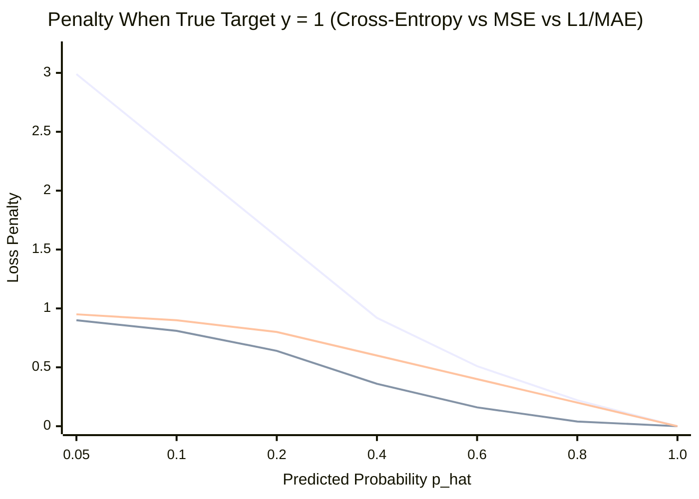
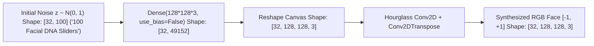
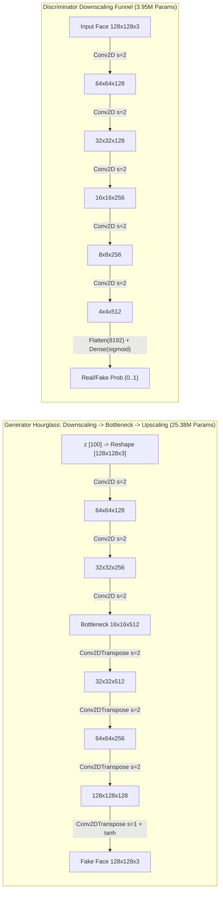

# Generating Fake Faces with GAN — Visual Guide to Loss Functions & Code Mechanics

- **Untouched Notebook**: [Generating_fake_faces_using_GAN_(1).ipynb](file:///Users/damodhar/Documents/Workspace/Learnings/Vizuara%20-%20Minor%20in%20AI/01-class-notes/08-generating-fake-faces-gan/Generating_fake_faces_using_GAN_%281%29.ipynb) (`128x128x3` Human Face Synthesis on `9,090` faces from `face-mask-lite-dataset`)

---

## 1. Loss Functions: `cross_entropy` vs. `MSE` vs. Other Losses

A **Loss Function** measures *"how wrong"* a neural network's prediction $\hat{y}$ is compared to the target $y$, producing the error signal that drives weight updates.

### A. Binary Cross-Entropy (`cross_entropy` in [`Cell 27`](file:///Users/damodhar/Documents/Workspace/Learnings/Vizuara%20-%20Minor%20in%20AI/01-class-notes/08-generating-fake-faces-gan/Generating_fake_faces_using_GAN_%281%29.ipynb#L923-L931))
Used whenever the output is a **probability** $\hat{p} \in (0, 1)$ answering a Yes/No question (*"Is this face Real `1` or Fake `0`?"*):
$$\mathcal{L}_{\text{BCE}}(y, \hat{p}) = -\Big[y \ln(\hat{p}) + (1 - y)\ln(1 - \hat{p})\Big]$$

- **`discriminator_loss`** (`fake_loss + real_loss`): Pushes `real_output` toward `1` ($-\ln D(\mathbf{x})$) and `fake_output` toward `0` ($-\ln(1 - D(G(\mathbf{z})))$).
- **`generator_loss`**: Compares `fake_output` against **`tf.ones_like(fake_output)` (`y = 1`)**! If the Discriminator says $\hat{p} = 0.01$ (*"Definitely Fake"*), $-\ln(0.01) = \mathbf{4.605}$ — an **exponentially steep penalty** that forces the Generator to improve fast.

> [!WARNING]
> **Subtle Code Catch (`from_logits=True` vs. `activation='sigmoid'`)**:
> In [`Discriminator()`](file:///Users/damodhar/Documents/Workspace/Learnings/Vizuara%20-%20Minor%20in%20AI/01-class-notes/08-generating-fake-faces-gan/Generating_fake_faces_using_GAN_%281%29.ipynb#L644), the final layer uses `Dense(1, activation='sigmoid')` (already squashed to $[0, 1]$), while [`Cell 27`](file:///Users/damodhar/Documents/Workspace/Learnings/Vizuara%20-%20Minor%20in%20AI/01-class-notes/08-generating-fake-faces-gan/Generating_fake_faces_using_GAN_%281%29.ipynb#L923) sets `BinaryCrossentropy(from_logits=True)`. Best practice is **either** `Dense(1)` (no activation, raw logits) + `from_logits=True` (numerically most stable!), **or** `Dense(1, activation='sigmoid')` + `from_logits=False`—never double-applying Sigmoid!

---

### B. Mean Squared Error (`MSE` / L2 Loss)
$$\mathcal{L}_{\text{MSE}}(y, \hat{y}) = \frac{1}{N}\sum_{i=1}^{N} (y_i - \hat{y}_i)^2$$
- **Why Pixel-Level MSE Fails for Face Generation**: If you train a Generator directly with pixel MSE, averaging a face looking slightly left and a face looking slightly right minimizes squared distance by predicting a **blurry, ghost-like average face**!
- **Where MSE *Does* Work in GANs (LSGAN — Least Squares GAN)**: Replacing `BinaryCrossentropy` on the Discriminator's output with MSE ($\frac{1}{2}(D(G(\mathbf{z})) - 1)^2$) penalizes samples smoothly even when they already fool the Discriminator, reducing mode collapse.

---

### C. Penalty Curve & Comparison With Other Loss Functions

Notice how **Cross-Entropy** explodes toward $\infty$ when a prediction for target $y=1$ approaches $\hat{p} \to 0$, whereas **MSE** caps out at $1.0$:

*(Top curve: **Binary Cross-Entropy** $-\ln(\hat{p})$ | Middle straight line: **MAE/L1** $\lvert 1-\hat{p}\rvert$ | Bottom curved line: **MSE** $(1-\hat{p})^2$)*

| Loss Function | Formula | Gradient Behavior & When to Use in GenAI |
| :--- | :--- | :--- |
| **Binary Cross-Entropy (`BCE`)** | $-[y\ln\hat{p} + (1-y)\ln(1-\hat{p})]$ | **Standard GANs (`Cell 27`)** & binary classifiers; huge gradient when confidently wrong. |
| **Categorical Cross-Entropy** | $-\sum_{c=1}^{V} y_c \ln \hat{p}_c$ | **LLMs / RNN / LSTM / Attention** next-word prediction across $V$ vocabulary classes. |
| **Mean Squared Error (`MSE` / L2)** | $\frac{1}{N}\sum (y_i - \hat{y}_i)^2$ | **Diffusion noise prediction** ($\lVert\boldsymbol{\epsilon} - \boldsymbol{\epsilon}_\theta\rVert^2$), **LSGAN**, & continuous regression; blurs raw pixels if used alone. |
| **Mean Absolute Error (`MAE` / L1)** | $\frac{1}{N}\sum \lvert y_i - \hat{y}_i\rvert$ | **Pix2Pix Image Translation (`Cell 5`)**: paired with GAN loss to keep sharp edges without L2 blur! |
| **Huber Loss** | $\frac{1}{2}e^2$ if $\lvert e\rvert\le\delta$, else $\delta(\lvert e\rvert-\frac{1}{2}\delta)$ | Robust regression & RL; smooth like MSE near $0$, outlier-resistant like MAE far away. |
| **Wasserstein / Hinge Loss** | $\mathbb{E}[D(\mathbf{x})] - \mathbb{E}[D(G(\mathbf{z}))]$ | **WGAN-GP / StyleGAN**: measures Earth-Mover distance so gradients never vanish even if $D$ is far stronger than $G$! |

---

## 2. Gradient Descent, Learning Rate & Dual `GradientTape` ([`Cells 25 & 29`](file:///Users/damodhar/Documents/Workspace/Learnings/Vizuara%20-%20Minor%20in%20AI/01-class-notes/08-generating-fake-faces-gan/Generating_fake_faces_using_GAN_%281%29.ipynb#L885-L977))

**Gradient Descent** updates weights $\mathbf{w}$ in the opposite direction of the slope $\nabla_{\mathbf{w}}\mathcal{L}$:
$$\mathbf{w}_{\text{new}} = \mathbf{w}_{\text{old}} - \eta \cdot \nabla_{\mathbf{w}}\mathcal{L}$$

In [`Cell 25`](file:///Users/damodhar/Documents/Workspace/Learnings/Vizuara%20-%20Minor%20in%20AI/01-class-notes/08-generating-fake-faces-gan/Generating_fake_faces_using_GAN_%281%29.ipynb#L885-L895), the code uses **`RMSprop(learning_rate=0.0001, clipvalue=1.0, decay=1e-8)`**:
- **`learning_rate = 0.0001` ($\eta$)**: Controls step size down the loss valley.
- **`RMSprop`**: Divides each weight's gradient by the root-mean-square of its recent gradients ($\sqrt{E[g^2] + \epsilon}$), damping steep oscillating directions and accelerating flat directions.
- **`clipvalue = 1.0`**: Clamps every raw gradient component into $[-1.0, +1.0]$ before updating weights—preventing a single wild adversarial spike (like Epoch 4 `Generator Loss: 16.68` in [`Cell 34`](file:///Users/damodhar/Documents/Workspace/Learnings/Vizuara%20-%20Minor%20in%20AI/01-class-notes/08-generating-fake-faces-gan/Generating_fake_faces_using_GAN_%281%29.ipynb#L1044)) from blowing up the network!

```mermaid
flowchart TD
    subgraph StepLoop["@tf.function Dual GradientTape Step (Cell 29)"]
        direction LR
        Z["Initial Noise z [32, 100]"] --> Gen["generator(z, training=True)"]
        Gen --> FakeImg["Fake Faces [32, 128, 128, 3]"]
        FakeImg --> Disc1["discriminator(fake)"]
        RealImg["Real Faces [32, 128, 128, 3]"] --> Disc2["discriminator(real)"]
        Disc1 --> GLoss["gen_loss (Target = 1)"]
        Disc1 & Disc2 --> DLoss["disc_loss (Fake=0, Real=1)"]
        GLoss --> GTape["gen_tape.gradient -> Clip [-1,+1] -> RMSprop(lr=1e-4)"]
        DLoss --> DTape["disc_tape.gradient -> Clip [-1,+1] -> RMSprop(lr=1e-4)"]
    end

    subgraph LRPhysics["How Learning Rate (lr) Shapes Convergence"]
        direction LR
        SmallLR["Too Small (lr = 1e-7): Tiny baby steps; stuck in local plateaus for days"]
        OptLR["Balanced (lr = 1e-4): Smoothly descends valley & stabilizes adversarial duel"]
        BigLR["Too Large (lr = 1e-1): Overshoots valley walls; losses explode to NaN!"]
        SmallLR --- OptLR --- BigLR
    end
```

---

## 3. Initial Noise (`latent_dim = 100`) — The Facial DNA Seed

Why feed `noise = tf.random.normal([batch_size, 100])` ($\mathbf{z} \sim \mathcal{N}(0, 1)$) into the Generator?
- Without random input noise, a deterministic neural network would generate the **exact same single face** every time!
- Each of the `100` Gaussian numbers acts like a continuous **latent slider (Facial DNA)**: after training, nudging dimensions smoothly morphs pose angle, smile, hair style, lighting, and skin tone across an infinite space of novel human faces.

---

## 4. Strides, Downscaling (`Conv2D`), & Upscaling (`Conv2DTranspose`)

### How `strides` & `padding='same'` Change Spatial Resolution
- **`strides = 1` (`padding='same'`)**: The $4 \times 4$ filter slides **1 pixel at a time** $\implies$ Spatial width & height stay **unchanged** ($H_{\text{out}} = H_{\text{in}}$). Refines local features (skin texture, eye edges).
- **`Conv2D(..., strides = 2)` — Downscaling**: The filter jumps **2 pixels at a time** $\implies$ Halves height & width ($H_{\text{out}} = H_{\text{in}} / 2$), compressing image pixels into compact, high-level semantic channels ($128 \to 64 \to 32 \to 16$).
- **`Conv2DTranspose(..., strides = 2)` — Upscaling (Learnable Deconvolution)**: Inserts zeros between feature grid cells and applies a learnable $4 \times 4$ filter $\implies$ **Doubles** height & width ($H_{\text{out}} = 2 \cdot H_{\text{in}}$: $16 \to 32 \to 64 \to 128$), painting high-resolution facial details from coarse features!

### Exact Spatial Flow Inside [`Generator()`](file:///Users/damodhar/Documents/Workspace/Learnings/Vizuara%20-%20Minor%20in%20AI/01-class-notes/08-generating-fake-faces-gan/Generating_fake_faces_using_GAN_%281%29.ipynb#L361-L392) & [`Discriminator()`](file:///Users/damodhar/Documents/Workspace/Learnings/Vizuara%20-%20Minor%20in%20AI/01-class-notes/08-generating-fake-faces-gan/Generating_fake_faces_using_GAN_%281%29.ipynb#L626-L645)

Notice that [`Generator()`](file:///Users/damodhar/Documents/Workspace/Learnings/Vizuara%20-%20Minor%20in%20AI/01-class-notes/08-generating-fake-faces-gan/Generating_fake_faces_using_GAN_%281%29.ipynb#L361) uses an **Autoencoder / Hourglass bottleneck** (`25.38M` params) that first compresses the noisy $128 \times 128$ canvas down to $16 \times 16 \times 512$ global facial structure before upscaling back to $128 \times 128 \times 3$:

---

## 5. Quick Reference Glossary of Every Other Term in the Code

| Code Term / Snippet | Location | Exact Role & Mathematical Reason |
| :--- | :--- | :--- |
| `cv2.cvtColor(img, cv2.COLOR_BGR2RGB)` | [`Cell 10`](file:///Users/damodhar/Documents/Workspace/Learnings/Vizuara%20-%20Minor%20in%20AI/01-class-notes/08-generating-fake-faces-gan/Generating_fake_faces_using_GAN_%281%29.ipynb#L248) | OpenCV loads images in **Blue-Green-Red** order; converts to standard **Red-Green-Blue** so faces aren't Smurf-blue! |
| `(img - 127.5) / 127.5` & `(img + 1) / 2` | [`Cells 10, 31`](file:///Users/damodhar/Documents/Workspace/Learnings/Vizuara%20-%20Minor%20in%20AI/01-class-notes/08-generating-fake-faces-gan/Generating_fake_faces_using_GAN_%281%29.ipynb#L251) | Maps raw pixels $[0, 255] \to [-1, +1]$ (zero-centered to match Generator's `tanh`), then rescales back to $[0, 1]$ for `plt.imshow`. |
| `tf.data.Dataset...batch(32)` | [`Cell 14`](file:///Users/damodhar/Documents/Workspace/Learnings/Vizuara%20-%20Minor%20in%20AI/01-class-notes/08-generating-fake-faces-gan/Generating_fake_faces_using_GAN_%281%29.ipynb#L336) | Streams `9,090` faces in mini-batches of `32` (`285` steps/epoch) onto GPU memory efficiently. |
| `use_bias=False` + `BatchNormalization()` | [`Cells 16, 19`](file:///Users/damodhar/Documents/Workspace/Learnings/Vizuara%20-%20Minor%20in%20AI/01-class-notes/08-generating-fake-faces-gan/Generating_fake_faces_using_GAN_%281%29.ipynb#L366-L367) | `BatchNorm` normalizes each channel to mean $0$, variance $1$ ($\gamma \frac{x - \mu_B}{\sqrt{\sigma_B^2 + \epsilon}} + \beta$), stabilizing deep GAN gradients. Because subtracting $\mu_B$ cancels any constant conv bias, `use_bias=False` saves wasted parameters! |
| `kernel_initializer='he_normal'` | [`Cells 16, 19`](file:///Users/damodhar/Documents/Workspace/Learnings/Vizuara%20-%20Minor%20in%20AI/01-class-notes/08-generating-fake-faces-gan/Generating_fake_faces_using_GAN_%281%29.ipynb#L365) | Draws initial weights from $\mathcal{N}\!\left(0, \sqrt{2 / \text{fan\_in}}\right)$, keeping signal variance stable across `LeakyReLU` layers at Epoch 0. |
| `LeakyReLU()` | [`Cells 16, 19`](file:///Users/damodhar/Documents/Workspace/Learnings/Vizuara%20-%20Minor%20in%20AI/01-class-notes/08-generating-fake-faces-gan/Generating_fake_faces_using_GAN_%281%29.ipynb#L368) | Outputs $\max(0.3x, x)$ (Keras default $\alpha = 0.3$); keeps negative activations alive so Discriminator gradients never die on their way back to the Generator. |
| `activation='tanh'` | [`Cell 16`](file:///Users/damodhar/Documents/Workspace/Learnings/Vizuara%20-%20Minor%20in%20AI/01-class-notes/08-generating-fake-faces-gan/Generating_fake_faces_using_GAN_%281%29.ipynb#L389) | Smoothly bounds final generated RGB pixels into $(-1, +1)$ via $\frac{e^x - e^{-x}}{e^x + e^{-x}}$. |
| `@tf.function` + `training=True` | [`Cell 29`](file:///Users/damodhar/Documents/Workspace/Learnings/Vizuara%20-%20Minor%20in%20AI/01-class-notes/08-generating-fake-faces-gan/Generating_fake_faces_using_GAN_%281%29.ipynb#L952-L959) | `@tf.function` compiles Python into a fast C++ TensorFlow graph (`~25.2s/epoch`), while `training=True` ensures `BatchNormalization` uses live mini-batch statistics during adversarial updates. |
