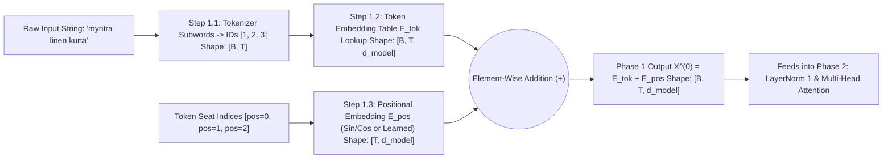

# Phase 1: The Transformer Input Pipeline
### *From Raw Text to Position-Aware Semantic Vectors: Tokenized Text $\longrightarrow$ Token Embedding $+$ Positional Embedding*

---

## 🔗 Quick Navigation
- **Master Architecture Overview**: [README.md](file:///Users/damodhar/Documents/Workspace/Learnings/Vizuara%20-%20Minor%20in%20AI/01-class-notes/09-transformers-architecture/README.md)
- **Original Live Embedding Lab Notebook**: [Live_Vector_embedding.ipynb](file:///Users/damodhar/Documents/Workspace/Learnings/Vizuara%20-%20Minor%20in%20AI/01-class-notes/09-transformers-architecture/Live_Vector_embedding.ipynb)
- **Individual Concept Deep-Dives for Phase 1**:
  1. [01-tokenized-text-and-bpe.md](file:///Users/damodhar/Documents/Workspace/Learnings/Vizuara%20-%20Minor%20in%20AI/01-class-notes/09-transformers-architecture/concepts/01-tokenized-text-and-bpe.md) — *Tokenized Text, Subword BPE & Vocabulary IDs*
  2. [02-token-embeddings-and-word2vec.md](file:///Users/damodhar/Documents/Workspace/Learnings/Vizuara%20-%20Minor%20in%20AI/01-class-notes/09-transformers-architecture/concepts/02-token-embeddings-and-word2vec.md) — *Token Embeddings, `word2vec-google-news-300`, Cosine vs. L2 Geometry*
  3. [03-positional-embeddings.md](file:///Users/damodhar/Documents/Workspace/Learnings/Vizuara%20-%20Minor%20in%20AI/01-class-notes/09-transformers-architecture/concepts/03-positional-embeddings.md) — *Positional Embeddings (Sinusoidal Waves, Learned Positions & RoPE)*
- **Next Phase**: [02-phase-2-processor-transformer-block.md](file:///Users/damodhar/Documents/Workspace/Learnings/Vizuara%20-%20Minor%20in%20AI/01-class-notes/09-transformers-architecture/02-phase-2-processor-transformer-block.md)

---

## 🧠 1. Class X Sensory Intuition: How the Brain Prepares a Sentence Before Thinking

Imagine reading the sentence: **`"The dog bit the postman"`** vs. **`"The postman bit the dog"`**.
Before your brain can reason about *who* needs medical attention, your visual cortex performs **three instant preparation steps** in parallel:
1. **Chopping Syllables (`Tokenized Text`)**: Your eyes split the continuous stream of ink into distinct vocabulary building blocks (`["myntra", "linen", "kurta"]`) and look up each piece's dictionary entry number (`[1, 2, 3]`).
2. **Retrieving Meaning (`Token Embedding`)**: A dictionary ID like `3` is just an arbitrary barcode—it tells you nothing about whether `"kurta"` is clothing or an earthworm! So your brain immediately maps each ID onto a rich **Mental Concept Card** of $d_{\text{model}}$ traits (*Is it wearable? Is it royal? Is it summer fabric?*).
3. **Stamping Word Order (`Positional Embedding`)**: Unlike an RNN/LSTM that reads one word per second on a conveyor belt, **a Transformer looks at the entire page simultaneously in one flash!** Without seat numbers stamped onto each word, `"dog bit postman"` and `"postman bit dog"` look like the exact same bag of words! So we add a unique **Seat-Number Wave ($\mathbf{E}_{\text{pos}}$)** directly onto each word's Meaning Vector ($\mathbf{E}_{\text{tok}}$).

---

## ⚙️ 2. Staff Backend Architect's Rosetta Stone (Phase 1)

| Phase 1 Neural Component | Distributed Systems & Backend Engineering Equivalent |
| :--- | :--- |
| **Subword Tokenizer (BPE / WordPiece)** | **Lexical Parser & Huffman Dictionary Compressor**: Splits raw UTF-8 strings into frequent subword chunks so rare SKUs/names never trigger `OutOfVocabularyException` (`<unk>`). |
| **Token IDs (`[1, 2, 3]`)** | **Surrogate Primary Keys (`BIGINT`)**: Compact integer foreign keys with zero intrinsic geometric meaning ($ID=4$ is not "twice" $ID=2$). |
| **Token Embedding Table ($\mathbf{E} \in \mathbb{R}^{V \times d_{\text{model}}}$)** | **In-Memory Columnar Feature Store (Redis / Feast)**: $O(1)$ row lookup mapping a discrete Primary Key to a dense $d_{\text{model}}$-float feature vector. |
| **Cosine Similarity vs. L2 Distance** | **Vector DB Index Metric (Pinecone / Milvus / pgvector)**: Measuring directional semantic alignment ($\cos\theta$) vs. absolute coordinate distance ($\lVert\mathbf{u}-\mathbf{v}\rVert_2$). |
| **Positional Embedding ($\mathbf{E}_{\text{pos}}$)** | **Lamport Logical Clock / Kafka Offset Timestamp**: Injecting sequence order metadata into each payload before dispatching to a stateless parallel worker pool! |

---

## 🔬 3. First-Principles Mathematics & Notebook Forensics

### Step 1.1: Tokenization ($\text{String} \to \mathbb{Z}^T$)
Given vocabulary $\mathcal{V}$ of size $V$ (e.g., $V = 50,257$ in GPT-2; $V = 6$ in our trace), a sequence of $T$ tokens is mapped to integer indices:
$$\mathbf{t} = [t_0, t_1, \dots, t_{T-1}] \in \{0, 1, \dots, V-1\}^T$$

---

### Step 1.2: Token Embeddings & Vector Space Geometry ([`Live_Vector_embedding.ipynb`](file:///Users/damodhar/Documents/Workspace/Learnings/Vizuara%20-%20Minor%20in%20AI/01-class-notes/09-transformers-architecture/Live_Vector_embedding.ipynb))

In [`Live_Vector_embedding.ipynb`](file:///Users/damodhar/Documents/Workspace/Learnings/Vizuara%20-%20Minor%20in%20AI/01-class-notes/09-transformers-architecture/Live_Vector_embedding.ipynb#L139-L448), we loaded Google's pre-trained **`word2vec-google-news-300`** model ($d_{\text{model}} = 300$, `word_vectors['cat'].shape == (300,)`):

1. **Linear Semantic Substructures (`Cell 8` — King + Woman - Man = Queen)**:
   $$\mathbf{v}_{\text{king}} - \mathbf{v}_{\text{man}} + \mathbf{v}_{\text{woman}} \approx \mathbf{v}_{\text{queen}} \quad (\text{Cosine Similarity} = \mathbf{0.7118})$$
   Why does simple vector subtraction and addition solve human analogies? Because training on billions of sentences aligns semantic concepts along **linear directional axes**: subtracting $\mathbf{v}_{\text{man}}$ cancels the `[+Masculine]` component while preserving `[+Royalty]`, and adding $\mathbf{v}_{\text{woman}}$ injects `[+Feminine]`!

2. **Cosine Similarity (`Cell 10`) vs. Euclidean Distance (`Cell 14`)**:
   - **Cosine Similarity** measures the **angle $\theta$** between two vectors (ignoring vector length/frequency):
     $$\text{CosineSim}(\mathbf{a}, \mathbf{b}) = \cos(\theta) = \frac{\mathbf{a} \cdot \mathbf{b}}{\lVert\mathbf{a}\rVert_2 \, \lVert\mathbf{b}\rVert_2} = \frac{\sum_{i=1}^{d} a_i b_i}{\sqrt{\sum_{i=1}^{d} a_i^2}\sqrt{\sum_{i=1}^{d} b_i^2}} \in [-1, +1]$$
     - `similarity('boy', 'girl') = 0.8543`, `similarity('woman', 'man') = 0.7664`, `similarity('king', 'queen') = 0.6511`
     - `similarity('paper', 'water') = 0.1141` (nearly orthogonal $\approx 83.4^\circ$!).
   - **Euclidean L2 Distance (`np.linalg.norm(v1 - v2)`)** measures the straight-line ruler distance between vector tips:
     $$\lVert\mathbf{a} - \mathbf{b}\rVert_2 = \sqrt{\sum_{i=1}^{d} (a_i - b_i)^2}$$
     - `'man'` vs. `'woman'`: $\mathbf{1.73}$ | `'nephew'` vs. `'niece'`: $\mathbf{1.96}$ (close semantic neighbors!)
     - `'semiconductor'` vs. `'earthworm'`: $\mathbf{5.67}$ (far apart across the 300D hyper-sphere!).

3. **Matrix Lookup in Transformers**:
   Representing token $t_k$ as a one-hot row vector $\mathbf{1}_{t_k} \in \{0, 1\}^{1 \times V}$ and multiplying by the learnable Embedding Matrix $\mathbf{E} \in \mathbb{R}^{V \times d_{\text{model}}}$ extracts row $t_k$:
   $$\mathbf{E}_{\text{tok}} = \begin{bmatrix} \mathbf{E}[t_0] \\ \mathbf{E}[t_1] \\ \vdots \\ \mathbf{E}[t_{T-1}] \end{bmatrix} \in \mathbb{R}^{T \times d_{\text{model}}} \quad (\text{or } \mathbb{R}^{B \times T \times d_{\text{model}}} \text{ for batch size } B)$$

---

### Step 1.3: Positional Embeddings ($\mathbf{E}_{\text{pos}} \in \mathbb{R}^{T \times d_{\text{model}}}$)

In Vaswani et al. (2017), position $\text{pos} \in \{0, 1, \dots, T-1\}$ and dimension pair $(2i, 2i+1)$ are encoded via geometric wavelengths from $2\pi$ to $10000 \cdot 2\pi$:
$$PE_{(\text{pos}, 2i)} = \sin\!\left(\frac{\text{pos}}{10000^{2i / d_{\text{model}}}}\right), \qquad PE_{(\text{pos}, 2i+1)} = \cos\!\left(\frac{\text{pos}}{10000^{2i / d_{\text{model}}}}\right)$$

**Why $\sin$ and $\cos$?** By trigonometric addition identities ($\sin(\alpha+\beta) = \sin\alpha\cos\beta + \cos\alpha\sin\beta$), for any fixed offset $k$, $PE_{\text{pos}+k}$ is a **exact linear rotation matrix** times $PE_{\text{pos}}$, allowing attention heads to learn relative distances ("3 words earlier") via simple dot products!

---

### Step 1.4: Combined Phase 1 Output ($\mathbf{X}^{(0)} = \mathbf{E}_{\text{tok}} + \mathbf{E}_{\text{pos}}$)
Using our verified trace from [`transformer_three_phases_from_scratch.py`](file:///Users/damodhar/Documents/Workspace/Learnings/Vizuara%20-%20Minor%20in%20AI/01-class-notes/09-transformers-architecture/transformer_three_phases_from_scratch.py) for `["myntra", "linen", "kurta"]` ($T=3, d_{\text{model}}=4$):

$$\mathbf{E}_{\text{tok}} = \begin{bmatrix} +0.9000 & +0.2000 & +0.4000 & -0.1000 \\ +0.1000 & +0.9500 & +0.3000 & +0.2000 \\ +0.2000 & +0.6000 & +0.9500 & +0.1000 \end{bmatrix}, \quad \mathbf{E}_{\text{pos}} = \begin{bmatrix} +0.0000 & +1.0000 & +0.0000 & +1.0000 \\ +0.8415 & +0.5403 & +0.0100 & +1.0000 \\ +0.9093 & -0.4161 & +0.0200 & +0.9998 \end{bmatrix}$$

$$\mathbf{X}^{(0)} = \mathbf{E}_{\text{tok}} + \mathbf{E}_{\text{pos}} = \begin{bmatrix} +0.9000 & +1.2000 & +0.4000 & +0.9000 \\ +0.9415 & +1.4903 & +0.3100 & +1.2000 \\ +1.1093 & +0.1839 & +0.9700 & +1.0998 \end{bmatrix} \in \mathbb{R}^{3 \times 4}$$

This position-stamped matrix $\mathbf{X}^{(0)}$ now enters **[Phase 2: The Processor Block](file:///Users/damodhar/Documents/Workspace/Learnings/Vizuara%20-%20Minor%20in%20AI/01-class-notes/09-transformers-architecture/02-phase-2-processor-transformer-block.md)**!
