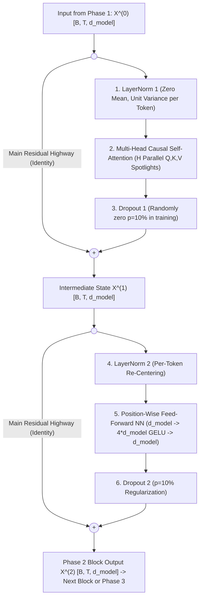

# Phase 2: The Transformer Processor Block ($\times N$ Layers)
### *How Tokens Communicate & Compute: `LayerNorm 1` $\to$ `Multi-Head Attention` $\to$ `Dropout` $\to$ `Residual (+)` $\to$ `LayerNorm 2` $\to$ `Feed-Forward NN` $\to$ `Dropout` $\to$ `Residual (+)`*

---

## 🔗 Quick Navigation
- **Previous Phase**: [01-phase-1-input-pipeline.md](file:///Users/damodhar/Documents/Workspace/Learnings/Vizuara%20-%20Minor%20in%20AI/01-class-notes/09-transformers-architecture/01-phase-1-input-pipeline.md)
- **Master Architecture Overview**: [README.md](file:///Users/damodhar/Documents/Workspace/Learnings/Vizuara%20-%20Minor%20in%20AI/01-class-notes/09-transformers-architecture/README.md)
- **Individual Concept Deep-Dives for Phase 2**:
  1. [04-layer-normalization.md](file:///Users/damodhar/Documents/Workspace/Learnings/Vizuara%20-%20Minor%20in%20AI/01-class-notes/09-transformers-architecture/concepts/04-layer-normalization.md) — *LayerNorm 1 & LayerNorm 2: Per-Token Stabilization & Pre-LN vs. Post-LN*
  2. [05-multi-head-attention.md](file:///Users/damodhar/Documents/Workspace/Learnings/Vizuara%20-%20Minor%20in%20AI/01-class-notes/09-transformers-architecture/concepts/05-multi-head-attention.md) — *Multi-Head Causal Self-Attention (`Q, K, V`, $\sqrt{d_k}$ Scaling & Masking)*
  3. [06-feed-forward-network.md](file:///Users/damodhar/Documents/Workspace/Learnings/Vizuara%20-%20Minor%20in%20AI/01-class-notes/09-transformers-architecture/concepts/06-feed-forward-network.md) — *Position-Wise Feed-Forward Network (`FFN`, $4 d_{\text{model}}$ Expansion & `GELU`)*
  4. [07-dropout-and-residual-connections.md](file:///Users/damodhar/Documents/Workspace/Learnings/Vizuara%20-%20Minor%20in%20AI/01-class-notes/09-transformers-architecture/concepts/07-dropout-and-residual-connections.md) — *Dropout Regularization & The Residual Stream Gradient Superhighway*
- **Next Phase**: [03-phase-3-output-head.md](file:///Users/damodhar/Documents/Workspace/Learnings/Vizuara%20-%20Minor%20in%20AI/01-class-notes/09-transformers-architecture/03-phase-3-output-head.md)

---

## 🧠 1. Class X Sensory Intuition: The Brain's "Roundtable Debate + Solo Reflection"

Once Phase 1 places the position-stamped word cards $\mathbf{X}^{(0)}$ (`["myntra", "linen", "kurta"]`) on the table, how does the Transformer actually *think*?
Every Transformer Processor Block repeats a **two-half cognitive cycle** (stacked $N = 12$ to $96$ times in modern LLMs):

1. **Sub-Block A: The Roundtable Debate (`LayerNorm 1` $\to$ `Multi-Head Attention` $\to$ `Dropout` $\to$ `Residual +`) — *Tokens Communicate Across Time***:
   - Before speaking, **`LayerNorm 1`** calms every word's volume so no single loud number dominates the room.
   - Next, in **`Multi-Head Attention`**, every word looks back at the words before it using multiple specialist lenses (**Head 1** checks *Brand & Fabric compatibility*, **Head 2** checks *Grammar & Garment noun*). Thus, `"kurta"` absorbs the context that it is specifically a *Myntra summer linen* kurta!
   - Finally, **`Dropout`** randomly mutes $10\%$ of pathways during training so the brain doesn't lazily rely on one neuron, and **`Residual Addition (+)`** writes the new insight *on top of* the original word card ($\mathbf{X}^{(1)} = \mathbf{X}^{(0)} + \Delta_{\text{MHA}}$) without erasing the original word!
2. **Sub-Block B: The Solo Study Cubicle (`LayerNorm 2` $\to$ `Feed-Forward NN` $\to$ `Dropout` $\to$ `Residual +`) — *Tokens Compute Individually***:
   - Now each word goes into its own private cubicle (**`Feed-Forward Network`**) without talking to other words.
   - It expands its 4D notes onto a wide **4x workbench** ($d_{\text{model}} = 4 \to d_{\text{ff}} = 8$), applies non-linear reasoning (`GELU`) to unlock stored world knowledge, compresses back to $4\text{D}$, applies **`Dropout`**, and adds the result back onto the Residual Stream ($\mathbf{X}^{(2)} = \mathbf{X}^{(1)} + \Delta_{\text{FFN}}$)!



---

## ⚙️ 2. Staff Backend Architect's Rosetta Stone (Phase 2)

| Phase 2 Processor Component | Distributed Systems & Backend Engineering Equivalent |
| :--- | :--- |
| **Residual Stream ($\mathbf{X}^{(0)} \to \mathbf{X}^{(1)} \to \mathbf{X}^{(2)}$)** | **Append-Only Event Bus / Shared Context Envelope**: Microservices read a normalized snapshot from the bus and publish additive deltas (`+`) back without overwriting upstream fields. |
| **`LayerNorm 1` & `LayerNorm 2`** | **Ingress Payload Schema Normalizer / Z-Score Sanitizer**: Standardizes each token's feature vector independently (zero cross-token synchronization overhead!). |
| **`Multi-Head Attention` (`Q, K, V`)** | **Parallel Multi-Index Scatter-Gather Query**: Fires $H$ concurrent similarity searches across previous token states ($O(1)$ hop distance!) and merges results via $\mathbf{W}_O$. |
| **`Feed-Forward Network (FFN)`** | **Stateless Map-Only Worker + Embedded Key-Value Knowledge Store**: Applies the exact same 2-layer MLP independently to every token position in parallel (`map()`). |
| **`Dropout(p=0.1)`** | **Chaos Monkey / Netflix Simian Army**: Randomly drops $10\%$ of internal service links during staging/training so downstream consumers build redundant, fault-tolerant pathways. |

---

## 🔬 3. Complete Mathematical Equations & Verified Numerical Trace

### Sub-Block A: Communication via Pre-LN Multi-Head Self-Attention

#### 1. `LayerNorm 1` ($\mathbb{R}^{B \times T \times d_{\text{model}}} \to \mathbb{R}^{B \times T \times d_{\text{model}}}$)
For each token vector $\mathbf{x}_t \in \mathbb{R}^{d_{\text{model}}}$ independently:
$$\mu_t = \frac{1}{d_{\text{model}}}\sum_{i=1}^{d_{\text{model}}} x_{t,i}, \qquad \sigma_t^2 = \frac{1}{d_{\text{model}}}\sum_{i=1}^{d_{\text{model}}} (x_{t,i} - \mu_t)^2, \qquad \mathbf{z}_t^{(1)} = \boldsymbol{\gamma}_1 \odot \frac{\mathbf{x}_t^{(0)} - \mu_t}{\sqrt{\sigma_t^2 + \epsilon}} + \boldsymbol{\beta}_1$$

#### 2. `Multi-Head Attention` ($H$ Heads, $d_k = d_{\text{model}} / H$)
For each head $h \in \{1, \dots, H\}$ with projections $\mathbf{W}_Q^{(h)}, \mathbf{W}_K^{(h)}, \mathbf{W}_V^{(h)} \in \mathbb{R}^{d_{\text{model}} \times d_k}$:
$$\mathbf{Q}_h = \mathbf{Z}^{(1)}\mathbf{W}_Q^{(h)}, \quad \mathbf{K}_h = \mathbf{Z}^{(1)}\mathbf{W}_K^{(h)}, \quad \mathbf{V}_h = \mathbf{Z}^{(1)}\mathbf{W}_V^{(h)} \in \mathbb{R}^{T \times d_k}$$
$$\text{head}_h = \text{Softmax}\!\left(\frac{\mathbf{Q}_h \mathbf{K}_h^T}{\sqrt{d_k}} + \mathbf{M}_{\text{causal}}\right)\mathbf{V}_h \in \mathbb{R}^{T \times d_k}, \qquad \mathbf{M}_{i,j} = \begin{cases} 0 & \text{if } j \le i \\ -\infty & \text{if } j > i \end{cases}$$
$$\text{MHA}(\mathbf{Z}^{(1)}) = \text{Concat}(\text{head}_1, \dots, \text{head}_H)\mathbf{W}_O \in \mathbb{R}^{T \times d_{\text{model}}}$$

#### 3. `Dropout 1` & `Residual Connection 1`
$$\mathbf{X}^{(1)} = \mathbf{X}^{(0)} + \text{Dropout}\!\big(\text{MHA}(\text{LN}_1(\mathbf{X}^{(0)}))\big) \in \mathbb{R}^{T \times d_{\text{model}}}$$

---

### Sub-Block B: Computation via Pre-LN Position-Wise Feed-Forward Network

#### 4. `LayerNorm 2`
$$\mathbf{Z}^{(2)} = \text{LN}_2(\mathbf{X}^{(1)}) \in \mathbb{R}^{T \times d_{\text{model}}}$$

#### 5. `Feed-Forward Network (FFN)` ($\mathbb{R}^{T \times d_{\text{model}}} \to \mathbb{R}^{T \times 4 d_{\text{model}}} \to \mathbb{R}^{T \times d_{\text{model}}}$)
$$\text{FFN}(\mathbf{Z}^{(2)}) = \text{GELU}\!\left(\mathbf{Z}^{(2)}\mathbf{W}_1 + \mathbf{b}_1\right)\mathbf{W}_2 + \mathbf{b}_2, \qquad \mathbf{W}_1 \in \mathbb{R}^{d_{\text{model}} \times 4d_{\text{model}}}, \; \mathbf{W}_2 \in \mathbb{R}^{4d_{\text{model}} \times d_{\text{model}}}$$

#### 6. `Dropout 2` & `Residual Connection 2`
$$\mathbf{X}^{(2)} = \mathbf{X}^{(1)} + \text{Dropout}\!\big(\text{FFN}(\text{LN}_2(\mathbf{X}^{(1)}))\big) \in \mathbb{R}^{T \times d_{\text{model}}}$$

---

### Verified Numerical Progression (`["myntra", "linen", "kurta"]` from [`transformer_three_phases_from_scratch.py`](file:///Users/damodhar/Documents/Workspace/Learnings/Vizuara%20-%20Minor%20in%20AI/01-class-notes/09-transformers-architecture/transformer_three_phases_from_scratch.py))

```text
LN_1(X^(0))  -->  [+0.1741, +1.2185, -1.5666, +0.1741]   (Row 0: "myntra")
                  [-0.1009, +1.1589, -1.5505, +0.4924]   (Row 1: "linen")
                  [+0.7008, -1.7140, +0.3373, +0.6760]   (Row 2: "kurta")

X^(1) (Res1) -->  [+0.3621, +1.3166, -0.3502, +1.2777]   (After Multi-Head Attention + Skip)
                  [+0.3225, +1.5782, -0.4410, +1.6964]
                  [+1.1311, -0.5157, +0.4777, +1.3849]

X^(2) (Res2) -->  [+0.8030, +2.3769, -1.1795, +2.4207]   (After Feed-Forward GELU + Skip)
                  [+0.7340, +2.6072, -1.2569, +2.8443]
                  [+1.9851, -0.7820, +0.7843, +1.8436]
```

After passing through $N$ stacked Processor Blocks, $\mathbf{X}^{(N)}$ enters **[Phase 3: The Output Head](file:///Users/damodhar/Documents/Workspace/Learnings/Vizuara%20-%20Minor%20in%20AI/01-class-notes/09-transformers-architecture/03-phase-3-output-head.md)**!
