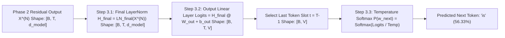

# Phase 3: The Transformer Output Head
### *From Deep Contextual Vectors to Next-Word Generation: `Final LayerNorm` $\to$ `Linear Output Layer (Logits)` $\to$ `Temperature Softmax`*

---

## 🔗 Quick Navigation
- **Previous Phase**: [02-phase-2-processor-transformer-block.md](file:///Users/damodhar/Documents/Workspace/Learnings/Vizuara%20-%20Minor%20in%20AI/01-class-notes/09-transformers-architecture/02-phase-2-processor-transformer-block.md)
- **Master Architecture Overview**: [README.md](file:///Users/damodhar/Documents/Workspace/Learnings/Vizuara%20-%20Minor%20in%20AI/01-class-notes/09-transformers-architecture/README.md)
- **Individual Concept Deep-Dive for Phase 3**:
  1. [08-final-layer-norm-and-output-layer.md](file:///Users/damodhar/Documents/Workspace/Learnings/Vizuara%20-%20Minor%20in%20AI/01-class-notes/09-transformers-architecture/concepts/08-final-layer-norm-and-output-layer.md) — *Final LayerNorm, Output Linear Projection, Weight Tying, Temperature & Top-$k$/Top-$p$ Sampling*

---

## 🧠 1. Class X Sensory Intuition: Turning a Finished Thought into Spoken Words

After $N$ rounds of Roundtable Debate (`Multi-Head Attention`) and Solo Reflection (`FFN`) in Phase 2, each token carries a rich, accumulated thought vector $\mathbf{X}^{(N)} \in \mathbb{R}^{T \times d_{\text{model}}}$.
Now, how does your brain speak the **very next word** after **`"myntra linen kurta"`**?

1. **The Final Volume Check (`Final LayerNorm`)**:
   - Because each of the $N$ Processor Blocks added new insights directly onto the **Residual Highway** ($\mathbf{X}^{(0)} + \Delta_1 + \Delta_2 + \dots + \Delta_{2N}$), the numbers in $\mathbf{X}^{(N)}$ have grown much louder than they started!
   - **`Final LayerNorm`** re-centers each token's final thought vector to **mean $0$ and variance $1$** ($\mathbf{H}_{\text{final}}$) so the output dictionary comparison doesn't saturate or explode.
2. **Matching Against the Entire Dictionary (`Output Linear Layer`)**:
   - Your brain compares the final thought vector at position $t=2$ (`"kurta"`) against **every single word in your $V$-word vocabulary** via dot products ($\mathbf{H}_{\text{final}}\mathbf{W}_{\text{out}}$), producing a raw **Logit Score** for every candidate word (*`"is"` gets `+1.42`, `"myntra"` gets `+0.18`, `"linen"` gets `-1.39`*).
3. **Turning Scores into Probabilities (`Softmax`)**:
   - Finally, **Softmax** converts those raw scores into percentages summing to $100\%$ (`"is": 56.33%`, `"myntra": 16.29%`, `"breathable": 13.57%`), and emits the winning next token **`"is"`**!



---

## ⚙️ 2. Staff Backend Architect's Rosetta Stone (Phase 3)

| Phase 3 Output Component | Distributed Systems & Backend Engineering Equivalent |
| :--- | :--- |
| **`Final LayerNorm`** | **Egress API Gateway Rate/Amplitude Limiter**: Re-normalizes the accumulated event-bus state after $N$ unscaled residual additions before hitting the downstream classifier. |
| **`Output Linear Layer` ($\mathbf{W}_{\text{out}} \in \mathbb{R}^{d_{\text{model}} \times V}$)** | **Full-Catalog Inverted Similarity Projection**: Dot-products the final $d_{\text{model}}$ query state against all $V$ vocabulary embeddings concurrently. |
| **Weight Tying ($\mathbf{W}_{\text{out}} = \mathbf{E}_{\text{tok}}^T$)** | **Shared Read/Write Schema Registry**: Reusing the exact same $V \times d_{\text{model}}$ embedding matrix for both Phase 1 ingress lookup and Phase 3 egress projection (saving $38\text{M+}$ parameters in GPT-2!). |
| **Temperature ($T$) & Top-$p$ Sampling** | **Weighted Canary / Probabilistic Traffic Router**: $T \to 0$ routes $100\%$ traffic to the single highest-scoring node (`argmax`); higher $T$ spreads traffic across candidate nodes. |

---

## 🔬 3. First-Principles Mathematics & Verified Numerical Trace

### Step 3.1: `Final LayerNorm` ($\mathbb{R}^{B \times T \times d_{\text{model}}} \to \mathbb{R}^{B \times T \times d_{\text{model}}}$)
Why is a **third** LayerNorm (`LN_final`) mandatory at the start of Phase 3 in Pre-LN Transformers (GPT-2, GPT-3, LLaMA, Gemini)?
- Look at the end of Phase 2: $\mathbf{X}^{(N)} = \mathbf{X}^{(N-1)} + \text{Dropout}(\text{FFN}(\text{LN}_2(\mathbf{X}^{(N-1)})))$.
- Because the residual addition happens **after** `LN_2`, the stream $\mathbf{X}^{(N)}$ is **unnormalized** (its variance grows roughly as $\mathcal{O}(N)$ across $N$ layers!).
- Applying $\mathbf{H}_{\text{final}} = \text{LN}_{\text{final}}(\mathbf{X}^{(N)})$ restores zero mean and unit variance at every token position $t$:
  $$\mathbf{h}_t^{\text{final}} = \boldsymbol{\gamma}_{\text{final}} \odot \frac{\mathbf{x}_t^{(N)} - \mu_t}{\sqrt{\sigma_t^2 + \epsilon}} + \boldsymbol{\beta}_{\text{final}} \in \mathbb{R}^{d_{\text{model}}}$$

---

### Step 3.2: `Output Linear Layer` & Weight Tying ($\mathbb{R}^{B \times T \times d_{\text{model}}} \to \mathbb{R}^{B \times T \times V}$)
The normalized hidden states $\mathbf{H}_{\text{final}} \in \mathbb{R}^{T \times d_{\text{model}}}$ are projected to vocabulary **Logits** $\mathbf{L} \in \mathbb{R}^{T \times V}$:
$$\mathbf{L} = \mathbf{H}_{\text{final}} \mathbf{W}_{\text{out}} + \mathbf{b}_{\text{out}}, \qquad \text{where } \mathbf{W}_{\text{out}} = \mathbf{E}_{\text{tok}}^T \in \mathbb{R}^{d_{\text{model}} \times V}$$

> [!TIP]
> **Why Parallel Training Uses ALL $T$ Rows of $\mathbf{L}$, While Inference Uses Only the Last Row $t = T-1$**:
> - **During Training**: Because Causal Masking prevented row $t$ from peeking at future tokens $>t$, row $t=0$ predicts token $1$ (`"linen"`), row $t=1$ predicts token $2$ (`"kurta"`), and row $t=2$ predicts token $3$ (`"is"`)—all in **one single parallel forward pass** graded by Categorical Cross-Entropy!
> - **During Autoregressive Generation (Inference)**: We already know tokens $0 \dots T-1$, so we only slice the final row $\mathbf{L}_{T-1, :} \in \mathbb{R}^V$ to sample the brand-new token $T$!

---

### Step 3.3: Temperature-Scaled Softmax & Verified Output Trace
$$\ P(w_{\text{next}} = v \mid w_{0:T-1}) = \frac{\exp(L_{T-1, v} / \tau)}{\sum_{u=0}^{V-1} \exp(L_{T-1, u} / \tau)}$$

From [`transformer_three_phases_from_scratch.py`](file:///Users/damodhar/Documents/Workspace/Learnings/Vizuara%20-%20Minor%20in%20AI/01-class-notes/09-transformers-architecture/transformer_three_phases_from_scratch.py) at position $t=2$ (`"kurta"`, $\tau = 1.0$):
```text
H_final[t=2] = [+0.9285, -1.5723, -0.1568, +0.8006]

Vocabulary Logits & Softmax Probabilities:
  Token 0 (<pad>     ) | Logit = -1.0000 | Prob =  5.01% ██
  Token 1 (myntra    ) | Logit = +0.1784 | Prob = 16.29% █████
  Token 2 (linen     ) | Logit = -1.3878 | Prob =  3.40% █
  Token 3 (kurta     ) | Logit = -0.9266 | Prob =  5.40% ██
  Token 4 (is        ) | Logit = +1.4191 | Prob = 56.33% █████████████████
  Token 5 (breathable) | Logit = -0.0046 | Prob = 13.57% ████
--> Predicted Next Token: 'is' (56.33%)
```
Appending `"is"` to the input produces `["myntra", "linen", "kurta", "is"]`, which loops back into **[Phase 1](file:///Users/damodhar/Documents/Workspace/Learnings/Vizuara%20-%20Minor%20in%20AI/01-class-notes/09-transformers-architecture/01-phase-1-input-pipeline.md)** to generate `"breathable"`!
