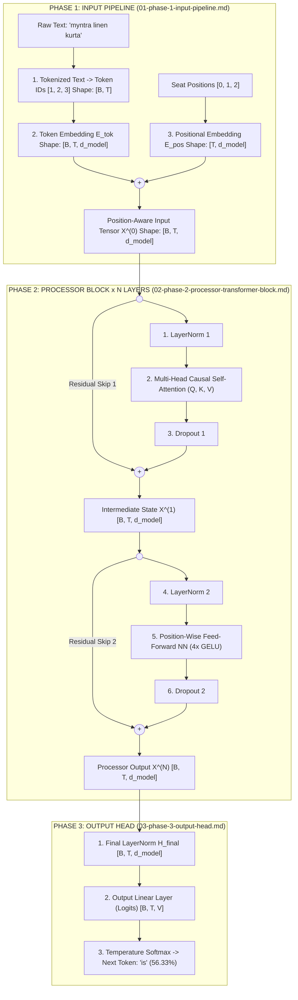

# Transformers Architecture — Master 3-Phase Blueprint (`Input` $\longrightarrow$ `Processor` $\longrightarrow$ `Output`)
### *From `Live_Vector_embedding.ipynb` Word2Vec Geometry to the Complete Pre-LN Transformer Pipeline*

---

## 🗺️ Module Architecture & File Map

This module decomposes the **Transformer Architecture** into **Three Distinct Phases** plus **Eight Individual Concept Deep-Dives** and **Dual-Language (Python + Java 17+) End-to-End Implementations**:

### 1. Original Lecture Notebook (100% Untouched)
- [`Live_Vector_embedding.ipynb`](file:///Users/damodhar/Documents/Workspace/Learnings/Vizuara%20-%20Minor%20in%20AI/01-class-notes/09-transformers-architecture/Live_Vector_embedding.ipynb) — *Google News 300D Word2Vec (`King - Man + Woman = Queen`, Cosine Similarity & Euclidean Distance)*

### 2. The Three Core Phase Files
| Phase | Phase Guide File | Pipeline Stages Covered |
| :--- | :--- | :--- |
| **Phase 1: Input** | [`01-phase-1-input-pipeline.md`](file:///Users/damodhar/Documents/Workspace/Learnings/Vizuara%20-%20Minor%20in%20AI/01-class-notes/09-transformers-architecture/01-phase-1-input-pipeline.md) | `Tokenized Text` $\to$ `Token Embedding` ($\mathbf{E}_{\text{tok}}$) $+$ `Positional Embedding` ($\mathbf{E}_{\text{pos}}$) |
| **Phase 2: Processor** | [`02-phase-2-processor-transformer-block.md`](file:///Users/damodhar/Documents/Workspace/Learnings/Vizuara%20-%20Minor%20in%20AI/01-class-notes/09-transformers-architecture/02-phase-2-processor-transformer-block.md) | `LayerNorm 1` $\to$ `Multi-Head Attention` $\to$ `Dropout` $\to$ `Residual (+)` $\to$ `LayerNorm 2` $\to$ `Feed-Forward NN` $\to$ `Dropout` $\to$ `Residual (+)` ($\times N$ Blocks) |
| **Phase 3: Output** | [`03-phase-3-output-head.md`](file:///Users/damodhar/Documents/Workspace/Learnings/Vizuara%20-%20Minor%20in%20AI/01-class-notes/09-transformers-architecture/03-phase-3-output-head.md) | `Final LayerNorm` $\to$ `Output Linear Layer` (Logits & Weight Tying) $\to$ `Softmax` |

### 3. Individual Concept Deep-Dive Files (`concepts/`)
1. [`01-tokenized-text-and-bpe.md`](file:///Users/damodhar/Documents/Workspace/Learnings/Vizuara%20-%20Minor%20in%20AI/01-class-notes/09-transformers-architecture/concepts/01-tokenized-text-and-bpe.md) — *Word vs. Character vs. Byte-Pair Encoding (BPE) Subword Tokenization*
2. [`02-token-embeddings-and-word2vec.md`](file:///Users/damodhar/Documents/Workspace/Learnings/Vizuara%20-%20Minor%20in%20AI/01-class-notes/09-transformers-architecture/concepts/02-token-embeddings-and-word2vec.md) — *Token Embedding Lookup Table & `Live_Vector_embedding.ipynb` Vector Math*
3. [`03-positional-embeddings.md`](file:///Users/damodhar/Documents/Workspace/Learnings/Vizuara%20-%20Minor%20in%20AI/01-class-notes/09-transformers-architecture/concepts/03-positional-embeddings.md) — *Sinusoidal $\sin/\cos$ Rotation Matrices, Learned Positions & RoPE*
4. [`04-layer-normalization.md`](file:///Users/damodhar/Documents/Workspace/Learnings/Vizuara%20-%20Minor%20in%20AI/01-class-notes/09-transformers-architecture/concepts/04-layer-normalization.md) — *Why `LayerNorm` Beats `BatchNorm` on Text + Exact Z-Score Math*
5. [`05-multi-head-attention.md`](file:///Users/damodhar/Documents/Workspace/Learnings/Vizuara%20-%20Minor%20in%20AI/01-class-notes/09-transformers-architecture/concepts/05-multi-head-attention.md) — *`Q, K, V` Projections, $\frac{1}{\sqrt{d_k}}$ Variance Proof & Causal Masking ($-\infty$)*
6. [`06-feed-forward-network.md`](file:///Users/damodhar/Documents/Workspace/Learnings/Vizuara%20-%20Minor%20in%20AI/01-class-notes/09-transformers-architecture/concepts/06-feed-forward-network.md) — *Position-Wise `FFN` ($d_{\text{model}} \to 4 d_{\text{model}} \to d_{\text{model}}$) & `GELU` / `SwiGLU`*
7. [`07-dropout-and-residual-connections.md`](file:///Users/damodhar/Documents/Workspace/Learnings/Vizuara%20-%20Minor%20in%20AI/01-class-notes/09-transformers-architecture/concepts/07-dropout-and-residual-connections.md) — *Inverted Dropout & The $\frac{\partial \mathbf{x}_L}{\partial \mathbf{x}_0} = \mathbf{I} + \dots$ Gradient Superhighway Proof*
8. [`08-final-layer-norm-and-output-layer.md`](file:///Users/damodhar/Documents/Workspace/Learnings/Vizuara%20-%20Minor%20in%20AI/01-class-notes/09-transformers-architecture/concepts/08-final-layer-norm-and-output-layer.md) — *`Final LayerNorm`, Output Projection, Weight Tying & Temperature/Top-$p$ Sampling*

### 4. Runnable Dual-Language Code Implementations
- **Pure Python 3-Phase Microscopic Trace**: [`transformer_three_phases_from_scratch.py`](file:///Users/damodhar/Documents/Workspace/Learnings/Vizuara%20-%20Minor%20in%20AI/01-class-notes/09-transformers-architecture/transformer_three_phases_from_scratch.py)
- **Enterprise Java 17+ 3-Phase Engine**: [`TransformerThreePhases.java`](file:///Users/damodhar/Documents/Workspace/Learnings/Vizuara%20-%20Minor%20in%20AI/01-class-notes/09-transformers-architecture/TransformerThreePhases.java)

---

## 🏛️ Master End-to-End 3-Phase Transformer Architecture Diagram



---

## 💻 Running the Complete 3-Phase Trace Locally

```bash
python3 "01-class-notes/09-transformers-architecture/transformer_three_phases_from_scratch.py"
```
This zero-dependency script executes **Part 0** (Word2Vec analogy & Cosine/L2 geometry from [`Live_Vector_embedding.ipynb`](file:///Users/damodhar/Documents/Workspace/Learnings/Vizuara%20-%20Minor%20in%20AI/01-class-notes/09-transformers-architecture/Live_Vector_embedding.ipynb)) followed by every matrix operation of **Phase 1**, **Phase 2**, and **Phase 3** on `["myntra", "linen", "kurta"]` $\to$ predicting `"is"` (`56.33%`).

## GPU Training Path

The trace remains the default and uses only the Python standard library. To run
the optional PyTorch training path, install a PyTorch build for your platform
and use:

```bash
python3 "01-class-notes/09-transformers-architecture/transformer_three_phases_from_scratch.py" --train
```

`--device auto` prefers CUDA, then Apple Metal (`mps`), and falls back to CPU.
You can select a device explicitly with `--device cuda`, `--device mps`, or
`--device cpu`; use `--epochs N` to change the training duration. The model,
inputs, targets, causal mask, and optimizer operations are placed on the
selected device.

## Notebook Version

The same content is available as a runnable notebook:
[`transformer_three_phases_from_scratch.ipynb`](./transformer_three_phases_from_scratch.ipynb).
It splits the script into cells (primitives → Part 0 → Phases 1-3 → GPU
training). The CLI flags are replaced by the final cell's arguments, e.g.
`run_training(epochs=20, requested_device="auto")`.
