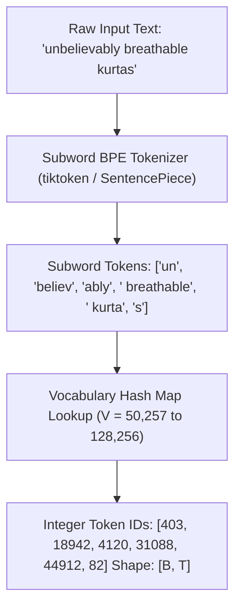

# Concept 01: Tokenized Text & Subword Tokenization (BPE)
### *Part of [Phase 1: Input Pipeline](file:///Users/damodhar/Documents/Workspace/Learnings/Vizuara%20-%20Minor%20in%20AI/01-class-notes/09-transformers-architecture/01-phase-1-input-pipeline.md)*

---

## 🧠 1. Class X Intuition: Syllables vs. Whole Dictionaries

How should a computer chop a sentence like **`"unbelievably breathable kurtas"`** into pieces before converting it into numbers?
1. **Word-Level Splitting (The Old Way — Lectures 01–08)**:
   - Every unique word gets an ID (`"kurta" -> 3`, `"kurtas" -> 9912`).
   - **Fatal Flaw**: If a shopper types a new compound word or typo (`"ultrabreathable"`), it isn't in the dictionary and collapses into `<unk>` (Unknown Token—total amnesia!).
2. **Character-Level Splitting (`['u','n','b','e',...]`)**:
   - Vocabulary is tiny ($V \approx 100$ characters), so zero `<unk>` words!
   - **Fatal Flaw**: Single letters like `'k'` have zero semantic meaning on their own, and a 500-word essay explodes into $3,000+$ tiny steps!
3. **The Goldilocks Solution — Subword Tokenization (Byte-Pair Encoding / BPE)**:
   - Just like a 10th-grade student breaks unfamiliar words into familiar **root syllables** (`"un" + "believ" + "ably"` and `"kurta" + "s"`), **BPE** keeps common words whole (`"linen"`) and splits rare words into meaningful roots and suffixes!

---

## ⚙️ 2. Staff Backend Architect's Lens

- **BPE Merge Table $\longleftrightarrow$ LZ77 / Huffman Dictionary Compression**: Iteratively merges the most frequent adjacent byte/character pairs $(\text{pair}_a, \text{pair}_b) \to \text{new\_token}$ until reaching vocabulary budget $V$.
- **Trade-off on GPU Memory & Latency**:
  - Smaller $V$ ($32\text{K}$) $\implies$ Smaller embedding table $\mathbf{E} \in \mathbb{R}^{V \times d_{\text{model}}}$, but longer sequence length $T$ (higher $\mathcal{O}(T^2)$ attention cost!).
  - Larger $V$ ($100\text{K–}256\text{K}$ in GPT-4o / Gemma / LLaMA-3) $\implies$ Compresses text into $30\%$ fewer tokens $T$, directly accelerating inference TPS!

---

## 🔬 3. How the BPE Algorithm Works Step-by-Step

Suppose our training corpus contains retail product titles: `{"low": 5, "lower": 2, "newest": 6, "widest": 3}`:
1. **Initialize Base Vocabulary** with individual characters + end-of-word marker `</w>`:
   - `l o w </w>` (5), `l o w e r </w>` (2), `n e w e s t </w>` (6), `w i d e s t </w>` (3)
2. **Count Adjacent Symbol Pairs**:
   - Pair `('e', 's')` appears $6 + 3 = 9$ times $\implies$ **Merge 1**: `'e' + 's' -> 'es'`
   - Pair `('es', 't')` appears $6 + 3 = 9$ times $\implies$ **Merge 2**: `'es' + 't' -> 'est'`
   - Pair `('est', '</w>')` appears $9$ times $\implies$ **Merge 3**: `'est</w>'` (discovers the superlative suffix!)
   - Pair `('l', 'o')` appears $5 + 2 = 7$ times $\implies$ **Merge 4**: `'lo'` $\to$ `'low'` (discovers the rootstem!)
3. **Result**: When an unseen word **`"lowest"`** arrives at inference time, BPE splits it cleanly into known tokens **`["low", "est</w>"]`** with zero `<unk>` loss!

---

## ➡️ Next Concept
Proceed to **[02-token-embeddings-and-word2vec.md](file:///Users/damodhar/Documents/Workspace/Learnings/Vizuara%20-%20Minor%20in%20AI/01-class-notes/09-transformers-architecture/concepts/02-token-embeddings-and-word2vec.md)** to see how each integer Token ID is converted into a high-dimensional semantic vector!
