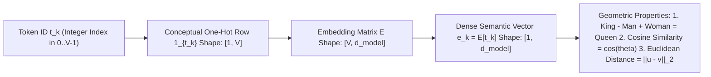

# Concept 02: Token Embeddings & Vector Space Geometry (`Word2Vec` to Transformers)
### *Part of [Phase 1: Input Pipeline](file:///Users/damodhar/Documents/Workspace/Learnings/Vizuara%20-%20Minor%20in%20AI/01-class-notes/09-transformers-architecture/01-phase-1-input-pipeline.md) | Companion to [`Live_Vector_embedding.ipynb`](file:///Users/damodhar/Documents/Workspace/Learnings/Vizuara%20-%20Minor%20in%20AI/01-class-notes/09-transformers-architecture/Live_Vector_embedding.ipynb)*

---

## 🧠 1. Class X Intuition: Turning Dictionary Barcodes into Meaning Coordinates

Why can't we feed raw Token IDs like `cat = 412`, `dog = 8901`, `computer = 413` directly into a neural network?
- Because in raw numbers, `412` (`cat`) is right next to `413` (`computer`), and far away from `8901` (`dog`)!
- A **Token Embedding** solves this by giving every word a **GPS coordinate in a $d_{\text{model}}$-dimensional "Map of Meaning"** (300 dimensions in Google News Word2Vec; 768 to 4,096+ dimensions in modern Transformers):
  - Words with similar meanings (`"cat"` and `"dog"`, or `"uncle"` and `"aunt"`) live in the **exact same neighborhood**.
  - Unrelated words (`"semiconductor"` and `"earthworm"`, or `"paper"` and `"water"`) live on **opposite continents**!



---

## 🔬 2. Deep-Dive Into Every Experiment in [`Live_Vector_embedding.ipynb`](file:///Users/damodhar/Documents/Workspace/Learnings/Vizuara%20-%20Minor%20in%20AI/01-class-notes/09-transformers-architecture/Live_Vector_embedding.ipynb)

### Experiment 1: 300-Dimensional Dense Representation ([`Cells 2–5`](file:///Users/damodhar/Documents/Workspace/Learnings/Vizuara%20-%20Minor%20in%20AI/01-class-notes/09-transformers-architecture/Live_Vector_embedding.ipynb#L139-L256))
```python
model = api.load("word2vec-google-news-300")
print(word_vectors['cat'].shape)   # Output: (300,)
```
Each word in the 3-million-word Google News vocabulary is a vector $\mathbf{v} \in \mathbb{R}^{300}$ trained via the **Distributional Hypothesis** (*"You shall know a word by the company it keeps"*—words appearing in similar surrounding contexts get pulled together by gradient descent).

---

### Experiment 2: Vector Arithmetic & Linear Analogies ([`Cell 8`](file:///Users/damodhar/Documents/Workspace/Learnings/Vizuara%20-%20Minor%20in%20AI/01-class-notes/09-transformers-architecture/Live_Vector_embedding.ipynb#L313))
```python
word_vectors.most_similar(positive=['king', 'woman'], negative=['man'], topn=10)
# Output: [('queen', 0.7118), ('monarch', 0.6190), ('princess', 0.5902), ...]
```
**Mathematical Proof Using a 4D Subspace Projection**:
Suppose 3 of the 300 dimensions represent `[Royalty, Femininity, Adult-Maturity]`:
$$\mathbf{v}_{\text{king}} = \begin{bmatrix} +0.95 \\ -0.80 \\ +0.70 \end{bmatrix}, \quad \mathbf{v}_{\text{man}} = \begin{bmatrix} +0.05 \\ -0.85 \\ +0.65 \end{bmatrix}, \quad \mathbf{v}_{\text{woman}} = \begin{bmatrix} +0.05 \\ +0.85 \\ +0.65 \end{bmatrix}$$
Perform element-wise vector subtraction and addition:
$$\mathbf{v}_{\text{king}} - \mathbf{v}_{\text{man}} + \mathbf{v}_{\text{woman}} = \begin{bmatrix} 0.95 - 0.05 + 0.05 \\ -0.80 - (-0.85) + 0.85 \\ 0.70 - 0.65 + 0.65 \end{bmatrix} = \begin{bmatrix} +0.95 & (\text{High Royalty}) \\ +0.90 & (\text{High Femininity}) \\ +0.70 & (\text{Adult Maturity}) \end{bmatrix} \approx \mathbf{v}_{\text{queen}}$$

---

### Experiment 3: Cosine Similarity vs. Euclidean Distance ([`Cells 10 & 14`](file:///Users/damodhar/Documents/Workspace/Learnings/Vizuara%20-%20Minor%20in%20AI/01-class-notes/09-transformers-architecture/Live_Vector_embedding.ipynb#L351-L448))

| Metric | Mathematical Formula | Notebook Results (`Cells 10 & 14`) | When to Use |
| :--- | :--- | :--- | :--- |
| **Cosine Similarity** | $\frac{\mathbf{u} \cdot \mathbf{v}}{\lVert\mathbf{u}\rVert_2 \lVert\mathbf{v}\rVert_2} \in [-1, +1]$ | `('boy','girl') = 0.854`, `('woman','man') = 0.766`, `('paper','water') = 0.114` | Measures **directional alignment** independent of word frequency/magnitude. |
| **Euclidean L2 Distance** | $\lVert\mathbf{u} - \mathbf{v}\rVert_2 = \sqrt{\sum (u_i - v_i)^2}$ | `||'man'-'woman'|| = 1.73`, `||'nephew'-'niece'|| = 1.96`, `||'semiconductor'-'earthworm'|| = 5.67` | Measures **absolute geometric separation** between points in $\mathbb{R}^d$. |

> [!NOTE]
> **How Cosine Similarity Connects Directly to Euclidean Distance**:
> For unit-normalized vectors ($\lVert\mathbf{u}\rVert_2 = \lVert\mathbf{v}\rVert_2 = 1$), expand the squared Euclidean distance:
> $$\lVert\mathbf{u} - \mathbf{v}\rVert_2^2 = \lVert\mathbf{u}\rVert_2^2 + \lVert\mathbf{v}\rVert_2^2 - 2(\mathbf{u} \cdot \mathbf{v}) = 2\big(1 - \cos(\theta)\big)$$
> Higher cosine similarity ($\cos\theta \to 1$) directly implies smaller Euclidean distance ($\lVert\mathbf{u}-\mathbf{v}\rVert_2 \to 0$)!

---

## 🚀 3. How Transformer Token Embeddings Evolve Beyond Static Word2Vec

In `Word2Vec`, the word **`"bank"`** has **one static vector** forever—whether in *"ICICI bank transfer"* or *"river bank fishing"*.
In a **Transformer**:
1. **Phase 1 (`Token Embedding`)** looks up a static starting vector $\mathbf{E}_{\text{tok}}[\text{"bank"}] \in \mathbb{R}^{d_{\text{model}}}$.
2. **Phase 2 (`Multi-Head Attention` + `FFN`)** dynamically bends and updates that vector based on surrounding words in the sentence, transforming a static dictionary entry into a **context-sensitive contextual embedding**!

---

## ➡️ Next Concept
Proceed to **[03-positional-embeddings.md](file:///Users/damodhar/Documents/Workspace/Learnings/Vizuara%20-%20Minor%20in%20AI/01-class-notes/09-transformers-architecture/concepts/03-positional-embeddings.md)** to see how word order is injected into these embeddings!
