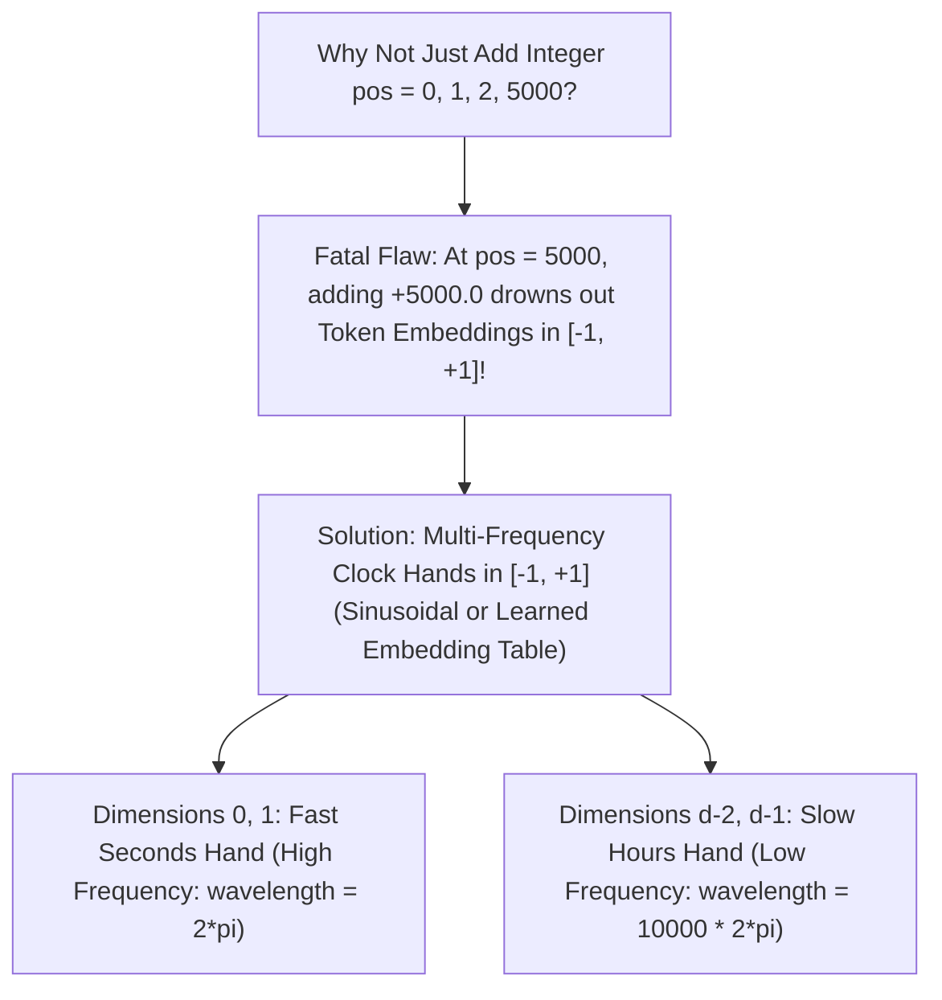

# Concept 03: Positional Embeddings (Sinusoidal, Learned & RoPE)
### *Part of [Phase 1: Input Pipeline](file:///Users/damodhar/Documents/Workspace/Learnings/Vizuara%20-%20Minor%20in%20AI/01-class-notes/09-transformers-architecture/01-phase-1-input-pipeline.md)*

---

## 🧠 1. Class X Intuition: Why Parallel Brains Need Seat Numbers

In Lectures 01–06 (**RNN & LSTM**), we fed words into the network one after another ($t=1, t=2, t=3$), so word order came for free—at the cost of **blocking GPU parallelism**.
In a **Transformer**, we throw out recurrence and feed **all $T$ words simultaneously in parallel**!
- **The Problem**: Without recurrence, Multi-Head Attention is a **symmetric set operation** (permutation-equivariant). Without position tags, the sentences:
  - **`"Customer paid merchant ₹50,000"`** and
  - **`"Merchant paid customer ₹50,000"`**
  contain the **exact same set of Token Embeddings**!
- **The Fix (`Positional Embedding`)**: Before entering Phase 2, we add a unique **Position Fingerprint vector $\mathbf{E}_{\text{pos}}[\text{pos}] \in \mathbb{R}^{d_{\text{model}}}$** to each token's embedding $\mathbf{E}_{\text{tok}}[t_{\text{pos}}]$ so the network knows both **WHAT** the word is and **WHERE** it sits!

---

## 🔬 2. First-Principles Mathematics: The 3 Generations of Positional Encoding

### 1. Sinusoidal Positional Encoding (Vaswani et al., 2017)
For token position $\text{pos} \in \{0, 1, \dots, T-1\}$ and dimension index $i \in \{0, 1, \dots, d_{\text{model}}/2 - 1\}$:
$$PE_{(\text{pos}, \, 2i)} = \sin\!\left(\frac{\text{pos}}{10000^{2i / d_{\text{model}}}}\right), \qquad PE_{(\text{pos}, \, 2i+1)} = \cos\!\left(\frac{\text{pos}}{10000^{2i / d_{\text{model}}}}\right)$$

#### Why Does This Formula Work So Well?
1. **Strictly Bounded in $[-1, +1]$**: Whether $\text{pos} = 2$ or $\text{pos} = 100,000$, every entry stays inside $[-1, +1]$, never overwhelming the semantic token embedding $\mathbf{E}_{\text{tok}}$!
2. **Relative Distance via Linear Rotation Matrix**:
   Let $\omega_i = 1 / 10000^{2i / d_{\text{model}}}$. For any relative offset $k$ tokens ahead ($\text{pos} + k$):
   $$\begin{bmatrix} \sin(\omega_i(\text{pos}+k)) \\ \cos(\omega_i(\text{pos}+k)) \end{bmatrix} = \underbrace{\begin{bmatrix} \cos(\omega_i k) & \sin(\omega_i k) \\ -\sin(\omega_i k) & \cos(\omega_i k) \end{bmatrix}}_{\text{Depends ONLY on offset } k!} \begin{bmatrix} \sin(\omega_i\,\text{pos}) \\ \cos(\omega_i\,\text{pos}) \end{bmatrix}$$
   Because the $2 \times 2$ rotation matrix depends **only on the relative hop distance $k$** (and not absolute position $\text{pos}$), an Attention Head can effortlessly learn to attend to *"the adjective 1 slot before me"* ($k = -1$) anywhere in a paragraph!

---

### 2. Learned Positional Embeddings (GPT-2, GPT-3, BERT)
Instead of fixed $\sin/\cos$ waves, create a second trainable lookup table $\mathbf{W}_{\text{pos}} \in \mathbb{R}^{T_{\max} \times d_{\text{model}}}$ (e.g., $T_{\max} = 1024$ in GPT-2) and let gradient descent learn the optimal vector for each seat index $0 \dots T_{\max}-1$:
$$\mathbf{X}^{(0)} = \mathbf{E}_{\text{tok}}[\mathbf{t}] + \mathbf{W}_{\text{pos}}[0 : T] \in \mathbb{R}^{B \times T \times d_{\text{model}}}$$

---

### 3. Modern Frontier: Rotary Position Embeddings (`RoPE` — LLaMA, Gemini, Mistral, Qwen)
Instead of *adding* $\mathbf{E}_{\text{pos}}$ at Phase 1, **RoPE** directly rotates the Query ($\mathbf{q}_m$) and Key ($\mathbf{k}_n$) vectors inside Phase 2 Multi-Head Attention by angles $m\theta_i$ and $n\theta_i$ so their dot product $\mathbf{q}_m^T \mathbf{k}_n$ depends **strictly on relative distance $(m - n)$**, enabling $128\text{K–}1\text{M+}$ context windows!

---

## ➡️ Next Concept
Proceed to **[04-layer-normalization.md](file:///Users/damodhar/Documents/Workspace/Learnings/Vizuara%20-%20Minor%20in%20AI/01-class-notes/09-transformers-architecture/concepts/04-layer-normalization.md)** to enter **Phase 2: The Processor Block**!
