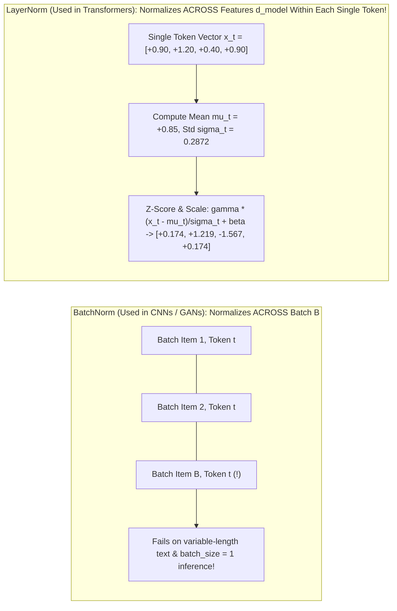

# Concept 04: Layer Normalization (`LayerNorm 1`, `LayerNorm 2` & `Final LayerNorm`)
### *Part of [Phase 2: Processor Block](file:///Users/damodhar/Documents/Workspace/Learnings/Vizuara%20-%20Minor%20in%20AI/01-class-notes/09-transformers-architecture/02-phase-2-processor-transformer-block.md) & [Phase 3: Output Head](file:///Users/damodhar/Documents/Workspace/Learnings/Vizuara%20-%20Minor%20in%20AI/01-class-notes/09-transformers-architecture/03-phase-3-output-head.md)*

---

## 🧠 1. Class X Intuition: Why `BatchNorm` Works for Images (GANs) But Breaks on Sentences (Transformers)

In our GAN lectures, we used **Batch Normalization (`BatchNorm`)** to keep numbers stable. Why do Transformers replace `BatchNorm` with **Layer Normalization (`LayerNorm`)**?
- Imagine a classroom of $B = 32$ students writing essays of **different lengths**: Student 1 writes a 50-word essay, while Student 2 writes a 3-word sentence (`"I am happy <pad> <pad> ..."`).
- **`BatchNorm` averages ACROSS students at Word Slot #10**: At Word Slot #10, 30 students have `<pad>` zeros while 2 students have real words—averaging across the batch mixes real words with empty padding and changes behavior depending on batch size!
- **`LayerNorm` averages INSIDE each single token's own $d_{\text{model}}$ features**: Every token (`"kurta"`) normalizes its own 4D (or 768D) feature card to **Mean $= 0$, Variance $= 1$** completely independently of other words and other batch items!

---

## 🔬 2. First-Principles Mathematical Formulation

Given a single token's representation $\mathbf{x}_t \in \mathbb{R}^{d_{\text{model}}}$ at position $t$:

1. **Compute Per-Token Feature Mean ($\mu_t$) and Variance ($\sigma_t^2$)**:
   $$\mu_t = \frac{1}{d_{\text{model}}}\sum_{i=1}^{d_{\text{model}}} x_{t,i}, \qquad \sigma_t^2 = \frac{1}{d_{\text{model}}}\sum_{i=1}^{d_{\text{model}}} (x_{t,i} - \mu_t)^2$$
2. **Normalize to Zero Mean, Unit Variance ($\hat{\mathbf{x}}_t$)**:
   $$\hat{x}_{t,i} = \frac{x_{t,i} - \mu_t}{\sqrt{\sigma_t^2 + \epsilon}} \qquad (\text{where } \epsilon = 10^{-5} \text{ prevents division by zero})$$
3. **Apply Learnable Gain ($\boldsymbol{\gamma} \in \mathbb{R}^{d_{\text{model}}}$) and Shift ($\boldsymbol{\beta} \in \mathbb{R}^{d_{\text{model}}}$)**:
   $$\text{LN}(\mathbf{x}_t) = \boldsymbol{\gamma} \odot \hat{\mathbf{x}}_t + \boldsymbol{\beta}$$

### Concrete Numerical Verification (Row 0 `"myntra"` from Phase 1: $\mathbf{x}_0^{(0)} = [0.90, 1.20, 0.40, 0.90]$)
- $\mu_0 = \frac{0.90 + 1.20 + 0.40 + 0.90}{4} = \frac{3.40}{4} = \mathbf{0.8500}$
- $\sigma_0^2 = \frac{(0.05)^2 + (0.35)^2 + (-0.45)^2 + (0.05)^2}{4} = \frac{0.0025 + 0.1225 + 0.2025 + 0.0025}{4} = \mathbf{0.0825}$
- $\sqrt{\sigma_0^2 + 10^{-5}} = \sqrt{0.08251} = \mathbf{0.287246}$
- With initial $\boldsymbol{\gamma} = \mathbf{1}, \boldsymbol{\beta} = \mathbf{0}$:
  $$\text{LN}_1(\mathbf{x}_0^{(0)}) = \left[\frac{0.05}{0.287246}, \; \frac{0.35}{0.287246}, \; \frac{-0.45}{0.287246}, \; \frac{0.05}{0.287246}\right] = \mathbf{[+0.1741, \; +1.2185, \; -1.5666, \; +0.1741]}$$
  *(Notice the sum is $0.0000$ and variance is $1.0000$—matching our Python trace to 4 decimal places!)*

---

## 🏛️ 3. Where Do the 3 LayerNorms Sit? (Pre-LN Architecture)

In modern Transformers (GPT-2, GPT-3, LLaMA, PaLM), LayerNorm is placed **before** each sub-layer (**Pre-LN**) so the main Residual Stream stays a pure, unobstructed addition highway:
1. **`LayerNorm 1` (Phase 2, Pre-Attention)**: Normalizes inputs right before `Q, K, V` projections so dot products $\mathbf{Q}\mathbf{K}^T$ don't explode and saturate Softmax.
2. **`LayerNorm 2` (Phase 2, Pre-FFN)**: Normalizes the post-attention state right before the $4 d_{\text{model}}$ FFN expansion.
3. **`Final LayerNorm` (Phase 3, Pre-Output Layer)**: Normalizes the final residual stream $\mathbf{X}^{(N)}$ right before projecting to vocabulary logits!

---

## ➡️ Next Concept
Proceed to **[05-multi-head-attention.md](file:///Users/damodhar/Documents/Workspace/Learnings/Vizuara%20-%20Minor%20in%20AI/01-class-notes/09-transformers-architecture/concepts/05-multi-head-attention.md)** to see how `LayerNorm 1`'s output is processed by **Multi-Head Self-Attention**!
