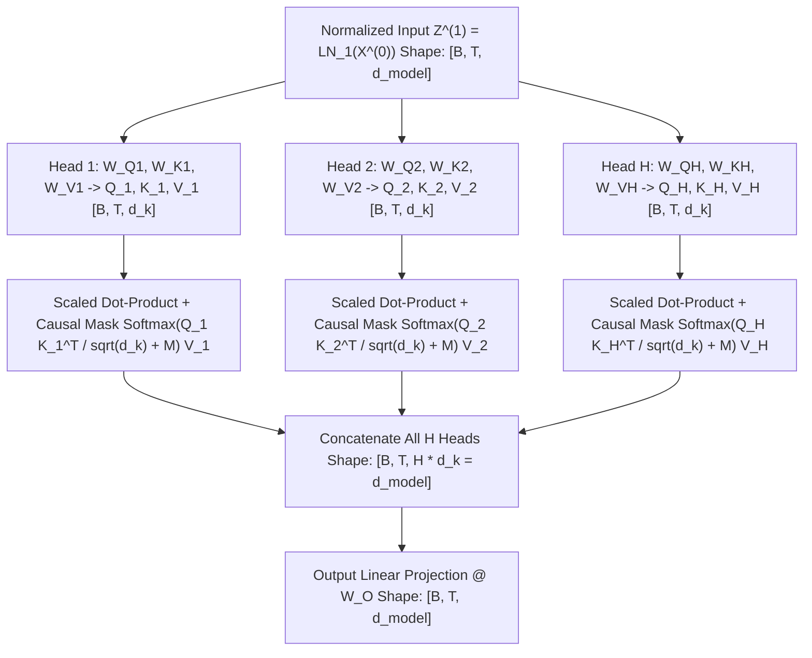

# Concept 05: Multi-Head Causal Self-Attention (`Q, K, V`)
### *Part of [Phase 2: Processor Block](file:///Users/damodhar/Documents/Workspace/Learnings/Vizuara%20-%20Minor%20in%20AI/01-class-notes/09-transformers-architecture/02-phase-2-processor-transformer-block.md)*

---

## 🧠 1. Class X Intuition: Why One Spotlight Isn't Enough ("The Cocktail Party Effect")

In Lectures 07–08 (**Bahdanau Attention**), the Decoder had **one single spotlight** scanning back across the Encoder.
Now imagine reading:
> **`"The customer returned the linen kurta to Myntra because it was torn."`**
When your brain reads the word **`"it"`**, what does `"it"` need to look back at?
- **Grammar Lens (Head 1 — Coreference)**: `"it"` must lock onto **`"kurta"`** (what was torn?).
- **Action Lens (Head 2 — Cause & Effect)**: `"it"` must link **`"returned"`** $\longleftrightarrow$ **`"torn"`** (why was it returned?).
- **Entity Lens (Head 3 — Merchant Context)**: `"it"` tracks **`"Myntra"`** vs. **`"customer"`**.

Instead of using one giant $d_{\text{model}}$ spotlight that blurs all three questions together, **Multi-Head Attention** splits the $d_{\text{model}}$ vector into **$H$ smaller, independent specialist spotlights ($d_k = d_{\text{model}} / H$)** that run in parallel and combine their findings via $\mathbf{W}_O$!

---

## ⚙️ 2. Staff Backend Architect's Lens: `Query`, `Key`, `Value` as a Relational Join

Every single token position $t$ emits three distinct vectors from its normalized state $\mathbf{z}_t$:
- **Query ($\mathbf{q}_t = \mathbf{z}_t \mathbf{W}_Q$)**: The **Search Filter / `WHERE` Clause** (*"I am the noun `'kurta'`—who ahead of me describes my fabric or brand?"*).
- **Key ($\mathbf{k}_j = \mathbf{z}_j \mathbf{W}_K$)**: The **Indexed Metadata Tag** advertised by token $j$ (*"I am `'linen'`—an adjective describing breathable summer fabric!"*).
- **Value ($\mathbf{v}_j = \mathbf{z}_j \mathbf{W}_V$)**: The **Actual Payload DTO** delivered by token $j$ when its Key matches your Query!

---

## 🔬 3. First-Principles Mathematical Rigor

### 1. Why Divide by $\sqrt{d_k}$? (Variance Preservation Proof)
Suppose components of $\mathbf{q} \in \mathbb{R}^{d_k}$ and $\mathbf{k} \in \mathbb{R}^{d_k}$ are independent random variables with mean $0$ and variance $1$ (guaranteed by `LayerNorm 1`!). Then each product $q_i k_i$ has mean $0$ and variance $1$. Summing over $d_k$ dimensions:
$$\mathbb{E}[\mathbf{q} \cdot \mathbf{k}] = 0, \qquad \text{Var}(\mathbf{q} \cdot \mathbf{k}) = \sum_{i=1}^{d_k} \text{Var}(q_i k_i) = \mathbf{d_k}, \qquad \text{Std}(\mathbf{q} \cdot \mathbf{k}) = \mathbf{\sqrt{d_k}}$$
- If $d_k = 64$, raw dot products have standard deviation $\sqrt{64} = 8$, producing extreme values like $+24$ and $-24$.
- Inside $\text{Softmax}$, $e^{24} \approx 2.6 \times 10^{10}$ pushes probabilities to **`1.0000` and `0.0000`**, where the Softmax Jacobian $\alpha_j(1 - \alpha_j) \to \mathbf{0}$ (**Vanishing Gradients!**).
- Dividing by $\sqrt{d_k}$ restores $\text{Var}\!\left(\frac{\mathbf{q}\cdot\mathbf{k}}{\sqrt{d_k}}\right) = \frac{d_k}{(\sqrt{d_k})^2} = \mathbf{1.0}$ regardless of head dimension!

### 2. Causal Masking ($\mathbf{M}_{\text{causal}}$ — Preventing Future Time-Travel)
During next-word training, token $i$ (`"linen"` at $i=1$) must **never** cheat by looking ahead at future token $j > i$ (`"kurta"` at $j=2$). We add a lower-triangular mask $\mathbf{M}$ before Softmax:
$$\mathbf{M} = \begin{bmatrix} 0 & -\infty & -\infty \\ 0 & 0 & -\infty \\ 0 & 0 & 0 \end{bmatrix} \implies \exp(-\infty) = \mathbf{0.0000}$$

Look at our verified Head 1 Causal Attention Matrix $\mathbf{A}_1$ from [`transformer_three_phases_from_scratch.py`](file:///Users/damodhar/Documents/Workspace/Learnings/Vizuara%20-%20Minor%20in%20AI/01-class-notes/09-transformers-architecture/transformer_three_phases_from_scratch.py):
$$\mathbf{A}_1 = \begin{bmatrix} 1.0000 & 0.0000 & 0.0000 \\ 0.5137 & 0.4863 & 0.0000 \\ 0.1121 & 0.1196 & 0.7683 \end{bmatrix} \begin{array}{l} \leftarrow \text{t=0 ('myntra') sees ONLY 'myntra'} \\ \leftarrow \text{t=1 ('linen') attends 51.4\% to 'myntra', 48.6\% to 'linen'} \\ \leftarrow \text{t=2 ('kurta') attends across all 3 tokens!} \end{array}$$

---

## ➡️ Next Concept
Proceed to **[06-feed-forward-network.md](file:///Users/damodhar/Documents/Workspace/Learnings/Vizuara%20-%20Minor%20in%20AI/01-class-notes/09-transformers-architecture/concepts/06-feed-forward-network.md)** to see how each token processes its attended context inside the **Position-Wise Feed-Forward Network**!
