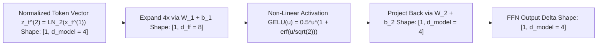
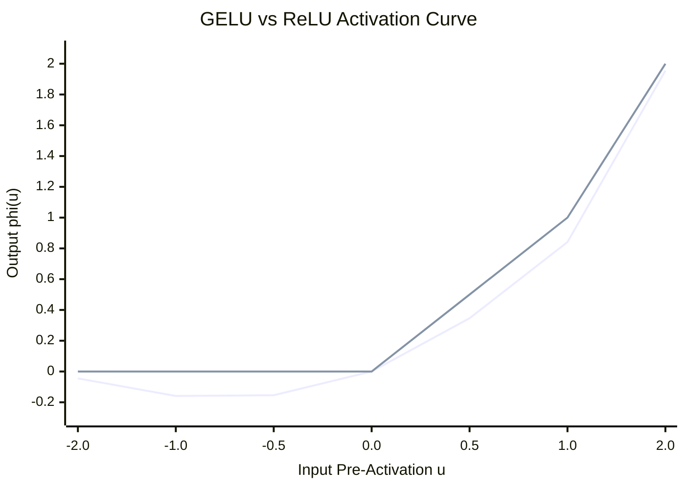

# Concept 06: Position-Wise Feed-Forward Network (`FFN` & `GELU`)
### *Part of [Phase 2: Processor Block](file:///Users/damodhar/Documents/Workspace/Learnings/Vizuara%20-%20Minor%20in%20AI/01-class-notes/09-transformers-architecture/02-phase-2-processor-transformer-block.md)*

---

## 🧠 1. Class X Intuition: The Solo Study Cubicle & Encyclopedic Memory Bank

If **Multi-Head Attention** is where words **talk to each other** to gather context (*`"kurta"` discovers it is paired with `"myntra"` and `"linen"`*), what does the **Feed-Forward Network (`FFN`)** do?
- After gathering notes from the roundtable, each word walks into its own **private study cubicle** (`Position-Wise`: zero cross-talk between positions!).
- Inside the cubicle, it spreads its $d_{\text{model}}$ vector across a **4x wider desk** ($d_{\text{ff}} = 4 \times d_{\text{model}}$, e.g., $768 \to 3,072$ in GPT-2, or $4 \to 8$ in our trace), passes through a smooth non-linear gate (`GELU`), and compresses back down to $d_{\text{model}}$.
- **Why does the FFN hold $\sim 66\%$ of all parameters in a Transformer?** Because the $4 d_{\text{model}}$ hidden neurons act as an **Encyclopedic Fact Bank**: when the input vector matches a pattern like `["Myntra" + "linen" + "kurta"]`, specific FFN neurons fire and inject stored factual associations (*"breathable summer ethnicwear, pairs with sandals, festive occasion"*) back into the token's vector!

---

## 🔬 2. First-Principles Mathematics & Activation Physics

For each token position $t \in \{0, \dots, T-1\}$ identically and independently:
$$\text{FFN}(\mathbf{z}_t^{(2)}) = \phi\!\left(\mathbf{z}_t^{(2)} \mathbf{W}_1 + \mathbf{b}_1\right)\mathbf{W}_2 + \mathbf{b}_2$$
where:
- $\mathbf{W}_1 \in \mathbb{R}^{d_{\text{model}} \times d_{\text{ff}}}$ and $\mathbf{b}_1 \in \mathbb{R}^{d_{\text{ff}}}$ (Expansion layer, $d_{\text{ff}} = 4 d_{\text{model}}$)
- $\mathbf{W}_2 \in \mathbb{R}^{d_{\text{ff}} \times d_{\text{model}}}$ and $\mathbf{b}_2 \in \mathbb{R}^{d_{\text{model}}}$ (Contraction layer)

### Evolution of the Non-Linear Activation $\phi(u)$ Across Transformers

| Generation | Activation Function $\phi(u)$ | Mathematical Formula | Why It Evolved |
| :--- | :--- | :--- | :--- |
| **2017 Vaswani Transformer** | **`ReLU`** | $\max(0, u)$ | Fast, but hard corner at $u=0$ kills negative neurons permanently ("Dying ReLU"). |
| **GPT-2 / GPT-3 / BERT** | **`GELU` (Gaussian Error Linear Unit)** | $u \cdot \Phi(u) = \frac{1}{2}u\!\left(1 + \text{erf}\!\left(\frac{u}{\sqrt{2}}\right)\right)$ | Smooth probabilistic gate; allows small negative values (around $u \in [-1, 0]$) to pass with non-zero gradient! |
| **LLaMA-3 / PaLM / Gemini** | **`SwiGLU`** | $\big(\text{Swish}_1(\mathbf{z}\mathbf{W}_{\text{gate}}) \odot (\mathbf{z}\mathbf{W}_{\text{up}})\big)\mathbf{W}_{\text{down}}$ | Adds a learnable multiplicative gate (like an LSTM gate inside the FFN!), boosting perplexity per FLOP. |

*(Curved line dipping slightly negative at $u = -0.5$: **`GELU`** | Sharp cornered line flat at $0$ for $u < 0$: **`ReLU`**)*

---

## ➡️ Next Concept
Proceed to **[07-dropout-and-residual-connections.md](file:///Users/damodhar/Documents/Workspace/Learnings/Vizuara%20-%20Minor%20in%20AI/01-class-notes/09-transformers-architecture/concepts/07-dropout-and-residual-connections.md)** to see how **Dropout** and **Residual Connections** protect the 96-layer gradient highway!
