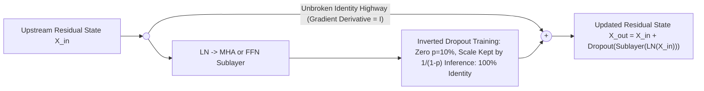

# Concept 07: Dropout & Residual Skip Connections
### *Part of [Phase 2: Processor Block](file:///Users/damodhar/Documents/Workspace/Learnings/Vizuara%20-%20Minor%20in%20AI/01-class-notes/09-transformers-architecture/02-phase-2-processor-transformer-block.md)*

---

## 🧠 1. Class X Intuition: The Unbroken Express Highway & Chaos Drills

In Phase 2, notice that both `Multi-Head Attention` and `Feed-Forward NN` end with the exact same pair of operations: **`Dropout`** followed by **`Residual Addition (+)`**:
$$\mathbf{X}_{\text{out}} = \mathbf{X}_{\text{in}} + \text{Dropout}\big(\text{Sublayer}(\text{LN}(\mathbf{X}_{\text{in}}))\big)$$

Why are these two simple steps the secret that allows GPT-4 and Gemini to stack **100+ Transformer Blocks** without collapsing?
1. **The Residual Express Highway (`+`)**:
   - Imagine playing "Chinese Whispers" (Telephone) across 100 rooms: if each room completely rewrites the message ($\mathbf{X}_{\text{out}} = f(\mathbf{X}_{\text{in}})$), by Room 100 the original sentence is garbled beyond recognition!
   - With **Residual Addition ($\mathbf{X}_{\text{in}} + f(\mathbf{X}_{\text{in}})$)**, the original message rides on an **unbroken express conveyor belt** straight from Phase 1 to Phase 3, and each room merely *pins a sticky-note adjustment* (`+ f(X)`) onto it!
2. **The Chaos Drill (`Dropout(p=0.1)`)**:
   - During training, **Dropout** randomly switches off $10\%$ of the sticky-note adjustments on every batch.
   - Just like a football coach randomly benching star players during practice so the whole team learns to pass the ball, Dropout forces knowledge to spread evenly across all neurons instead of memorizing training sentences!

---

## 🔬 2. First-Principles Calculus Proof: Why Residual Connections Kill Vanishing Gradients

Consider a deep Transformer with $L$ stacked layers. Without residual connections ($\mathbf{x}_{l} = f_l(\mathbf{x}_{l-1})$), backpropagation from loss $\mathcal{L}$ to Phase 1 input $\mathbf{x}_0$ multiplies $L$ Jacobians together:
$$\frac{\partial \mathcal{L}}{\partial \mathbf{x}_0} = \frac{\partial \mathcal{L}}{\partial \mathbf{x}_L} \prod_{l=1}^{L} \frac{\partial f_l(\mathbf{x}_{l-1})}{\partial \mathbf{x}_{l-1}} \xrightarrow{\text{if } \lVert\partial f_l\rVert < 1} \mathbf{0} \quad (\text{Vanishing Gradient!})$$

Now add the **Pre-LN Residual Connection**:
$$\mathbf{x}_l = \mathbf{x}_{l-1} + g_l(\mathbf{x}_{l-1}) \implies \mathbf{x}_L = \mathbf{x}_0 + \sum_{l=1}^{L} g_l(\mathbf{x}_{l-1})$$
Differentiate $\mathbf{x}_L$ with respect to the Phase 1 input $\mathbf{x}_0$:
$$\frac{\partial \mathcal{L}}{\partial \mathbf{x}_0} = \frac{\partial \mathcal{L}}{\partial \mathbf{x}_L} \cdot \left(\mathbf{I} + \frac{\partial}{\partial \mathbf{x}_0}\sum_{l=1}^{L} g_l(\mathbf{x}_{l-1})\right) = \underbrace{\frac{\partial \mathcal{L}}{\partial \mathbf{x}_L}}_{\text{Direct Unattenuated Signal!}} + \frac{\partial \mathcal{L}}{\partial \mathbf{x}_L}\frac{\partial}{\partial \mathbf{x}_0}\sum_{l=1}^{L} g_l(\mathbf{x}_{l-1})$$

> [!IMPORTANT]
> **The Identity Matrix $\mathbf{I}$ Guarantee**:
> Even if the sublayer derivatives $\frac{\partial g_l}{\partial \mathbf{x}}$ are tiny ($0.001$) across 100 layers, the **$\mathbf{I}$ term guarantees that the Phase 3 loss gradient $\frac{\partial \mathcal{L}}{\partial \mathbf{x}_L}$ teleports directly back to Phase 1 Embeddings with weight $1.0$!**

---

## ⚙️ 3. Inverted Dropout Mathematics (Training vs. Inference)

Let $p \in [0, 1)$ be the dropout probability (typically $p = 0.1$) and $m_i \sim \text{Bernoulli}(1 - p) \in \{0, 1\}$:
$$\text{Dropout}_{\text{train}}(u_i) = \frac{m_i}{1 - p} u_i, \qquad \text{Dropout}_{\text{inference}}(u_i) = u_i$$
**Why divide by $(1 - p)$ during training?** Because taking the expectation:
$$\mathbb{E}\big[\text{Dropout}_{\text{train}}(u_i)\big] = \frac{\mathbb{E}[m_i]}{1 - p} u_i = \frac{1 - p}{1 - p} u_i = u_i$$
This keeps the expected activation magnitude identical between training and production inference!

---

## ➡️ Next Concept
Proceed to **[08-final-layer-norm-and-output-layer.md](file:///Users/damodhar/Documents/Workspace/Learnings/Vizuara%20-%20Minor%20in%20AI/01-class-notes/09-transformers-architecture/concepts/08-final-layer-norm-and-output-layer.md)** to enter **Phase 3: Final LayerNorm & Output Layer**!
