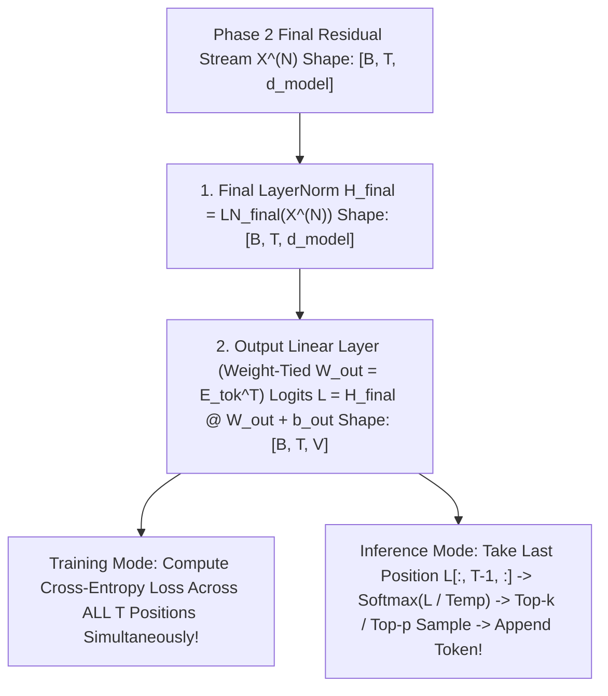

# Concept 08: Final LayerNorm, Linear Output Layer & Next-Token Sampling
### *Part of [Phase 3: Output Head](file:///Users/damodhar/Documents/Workspace/Learnings/Vizuara%20-%20Minor%20in%20AI/01-class-notes/09-transformers-architecture/03-phase-3-output-head.md)*

---

## 🧠 1. Class X Intuition: From Brainwaves to the Spoken Word

Once the Transformer finishes $N$ layers of thinking in Phase 2, how does it turn a 4-dimensional (or 4,096-dimensional) thought vector into an actual English word from a 50,000-word dictionary?

1. **`Final LayerNorm` (The Calm Before Speaking)**:
   - After $2N$ residual additions (`+`), the numbers on the residual highway have drifted in scale. `Final LayerNorm` resets every token's vector to a clean **Mean $= 0$, Variance $= 1$** vector $\mathbf{H}_{\text{final}}$.
2. **`Output Linear Layer` (The Dictionary Voting Booth)**:
   - Multiply $\mathbf{H}_{\text{final}} \in \mathbb{R}^{T \times d_{\text{model}}}$ by the Output Matrix $\mathbf{W}_{\text{out}} \in \mathbb{R}^{d_{\text{model}} \times V}$.
   - Each column of $\mathbf{W}_{\text{out}}$ is a dictionary word's vector! Taking the dot product asks: *"Which word in the entire vocabulary points in the same semantic direction as my final thought?"*
3. **Temperature & Sampling (Choosing the Next Word)**:
   - Convert raw dot-product scores (**Logits**) into probabilities via **Softmax**, and pick the next word!

---

## 🔬 2. First-Principles Mathematics: Weight Tying, Temperature & Sampling

### 1. Weight Tying ($\mathbf{W}_{\text{out}} = \mathbf{E}_{\text{tok}}^T$)
In Phase 1, the Token Embedding matrix $\mathbf{E}_{\text{tok}} \in \mathbb{R}^{V \times d_{\text{model}}}$ maps Token IDs $\to$ Vectors.
In Phase 3, the Output Layer $\mathbf{W}_{\text{out}} \in \mathbb{R}^{d_{\text{model}} \times V}$ maps Vectors $\to$ Token Logits:
$$\mathbf{L}_t = \mathbf{h}_t^{\text{final}} \mathbf{E}_{\text{tok}}^T + \mathbf{b}_{\text{out}} \in \mathbb{R}^V$$
- **Geometric Insight**: The logit $L_{t, v} = \mathbf{h}_t^{\text{final}} \cdot \mathbf{e}_v + b_v$ is literally the **inner product similarity** between the Transformer's final contextual state $\mathbf{h}_t^{\text{final}}$ and candidate word $v$'s Phase 1 embedding $\mathbf{e}_v$!
- **Engineering Win**: In a model with $V = 128,000$ and $d_{\text{model}} = 4,096$, sharing $\mathbf{W}_{\text{out}} = \mathbf{E}_{\text{tok}}^T$ saves $128,000 \times 4,096 = \mathbf{524.3\text{ Million parameters}}$ ($\sim 1\text{ GB}$ of GPU VRAM)!

---

### 2. Temperature Scaling ($\tau$) & Decoding Strategies
Given logits $\mathbf{L}_{T-1} \in \mathbb{R}^V$ at the last sequence position, we divide by **Temperature $\tau > 0$** before Softmax:
$$P(w_v) = \frac{\exp(L_{T-1, v} / \tau)}{\sum_{u=0}^{V-1} \exp(L_{T-1, u} / \tau)}$$

| Decoding Strategy | Parameter Setting | Mathematical Behavior & Production Use Case |
| :--- | :--- | :--- |
| **Greedy (`argmax`)** | $\tau \to 0^+$ | Always picks $\arg\max_v L_v$ ($100\%$ deterministic); used for SQL/code generation & factual Q&A, but can get stuck in repetitive loops on long stories. |
| **Standard Softmax** | $\tau = 1.0$ | Samples proportionally to raw trained probabilities (`"is": 56.33%` in our trace). |
| **High Temperature** | $\tau > 1.0$ (e.g., $1.5$) | Flattens logit differences toward uniform distribution; boosts creative brainstorming at the risk of hallucinations. |
| **Top-$k$ Sampling** | Keep top $k$ logits (e.g., $k=50$) | Sets all logits outside the top $k$ to $-\infty$ before Softmax, amputating the long tail of nonsensical words. |
| **Top-$p$ (Nucleus)** | Cumulative prob $\sum P \ge p$ (e.g., $p=0.9$) | Dynamically keeps the smallest set of top words whose probabilities sum to $90\%$—narrow when confident, wide when uncertain! |

---

## 🔗 Back to Master Architecture
Return to **[README.md](file:///Users/damodhar/Documents/Workspace/Learnings/Vizuara%20-%20Minor%20in%20AI/01-class-notes/09-transformers-architecture/README.md)** to review the complete 3-Phase Transformer Architecture!
