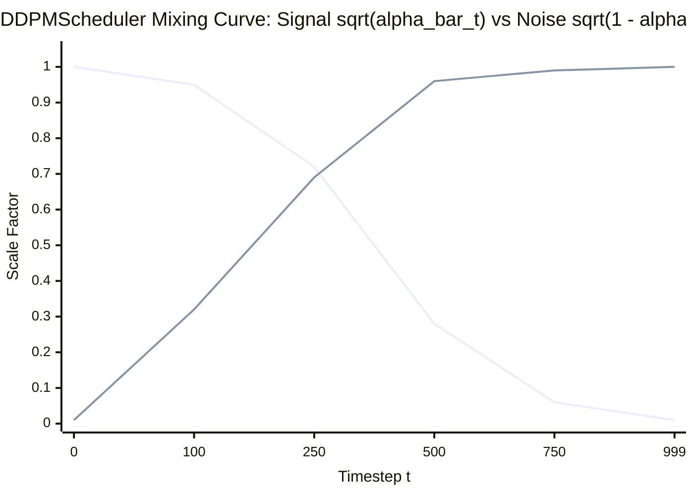
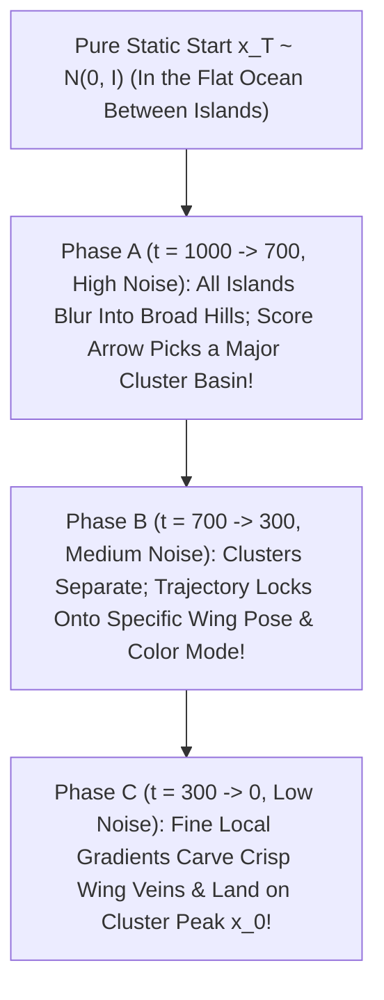
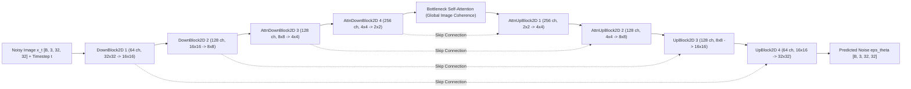
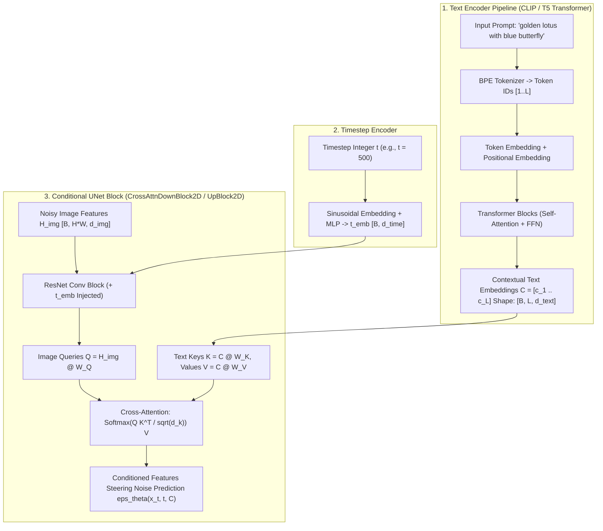
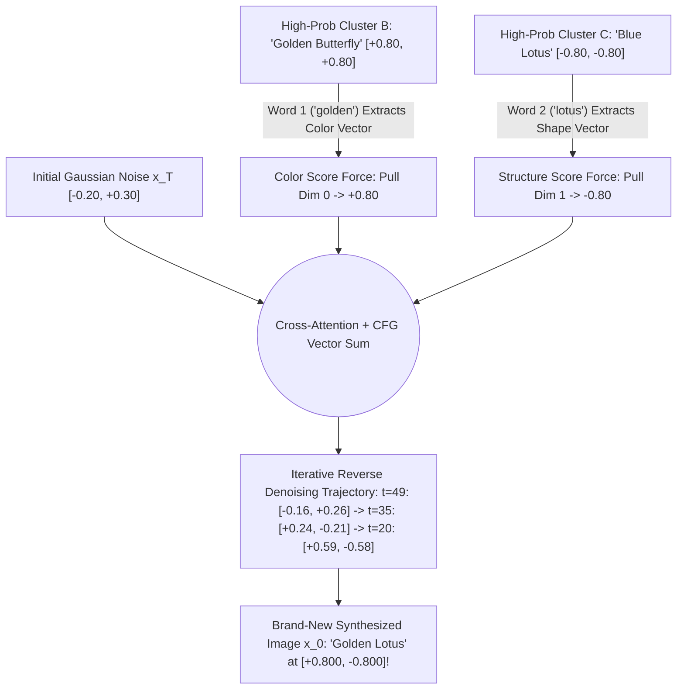

# Introduction to Diffusion Models (🤗 Diffusers) — High-Probability Clusters, Noise Tracing & Multi-Word Text Conditioning
### *From Butterfly DDPMs (`GenAI_Fundamentals_Introduction_to_diffusers.ipynb`) to Score Fields, Cross-Attention Conditioning & Synthesizing Brand-New Worlds*

---

## 📂 Deliverables in This Module

- **Original Lecture Notebook (100% Untouched)**: [`GenAI_Fundamentals_Introduction_to_diffusers.ipynb`](file:///Users/damodhar/Documents/Workspace/Learnings/Vizuara%20-%20Minor%20in%20AI/01-class-notes/10-introduction-to-diffusion-models/GenAI_Fundamentals_Introduction_to_diffusers.ipynb)
- **Dedicated Pixel-Space & Dimensional Projection Deep-Dive**: [`pixel_space_and_dimensional_projection.md`](file:///Users/damodhar/Documents/Workspace/Learnings/Vizuara%20-%20Minor%20in%20AI/01-class-notes/10-introduction-to-diffusion-models/pixel_space_and_dimensional_projection.md)
- **Dedicated KL-Divergence & Diffusion Loss (`F.mse_loss`) Deep-Dive**: [`kl_divergence_and_diffusion_loss.md`](file:///Users/damodhar/Documents/Workspace/Learnings/Vizuara%20-%20Minor%20in%20AI/01-class-notes/10-introduction-to-diffusion-models/kl_divergence_and_diffusion_loss.md)
- **Dedicated Learning Rate Schedules Guide (`Warmup`, `Cosine`, `Linear`, `Step`, `WSD`)**: [`learning_rate_schedules_in_diffusion_and_genai.md`](file:///Users/damodhar/Documents/Workspace/Learnings/Vizuara%20-%20Minor%20in%20AI/01-class-notes/10-introduction-to-diffusion-models/learning_rate_schedules_in_diffusion_and_genai.md)
- **Pure Python Diffusion & Cluster-Mixing Verifier**: [`diffusion_cluster_navigation_from_scratch.py`](file:///Users/damodhar/Documents/Workspace/Learnings/Vizuara%20-%20Minor%20in%20AI/01-class-notes/10-introduction-to-diffusion-models/diffusion_cluster_navigation_from_scratch.py)
- **Enterprise Java 17+ Implementation**: [`DiffusionClusterNavigator.java`](file:///Users/damodhar/Documents/Workspace/Learnings/Vizuara%20-%20Minor%20in%20AI/01-class-notes/10-introduction-to-diffusion-models/DiffusionClusterNavigator.java)

---

## 🧠 Tier 1: Class X Sensory Intuition — Islands of Meaning in an Ocean of TV Static

### 1. What Is a "High-Probability Distribution" ($p_{\text{data}}(\mathbf{x})$)?
Imagine every possible $32 \times 32$ color image from [`GenAI_Fundamentals_Introduction_to_diffusers.ipynb`](file:///Users/damodhar/Documents/Workspace/Learnings/Vizuara%20-%20Minor%20in%20AI/01-class-notes/10-introduction-to-diffusion-models/GenAI_Fundamentals_Introduction_to_diffusers.ipynb#L461) as a point on a giant map with $32 \times 32 \times 3 = 3,072$ coordinates:
- **$99.999999\%$ of the Map Is an Empty Ocean of Static ($p_{\text{data}}(\mathbf{x}) \approx 0$)**: If you pick 3,072 random numbers, you get meaningless colorful TV snow.
- **High-Probability Clusters Are "Mountain Islands of Meaning" ($p_{\text{data}}(\mathbf{x}) \gg 0$)**: Real photographs don't scatter randomly! All Monarch butterflies cluster tightly on **Island A**, swallowtail butterflies cluster on **Island B**, and lotus flowers cluster on **Island C**—because real objects obey strict rules of symmetry, smooth wing gradients, and natural colors.

### 2. Why Is Navigating to an Island So Hard—And How Does Diffusion Solve It?
- **The Desert Problem**: If you drop a blindfolded hiker in the middle of the flat ocean of static ($\mathbf{x}_T \sim \mathcal{N}(\mathbf{0}, \mathbf{I})$), the ground is completely flat ($p_{\text{data}} = 0$ everywhere around them!). They have **zero slope (gradient)** telling them which direction the Butterfly Island is!
- **The Diffusion Breakthrough (Spreading Scent Across the Ocean)**:
  1. **Forward Diffusion (Adding Noise, $t = 0 \to 1000$)**: We take real butterflies from the High-Probability Islands and gradually dissolve them into fog over 1,000 steps. Like dropping perfume on each island and letting the wind diffuse it across the entire ocean, **the islands blur outward until a smooth scent gradient fills every square inch of the map!**
  2. **Reverse Diffusion (Following the Scent Uphill, $t = 1000 \to 0$)**: Our neural network (`UNet2DModel`) learns one simple job at every fog level $t$: *"Look at the noisy image $\mathbf{x}_t$ and point out the exact noise $\boldsymbol{\epsilon}$ that was added!"* Subtracting that noise step-by-step is literally **walking uphill along the probability scent trail** until you stand on the peak of a High-Probability Butterfly Island ($\mathbf{x}_0$)!


---

## ⚙️ Tier 2: Staff Backend Architect's Rosetta Stone

| Diffusion / Diffusers Concept | Distributed Systems & Backend Engineering Equivalent |
| :--- | :--- |
| **High-Probability Clusters ($p_{\text{data}}(\mathbf{x})$)** | **Valid Schema Subspaces / Dense Consistent-Hashing Rings**: Tiny valid regions inside a massive byte-array space where payloads satisfy all domain invariants. |
| **`DDPMScheduler` (`alphas_cumprod` $\bar{\alpha}_t$)** | **Deterministic Signal-to-Noise Attenuation Curve**: Pre-computed lookup table controlling exact signal weight $\sqrt{\bar{\alpha}_t}$ vs. chaos weight $\sqrt{1-\bar{\alpha}_t}$ at step $t$. |
| **Predicted Noise $\boldsymbol{\epsilon}_\theta(\mathbf{x}_t, t)$ & Score $\nabla \ln p$** | **Distributed Vector Routing Compass**: At any corrupted state $\mathbf{x}_t$, outputs the exact delta vector pointing back toward the nearest valid state cluster. |
| **`UNet2DModel` (DownBlocks + Skip + UpBlocks)** | **Multi-Resolution MapReduce with Bypass Cache**: Downsamples $32 \to 16 \to 8 \to 4$ to compute global layout, then merges high-res skip caches during upsampling so pixel edges aren't lost. |
| **Text Embeddings + Cross-Attention Conditioning** | **Parameterized Multi-Predicate Search Query (`WHERE color='gold' AND type='lotus'`)**: Injects external query vectors into the UNet's spatial attention layers to steer trajectory routing. |
| **Compositional Multi-Word Cluster Mixing** | **Cross-Shard Materialized Intersection**: Combining orthogonal attribute vectors from separate training shards to synthesize a valid composite entity never stored in the DB! |

---

## 🔬 Tier 3 & 4: Deep-Dive Into All 5 Core Questions & First-Principles Mathematics

### Question 1: How Does Forward Diffusion Turn High-Probability Clusters into a Navigable Landscape?

In [`Cells 22–28`](file:///Users/damodhar/Documents/Workspace/Learnings/Vizuara%20-%20Minor%20in%20AI/01-class-notes/10-introduction-to-diffusion-models/GenAI_Fundamentals_Introduction_to_diffusers.ipynb#L563-L685) of the notebook, `DDPMScheduler(num_train_timesteps=1000)` defines a variance schedule $\beta_1, \beta_2, \dots, \beta_T \in (0.0001, 0.02)$.
At each single step $t$, we scale the previous image by $\sqrt{1 - \beta_t}$ and inject Gaussian noise $\sqrt{\beta_t}\boldsymbol{\epsilon}_t$:
$$q(\mathbf{x}_t \mid \mathbf{x}_{t-1}) = \mathcal{N}\!\left(\mathbf{x}_t; \sqrt{1 - \beta_t}\mathbf{x}_{t-1}, \, \beta_t \mathbf{I}\right)$$

#### The Closed-Form Teleportation Trick (`noise_scheduler.add_noise` in [`Cell 28`](file:///Users/damodhar/Documents/Workspace/Learnings/Vizuara%20-%20Minor%20in%20AI/01-class-notes/10-introduction-to-diffusion-models/GenAI_Fundamentals_Introduction_to_diffusers.ipynb#L683))
Because the sum of independent Gaussians is still a Gaussian, defining $\alpha_t = 1 - \beta_t$ and the cumulative product $\bar{\alpha}_t = \prod_{s=1}^{t} \alpha_s$ lets us jump **directly from clean image $\mathbf{x}_0$ to any noisy step $t \in [0, 999]$ in $O(1)$ time**:
$$\mathbf{x}_t = \underbrace{\sqrt{\bar{\alpha}_t}}_{\text{Signal Scale}} \mathbf{x}_0 + \underbrace{\sqrt{1 - \bar{\alpha}_t}}_{\text{Noise Scale}} \boldsymbol{\epsilon}, \qquad \boldsymbol{\epsilon} \sim \mathcal{N}(\mathbf{0}, \mathbf{I})$$

Look at how the Signal Scale $\sqrt{\bar{\alpha}_t}$ and Noise Scale $\sqrt{1 - \bar{\alpha}_t}$ cross over across the 1,000 timesteps (matching [`Cell 24`](file:///Users/damodhar/Documents/Workspace/Learnings/Vizuara%20-%20Minor%20in%20AI/01-class-notes/10-introduction-to-diffusion-models/GenAI_Fundamentals_Introduction_to_diffusers.ipynb#L618)):


*(Descending curve: **Clean Image Signal $\sqrt{\bar{\alpha}_t}$** | Ascending curve: **Gaussian Noise $\sqrt{1 - \bar{\alpha}_t}$**)*

---

### Question 2: Navigating the Path to High-Distribution Clusters (The Score Compass Proof!)

In [`Cell 40`](file:///Users/damodhar/Documents/Workspace/Learnings/Vizuara%20-%20Minor%20in%20AI/01-class-notes/10-introduction-to-diffusion-models/GenAI_Fundamentals_Introduction_to_diffusers.ipynb#L1211), the entire training loss of the diffusion model is just **one line of Mean Squared Error**:
```python
loss = F.mse_loss(noise_pred, noise)
```
**Why does predicting the noise $\boldsymbol{\epsilon}$ teach the model how to navigate to High-Probability Clusters?**
By **Tweedie's Formula**, the gradient of the log-probability density $\nabla_{\mathbf{x}_t} \ln q_t(\mathbf{x}_t)$ (called the **Score Function**—the vector arrow pointing steepest uphill toward the high-probability data clusters!) satisfies:
$$\nabla_{\mathbf{x}_t} \ln q_t(\mathbf{x}_t) = -\frac{\mathbf{x}_t - \sqrt{\bar{\alpha}_t}\,\mathbb{E}[\mathbf{x}_0 \mid \mathbf{x}_t]}{1 - \bar{\alpha}_t} = -\frac{\boldsymbol{\epsilon}_\theta(\mathbf{x}_t, t)}{\sqrt{1 - \bar{\alpha}_t}}$$

> [!IMPORTANT]
> **The Profound Geometric Insight**:
> The noise vector $\boldsymbol{\epsilon}_\theta(\mathbf{x}_t, t)$ predicted by the UNet is **literally the negative uphill compass arrow $-\sqrt{1 - \bar{\alpha}_t}\nabla_{\mathbf{x}_t} \ln q_t(\mathbf{x}_t)$**!
> - When the UNet says *"Here is the noise $\boldsymbol{\epsilon}_\theta$ that corrupted the image"*, subtracting $\boldsymbol{\epsilon}_\theta$ moves $\mathbf{x}_t$ **directly uphill into the high-probability cluster**!



---

### Question 3: Noise Tracing to the Final Image ([`Cell 33`](file:///Users/damodhar/Documents/Workspace/Learnings/Vizuara%20-%20Minor%20in%20AI/01-class-notes/10-introduction-to-diffusion-models/GenAI_Fundamentals_Introduction_to_diffusers.ipynb#L1043) `UNet2DModel` & [`Cell 60`](file:///Users/damodhar/Documents/Workspace/Learnings/Vizuara%20-%20Minor%20in%20AI/01-class-notes/10-introduction-to-diffusion-models/GenAI_Fundamentals_Introduction_to_diffusers.ipynb#L1574) Sampling Loop)

Look at the explicit reverse denoising loop in [`Cell 60`](file:///Users/damodhar/Documents/Workspace/Learnings/Vizuara%20-%20Minor%20in%20AI/01-class-notes/10-introduction-to-diffusion-models/GenAI_Fundamentals_Introduction_to_diffusers.ipynb#L1574-L1584):
```python
sample = torch.randn(8, 3, 32, 32).to(device)          # 1. Start from pure Gaussian noise x_1000
for i, t in enumerate(noise_scheduler.timesteps):      # 2. Count down t = 999, 998, ..., 0
    with torch.no_grad():
        residual = model(sample, t).sample             # 3. UNet predicts noise eps_theta(x_t, t)
    sample = noise_scheduler.step(residual, t, sample).prev_sample  # 4. Step uphill to x_{t-1}
```

#### Exact Equation Inside `noise_scheduler.step(residual, t, sample)`
At each step $t$, the scheduler computes the slightly cleaner image $\mathbf{x}_{t-1}$:
$$\mathbf{x}_{t-1} = \frac{1}{\sqrt{\alpha_t}}\left(\mathbf{x}_t - \frac{1 - \alpha_t}{\sqrt{1 - \bar{\alpha}_t}}\boldsymbol{\epsilon}_\theta(\mathbf{x}_t, t)\right) + \sigma_t \mathbf{z}, \qquad \mathbf{z} \sim \mathcal{N}(\mathbf{0}, \mathbf{I}) \text{ for } t > 0$$
*(Why add a tiny fresh random nudge $\sigma_t \mathbf{z}$ when $t > 0$? Just like simulated annealing in physics, a tiny random thermal kick prevents the trajectory from getting trapped in a flat saddle point between two clusters!)*

#### How `UNet2DModel` ([`Cell 33`](file:///Users/damodhar/Documents/Workspace/Learnings/Vizuara%20-%20Minor%20in%20AI/01-class-notes/10-introduction-to-diffusion-models/GenAI_Fundamentals_Introduction_to_diffusers.ipynb#L1043)) Predicts Exact Pixel-Level Noise $\boldsymbol{\epsilon}_\theta(\mathbf{x}_t, t)$



---

### Question 4: How Input Text Is Converted to Embeddings and Injected as Conditions into the Model

In [`GenAI_Fundamentals_Introduction_to_diffusers.ipynb`](file:///Users/damodhar/Documents/Workspace/Learnings/Vizuara%20-%20Minor%20in%20AI/01-class-notes/10-introduction-to-diffusion-models/GenAI_Fundamentals_Introduction_to_diffusers.ipynb), the butterfly generator is **unconditional** (`UNet2DModel` only takes `(noisy_images, timesteps)`).
How do **Text-to-Image Diffusion Models** (Stable Diffusion, Imagen, Midjourney, Flux) steer the denoising path using a text prompt like **`"a golden lotus with blue butterfly wings"`**?

It connects **our Module 09 Transformer Pipeline** directly into the UNet (`UNet2DConditionModel`) in **three exact steps**:

1. **Step 1 — Text $\to$ Token IDs $\to$ Contextual Word Embeddings (Module 09 Phase 1 & Phase 2!)**:
   - The prompt string is split by a BPE Tokenizer into $L$ tokens (`["a", "golden", "lotus", "with", "blue", "butterfly", "wings"]`).
   - Each token ID is mapped to **Token Embedding + Positional Embedding** and processed through a pre-trained **Text Transformer Encoder (CLIP / T5)**, producing a matrix of contextual embeddings:
     $$\mathbf{C} = [\mathbf{c}_1, \mathbf{c}_2, \dots, \mathbf{c}_L] \in \mathbb{R}^{L \times d_{\text{text}}}$$
2. **Step 2 — Timestep Conditioning ($t \to \text{ResNet Blocks}$)**:
   - The integer timestep $t \in [0, 999]$ is converted into a **Sinusoidal Positional Embedding** ($\sin/\cos$ clock frequencies, identical to [Concept 03](file:///Users/damodhar/Documents/Workspace/Learnings/Vizuara%20-%20Minor%20in%20AI/01-class-notes/09-transformers-architecture/concepts/03-positional-embeddings.md)!) and added into every ResNet feature map so the UNet knows *how much fog* remains.
3. **Step 3 — Text Conditioning via Cross-Attention Inside the UNet (`AttnDownBlock2D` $\to$ `CrossAttnDownBlock2D`)**:
   - At every spatial resolution ($16 \times 16$, $8 \times 8$), the noisy image features $\mathbf{H}_{\text{img}} \in \mathbb{R}^{(H\cdot W) \times d_{\text{img}}}$ interact with the text embeddings $\mathbf{C} \in \mathbb{R}^{L \times d_{\text{text}}}$ via **Cross-Attention**:
     $$\mathbf{Q} = \mathbf{H}_{\text{img}}\mathbf{W}_Q \in \mathbb{R}^{(H\cdot W) \times d_k} \quad (\text{Each Pixel asks: 'What word describes me?'})$$
     $$\mathbf{K} = \mathbf{C}\mathbf{W}_K \in \mathbb{R}^{L \times d_k}, \qquad \mathbf{V} = \mathbf{C}\mathbf{W}_V \in \mathbb{R}^{L \times d_k} \quad (\text{Each Text Word advertises its meaning!})$$
     $$\text{CrossAttention}(\mathbf{H}_{\text{img}}, \mathbf{C}) = \text{Softmax}\!\left(\frac{\mathbf{Q}\mathbf{K}^T}{\sqrt{d_k}}\right)\mathbf{V} \in \mathbb{R}^{(H\cdot W) \times d_k}$$



---

### Question 5: How Multiple Words Mix High-Probability Clusters to Create a Brand-New Image!

This is the ultimate magic of Diffusion:
Suppose our training dataset contains **three High-Probability Clusters**:
- **Cluster A**: *Blue Butterflies* at $\boldsymbol{\mu}_A = [-0.80, +0.80]$ (`Color = Blue`, `Structure = Butterfly`)
- **Cluster B**: *Golden Butterflies* at $\boldsymbol{\mu}_B = [+0.80, +0.80]$ (`Color = Golden`, `Structure = Butterfly`)
- **Cluster C**: *Blue Lotuses* at $\boldsymbol{\mu}_C = [-0.80, -0.80]$ (`Color = Blue`, `Structure = Lotus`)

Notice: **The training set has ZERO images of a `"Golden Lotus"` (`[+0.80, -0.80]`)!**
How does typing the multi-word prompt **`"golden lotus"`** create a brand-new, photorealistic Golden Lotus? Through **three mathematical mechanisms working together**:

#### Mechanism 1: Compositional Score Superposition (Adding Probability Force Vectors)
By Bayes' Rule, when a prompt combines multiple concepts $w_1 = \text{"golden"}$ and $w_2 = \text{"lotus"}$, the conditional log-probability gradient decomposes into a **sum of directional pull vectors**:
$$\nabla_{\mathbf{x}_t} \ln p(\mathbf{x}_t \mid w_1, w_2) \approx \nabla_{\mathbf{x}_t} \ln p(\mathbf{x}_t) + \underbrace{\nabla_{\mathbf{x}_t} \ln p(w_1 \mid \mathbf{x}_t)}_{\text{Pulls Color Axis toward } +0.80 \text{ (Cluster B)}} + \underbrace{\nabla_{\mathbf{x}_t} \ln p(w_2 \mid \mathbf{x}_t)}_{\text{Pulls Structure Axis toward } -0.80 \text{ (Cluster C)}}$$
- Word 1 (`"golden"`) learned its color gradient from **Cluster B (Golden Butterflies)** and pulls the Color dimension toward $+0.80$.
- Word 2 (`"lotus"`) learned its petal-shape gradient from **Cluster C (Blue Lotuses)** and pulls the Structure dimension toward $-0.80$.
- **Vector Addition Result**: Even though neither Cluster B nor Cluster C sits at $[+0.80, -0.80]$, **the sum of their two perpendicular score vectors points straight to the brand-new intersection point $[+0.80, -0.80]$!**

#### Mechanism 2: Spatial Routing via Cross-Attention Maps ($\mathbf{A} = \text{Softmax}(\mathbf{Q}\mathbf{K}^T / \sqrt{d_k})$)
When a prompt contains multiple objects or attributes (e.g., *"a blue butterfly perched on a golden lotus"*):
- During early high-noise steps ($t = 1000 \to 700$), the Cross-Attention map $\mathbf{A} \in \mathbb{R}^{(H\cdot W) \times L}$ partitions the 2D canvas: top pixels attend strongly to `"blue"` and `"butterfly"`, while bottom pixels attend strongly to `"golden"` and `"lotus"`.
- Thus, each region of the canvas is pulled toward its own corresponding high-probability texture cluster, while the UNet's convolutional & self-attention layers seamlessly blend the lighting, shadows, and boundaries between them!

#### Mechanism 3: Classifier-Free Guidance (`CFG` — Amplifying the Prompt Pull)
In practice, we run the UNet twice per step—once **with** the text embeddings $\boldsymbol{\epsilon}_\theta(\mathbf{x}_t, t, \mathbf{C})$ and once **with an empty prompt** $\boldsymbol{\epsilon}_\theta(\mathbf{x}_t, t, \varnothing)$—and extrapolate along the difference vector with guidance scale $w_{\text{CFG}}$ (typically $7.5$):
$$\tilde{\boldsymbol{\epsilon}}_\theta(\mathbf{x}_t, t, \mathbf{C}) = \boldsymbol{\epsilon}_\theta(\mathbf{x}_t, t, \varnothing) + w_{\text{CFG}} \cdot \Big(\boldsymbol{\epsilon}_\theta(\mathbf{x}_t, t, \mathbf{C}) - \boldsymbol{\epsilon}_\theta(\mathbf{x}_t, t, \varnothing)\Big)$$



---

## 💻 Tier 5: Dual-Language Implementation & Verified Trajectory Trace

### 1. Pure Python Zero-Dependency Verification (`diffusion_cluster_navigation_from_scratch.py`)
Run [`diffusion_cluster_navigation_from_scratch.py`](file:///Users/damodhar/Documents/Workspace/Learnings/Vizuara%20-%20Minor%20in%20AI/01-class-notes/10-introduction-to-diffusion-models/diffusion_cluster_navigation_from_scratch.py) locally to see all three experiments verified numerically:
```bash
python3 "01-class-notes/10-introduction-to-diffusion-models/diffusion_cluster_navigation_from_scratch.py"
```

**Verified Output Trace**:
```text
1. UNCONDITIONAL REVERSE NAVIGATION (Landing on High-Probability Cluster A [-0.80, +0.80]):
  Reverse Step t=49 | x_t=[-0.384, +0.404] | Cluster Prob P(A,B,C)=[0.36, 0.32, 0.31]  (Broad overlapping fog)
  Reverse Step t=20 | x_t=[-0.385, +0.298] | Cluster Prob P(A,B,C)=[0.58, 0.18, 0.24]  (Commits to Cluster A basin)
  Reverse Step t= 0 | x_t=[-0.800, +0.800] | Cluster Prob P(A,B,C)=[1.00, 0.00, 0.00]  (Exact Cluster A peak!)

2. MULTI-WORD COMPOSITIONAL CLUSTER MIXING (Prompt: 'golden lotus' -> Target [+0.80, -0.80]):
  Reverse Step t=49 | Prompt='golden lotus' | Trajectory x_t = [-0.164, +0.258]
  Reverse Step t=35 | Prompt='golden lotus' | Trajectory x_t = [+0.241, -0.205]
  Reverse Step t=20 | Prompt='golden lotus' | Trajectory x_t = [+0.587, -0.577]
  Reverse Step t=10 | Prompt='golden lotus' | Trajectory x_t = [+0.744, -0.741]
  Reverse Step t= 0 | Prompt='golden lotus' | Trajectory x_t = [+0.800, -0.800]  (Brand-new Golden Lotus!)
```

### 2. Enterprise Java 17+ Implementation
See [`DiffusionClusterNavigator.java`](file:///Users/damodhar/Documents/Workspace/Learnings/Vizuara%20-%20Minor%20in%20AI/01-class-notes/10-introduction-to-diffusion-models/DiffusionClusterNavigator.java), implementing [`DDPMScheduler`](file:///Users/damodhar/Documents/Workspace/Learnings/Vizuara%20-%20Minor%20in%20AI/01-class-notes/10-introduction-to-diffusion-models/DiffusionClusterNavigator.java#L16-L65) and [`computeClusterScoreAndNoise`](file:///Users/damodhar/Documents/Workspace/Learnings/Vizuara%20-%20Minor%20in%20AI/01-class-notes/10-introduction-to-diffusion-models/DiffusionClusterNavigator.java#L67-L119) with immutable Java `record`s.
