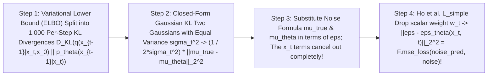
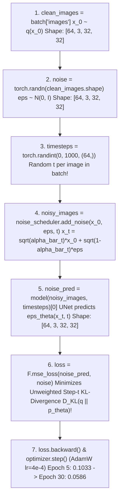

# KL-Divergence & How the Diffusion Loss Function (`F.mse_loss`) Actually Works
### *Part of [Module 10: Introduction to Diffusion Models](file:///Users/damodhar/Documents/Workspace/Learnings/Vizuara%20-%20Minor%20in%20AI/01-class-notes/10-introduction-to-diffusion-models/README.md) | Companion to [`GenAI_Fundamentals_Introduction_to_diffusers.ipynb` (`Cell 40`)](file:///Users/damodhar/Documents/Workspace/Learnings/Vizuara%20-%20Minor%20in%20AI/01-class-notes/10-introduction-to-diffusion-models/GenAI_Fundamentals_Introduction_to_diffusers.ipynb#L1196-L1220)*

---

## 🧠 1. Class X Sensory Intuition: What Is KL-Divergence ($D_{\text{KL}}(P \parallel Q)$)?

Imagine you are packing clothes for a 10-day school trip to Goa:
- **The True Weather Distribution ($P$)**: In reality, Goa is **$90\%$ Sunny (`0.90`)** and **$10\%$ Rainy (`0.10`)**.
- **Your Friend's Predicted Distribution ($Q$)**: Your friend predicts **$20\%$ Sunny (`0.20`)** and **$80\%$ Rainy (`0.80`)**, so you pack 8 heavy raincoats and only 2 t-shirts!

How do we measure **how badly your friend's probability distribution $Q$ mismatched the true distribution $P$**?
That exact mismatch meter is **Kullback-Leibler (KL) Divergence**:
$$D_{\text{KL}}(P \parallel Q) = \sum_{x} P(x) \ln\!\left(\frac{P(x)}{Q(x)}\right)$$

### Computing the Goa Weather KL-Divergence by Hand:
$$D_{\text{KL}}(P \parallel Q) = 0.90 \ln\!\left(\frac{0.90}{0.20}\right) + 0.10 \ln\!\left(\frac{0.10}{0.80}\right) = 0.90(1.5041) + 0.10(-2.0794) = 1.3537 - 0.2079 = \mathbf{+1.1458\text{ nats of surprise!}}$$
What if your friend's prediction $Q$ matched reality $P$ perfectly ($Q = [0.90, 0.10]$)?
$$D_{\text{KL}}(P \parallel P) = 0.90 \ln\!\left(\frac{0.90}{0.90}\right) + 0.10 \ln\!\left(\frac{0.10}{0.10}\right) = 0.90(0) + 0.10(0) = \mathbf{0.0000}$$

---

### Why KL-Divergence Explains Why Diffusion Models Never Suffer From "Mode Collapse" (Unlike GANs!)

Notice that $D_{\text{KL}}(P \parallel Q)$ is **not symmetric** ($D_{\text{KL}}(P \parallel Q) \ne D_{\text{KL}}(Q \parallel P)$):

```mermaid
flowchart TD
    subgraph ForwardKL["1. Forward KL: D_KL(P_real || Q_model) — Used in Diffusion & LLMs ('Mode-Covering')"]
        FRule["Formula: Sum P_real(x) * ln(P_real(x) / Q_model(x))"] --> FPenalty["If a Real Butterfly Island has P_real(x) > 0, and your Model ignores it (Q_model(x) -> 0):"]
        FPenalty --> FInf["ln(P_real / 0) = +INFINITY PENALTY!"]
        FInf --> FResult["Result: Diffusion is FORCED to cover ALL High-Probability Clusters (Zero Mode Collapse!)"]
    end

    subgraph ReverseKL["2. Reverse KL: D_KL(Q_model || P_real) — Behaves Like GANs ('Mode-Seeking / Dropping')"]
        RRule["Formula: Sum Q_model(x) * ln(Q_model(x) / P_real(x))"] --> RSafe["If the Model sets Q_model(x) = 0 on 9 out of 10 Butterfly Islands and parks only on Island 1:"]
        RSafe --> RZero["0 * ln(0 / P_real) = 0 Penalty!"]
        RZero --> RResult["Result: Model safely drops 9 islands -> Mode Collapse!"]
    end
```



---

## 🔬 2. The Big Mystery: How Does KL-Divergence Become `F.mse_loss(noise_pred, noise)` in [`Cell 40`](file:///Users/damodhar/Documents/Workspace/Learnings/Vizuara%20-%20Minor%20in%20AI/01-class-notes/10-introduction-to-diffusion-models/GenAI_Fundamentals_Introduction_to_diffusers.ipynb#L1211)?

Look at [`Cell 40`](file:///Users/damodhar/Documents/Workspace/Learnings/Vizuara%20-%20Minor%20in%20AI/01-class-notes/10-introduction-to-diffusion-models/GenAI_Fundamentals_Introduction_to_diffusers.ipynb#L1211) of the notebook:
```python
loss = F.mse_loss(noise_pred, noise)
```
Wait—if Diffusion is a probabilistic model minimizing **KL-Divergence**, why doesn't the code call `F.kl_div(...)`? Why does it call **`F.mse_loss(noise_pred, noise)`**?!

Here is the **complete 4-step mathematical proof** from Ho et al. (2020, *Denoising Diffusion Probabilistic Models*) showing how KL-Divergence magically simplifies into `F.mse_loss(noise_pred, noise)`!



---

### Step 1: Decomposing Total Distribution Mismatch into Per-Step KL-Divergences (ELBO)
We want our reverse denoising chain $p_\theta(\mathbf{x}_{0:T})$ to match the true forward corruption chain $q(\mathbf{x}_{0:T})$. Minimizing the Variational Lower Bound ($\mathcal{L}_{\text{VLB}}$) breaks the 1,000-step chain into **one KL-Divergence per timestep $t$**:
$$\mathcal{L}_{\text{VLB}} = \underbrace{D_{\text{KL}}\big(q(\mathbf{x}_T \mid \mathbf{x}_0) \parallel p(\mathbf{x}_T)\big)}_{\mathcal{L}_T \text{ (Constant: Pure Noise vs. }\mathcal{N}(\mathbf{0},\mathbf{I})\text{)}} + \sum_{t=2}^{T} \underbrace{D_{\text{KL}}\Big(q(\mathbf{x}_{t-1} \mid \mathbf{x}_t, \mathbf{x}_0) \;\Big\|\; p_\theta(\mathbf{x}_{t-1} \mid \mathbf{x}_t)\Big)}_{\mathcal{L}_{t-1} \text{ (True 1-Step Denoising vs. UNet 1-Step Denoising!)}} - \ln p_\theta(\mathbf{x}_0 \mid \mathbf{x}_1)$$

Look closely at $\mathcal{L}_{t-1}$:
- **$q(\mathbf{x}_{t-1} \mid \mathbf{x}_t, \mathbf{x}_0)$ ("The Teacher's True Reverse Step")**: Because we know the clean training butterfly $\mathbf{x}_0$ during training, Bayes' Rule gives us the **exact Gaussian distribution** of where $\mathbf{x}_{t-1}$ *should* go:
  $$q(\mathbf{x}_{t-1} \mid \mathbf{x}_t, \mathbf{x}_0) = \mathcal{N}\!\big(\mathbf{x}_{t-1}; \, \tilde{\boldsymbol{\mu}}_t(\mathbf{x}_t, \mathbf{x}_0), \, \sigma_t^2 \mathbf{I}\big)$$
- **$p_\theta(\mathbf{x}_{t-1} \mid \mathbf{x}_t)$ ("The UNet Student's Predicted Reverse Step")**:
  $$p_\theta(\mathbf{x}_{t-1} \mid \mathbf{x}_t) = \mathcal{N}\!\big(\mathbf{x}_{t-1}; \, \boldsymbol{\mu}_\theta(\mathbf{x}_t, t), \, \sigma_t^2 \mathbf{I}\big)$$

---

### Step 2: What Is the KL-Divergence Between Two Gaussians With Equal Variance $\sigma_t^2$?
For any two $D$-dimensional Gaussians $P = \mathcal{N}(\tilde{\boldsymbol{\mu}}_t, \sigma_t^2 \mathbf{I})$ and $Q = \mathcal{N}(\boldsymbol{\mu}_\theta, \sigma_t^2 \mathbf{I})$ sharing the same variance $\sigma_t^2$, write out the KL integral:
$$D_{\text{KL}}(P \parallel Q) = \int P(\mathbf{x}) \left[ -\frac{\lVert\mathbf{x} - \tilde{\boldsymbol{\mu}}_t\rVert_2^2}{2\sigma_t^2} + \frac{\lVert\mathbf{x} - \boldsymbol{\mu}_\theta\rVert_2^2}{2\sigma_t^2} \right] d\mathbf{x} = \frac{1}{2\sigma_t^2} \big\lVert \tilde{\boldsymbol{\mu}}_t(\mathbf{x}_t, \mathbf{x}_0) - \boldsymbol{\mu}_\theta(\mathbf{x}_t, t) \big\rVert_2^2$$

> [!IMPORTANT]
> **Key Mathematical Fact**:
> Because both the Teacher $q$ and the Student $p_\theta$ are Gaussian bells of the **exact same width $\sigma_t$**, the **KL-Divergence between them is literally just the Squared Euclidean Distance (MSE!) between their centers $\tilde{\boldsymbol{\mu}}_t$ and $\boldsymbol{\mu}_\theta$!**

---

### Step 3: Expressing Both Gaussian Centers in Terms of the Noise $\boldsymbol{\epsilon}$
From the forward equation $\mathbf{x}_t = \sqrt{\bar{\alpha}_t}\mathbf{x}_0 + \sqrt{1 - \bar{\alpha}_t}\boldsymbol{\epsilon}$, Bayes' Rule gives the Teacher's exact center $\tilde{\boldsymbol{\mu}}_t$ in terms of the true noise $\boldsymbol{\epsilon}$:
$$\tilde{\boldsymbol{\mu}}_t(\mathbf{x}_t, \boldsymbol{\epsilon}) = \frac{1}{\sqrt{\alpha_t}}\left(\mathbf{x}_t - \frac{\beta_t}{\sqrt{1 - \bar{\alpha}_t}}\boldsymbol{\epsilon}\right)$$
Similarly, the Student UNet predicts the noise $\boldsymbol{\epsilon}_\theta(\mathbf{x}_t, t)$ to form its center $\boldsymbol{\mu}_\theta$:
$$\boldsymbol{\mu}_\theta(\mathbf{x}_t, t) = \frac{1}{\sqrt{\alpha_t}}\left(\mathbf{x}_t - \frac{\beta_t}{\sqrt{1 - \bar{\alpha}_t}}\boldsymbol{\epsilon}_\theta(\mathbf{x}_t, t)\right)$$

Now plug $\tilde{\boldsymbol{\mu}}_t$ and $\boldsymbol{\mu}_\theta$ into our KL-Divergence formula from Step 2! Watch the $\frac{1}{\sqrt{\alpha_t}}\mathbf{x}_t$ terms **cancel out completely**:
$$\mathcal{L}_{t-1} = \frac{1}{2\sigma_t^2} \left\lVert \frac{1}{\sqrt{\alpha_t}}\left(\mathbf{x}_t - \frac{\beta_t}{\sqrt{1 - \bar{\alpha}_t}}\boldsymbol{\epsilon}\right) - \frac{1}{\sqrt{\alpha_t}}\left(\mathbf{x}_t - \frac{\beta_t}{\sqrt{1 - \bar{\alpha}_t}}\boldsymbol{\epsilon}_\theta(\mathbf{x}_t, t)\right) \right\rVert_2^2$$
$$\mathcal{L}_{t-1} = \underbrace{\frac{\beta_t^2}{2\sigma_t^2 \alpha_t (1 - \bar{\alpha}_t)}}_{\text{Scalar Timestep Weight } w_t} \big\lVert \boldsymbol{\epsilon} - \boldsymbol{\epsilon}_\theta(\mathbf{x}_t, t) \big\rVert_2^2$$

---

### Step 4: Dropping the Weight $w_t$ Gives `F.mse_loss(noise_pred, noise)`!
Ho et al. (2020) discovered empirically that dropping the scalar multiplier $w_t$ (setting $w_t = 1$ for all $t$) actually **improves image quality** because $w_t$ is huge at tiny noise levels ($t=1$) and small at heavy noise levels ($t=500$). Setting $w_t = 1$ forces the UNet to focus equally on hard, high-noise global structure steps!

Thus, the KL-Divergence objective reduces to **1 line of PyTorch code**:
$$\mathcal{L}_{\text{simple}}(\theta) = \mathbb{E}_{t \sim \mathcal{U}(0, 999), \, \mathbf{x}_0, \, \boldsymbol{\epsilon} \sim \mathcal{N}(\mathbf{0}, \mathbf{I})}\Big[ \big\lVert \boldsymbol{\epsilon} - \boldsymbol{\epsilon}_\theta(\mathbf{x}_t, t) \big\rVert_2^2 \Big] = \texttt{F.mse\_loss(noise\_pred, noise)}$$

---

## 💻 3. Line-by-Line Anatomy of the Training Loop in [`Cell 40`](file:///Users/damodhar/Documents/Workspace/Learnings/Vizuara%20-%20Minor%20in%20AI/01-class-notes/10-introduction-to-diffusion-models/GenAI_Fundamentals_Introduction_to_diffusers.ipynb#L1196-L1220)

Every single line of the training loop in [`Cell 40`](file:///Users/damodhar/Documents/Workspace/Learnings/Vizuara%20-%20Minor%20in%20AI/01-class-notes/10-introduction-to-diffusion-models/GenAI_Fundamentals_Introduction_to_diffusers.ipynb#L1196-L1220) maps 1-to-1 to the equations above:



### Why Does Loss Plateau Around `0.0586` Instead of Reaching `0.0000`?
Look at the notebook's training log in [`Cell 40`](file:///Users/damodhar/Documents/Workspace/Learnings/Vizuara%20-%20Minor%20in%20AI/01-class-notes/10-introduction-to-diffusion-models/GenAI_Fundamentals_Introduction_to_diffusers.ipynb#L1225-L1230):
- `Epoch: 5, loss: 0.1033` $\to$ `Epoch: 15, loss: 0.0744` $\to$ `Epoch: 30, loss: 0.0586`
- Why can't `F.mse_loss(noise_pred, noise)` ever hit `0.0000`?
  - Because at high timesteps ($t \approx 990$), two different butterflies $\mathbf{x}_0^{(A)}$ and $\mathbf{x}_0^{(B)}$ corrupted by two different noises $\boldsymbol{\epsilon}^{(A)}$ and $\boldsymbol{\epsilon}^{(B)}$ can land on the **exact same noisy point $\mathbf{x}_t$**!
  - Given only $\mathbf{x}_t$, the Bayes-optimal prediction is the posterior expectation $\mathbb{E}[\boldsymbol{\epsilon} \mid \mathbf{x}_t]$, which has irreducible Bayes variance $> 0$ (`~0.04–0.05`). A loss of `0.0586` means the UNet has converged right onto the theoretical Bayes-optimal Score Field!
