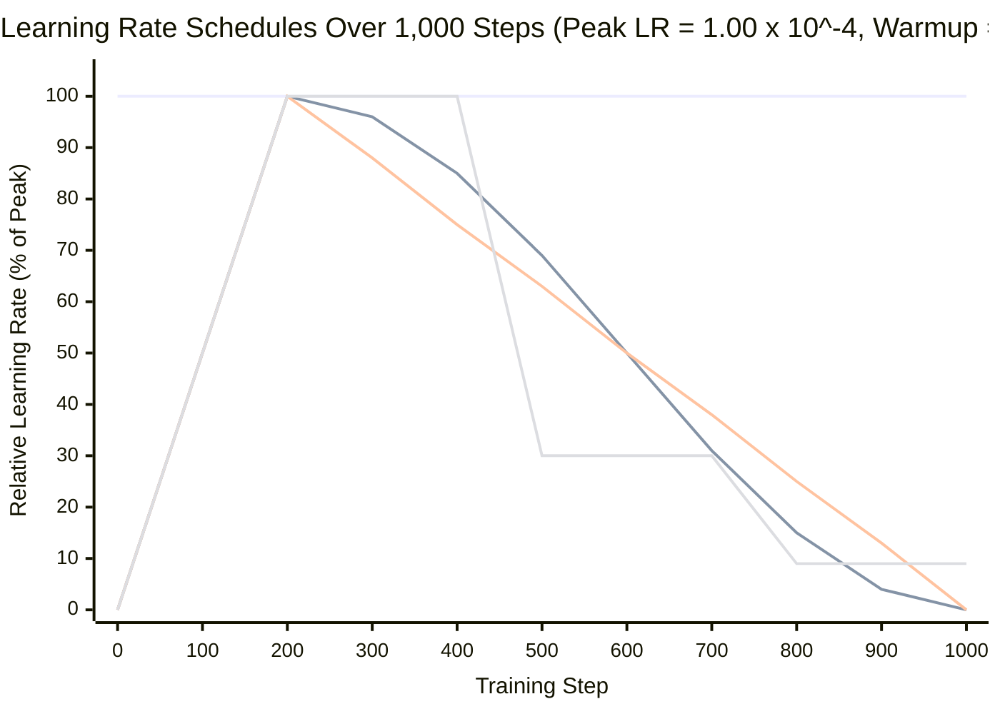
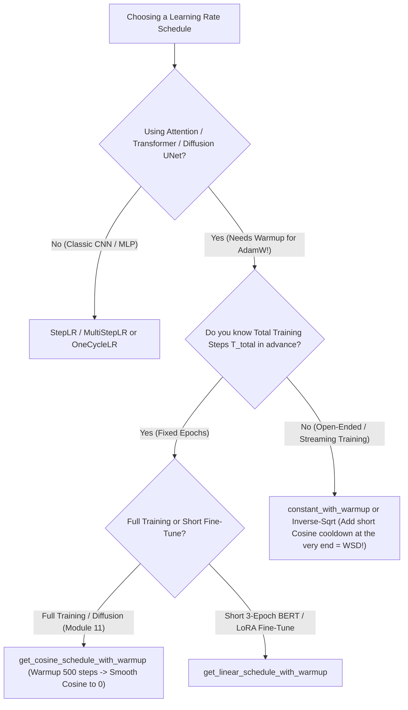

# Complete Guide to Learning Rate Schedules in Diffusion Models & Deep Learning
### *Incremental Warmup, Cosine Annealing, Linear, Step, Cyclical/Restarts, One-Cycle & When to Use Each*

---

## 🔗 Quick Navigation
- **Module 10 (Butterfly DDPM)**: [README.md](file:///Users/damodhar/Documents/Workspace/Learnings/Vizuara%20-%20Minor%20in%20AI/01-class-notes/10-introduction-to-diffusion-models/README.md) (`Constant AdamW lr=4e-4` in [`Cell 40`](file:///Users/damodhar/Documents/Workspace/Learnings/Vizuara%20-%20Minor%20in%20AI/01-class-notes/10-introduction-to-diffusion-models/GenAI_Fundamentals_Introduction_to_diffusers.ipynb#L1189))
- **Module 11 (Chinese Characters Diffusion)**: [README.md](file:///Users/damodhar/Documents/Workspace/Learnings/Vizuara%20-%20Minor%20in%20AI/01-class-notes/11-diffusion-project-chinese-characters/README.md) (`get_cosine_schedule_with_warmup` in [`Cell 20`](file:///Users/damodhar/Documents/Workspace/Learnings/Vizuara%20-%20Minor%20in%20AI/01-class-notes/11-diffusion-project-chinese-characters/Diffusion_Project_Generate_Chinese_Characters.ipynb#L1160))

---

## 🧠 1. Class X Sensory Intuition: Driving a Car Down a Foggy Mountain Into a Parking Spot

When training a neural network ($\mathbf{w}_{\text{new}} = \mathbf{w}_{\text{old}} - \eta_t \nabla \mathcal{L}$), the **Learning Rate ($\eta_t$)** is your **car's speed** as you drive down a mountain toward the lowest valley point (minimum loss):

1. **Phase 1 — Pulling Out of the Garage (`Incremental Linear Warmup`: Step $0 \to 500$)**:
   - At Step 0, your weights are random and your car's steering/tires (`AdamW` variance buffers) are completely cold!
   - If you floor the accelerator to $100\text{ km/h}$ (`lr = 1e-4`) at millisecond 0, you immediately skid off a cliff!
   - **Incremental Warmup** starts at $0\text{ km/h}$ and gently presses the pedal step-by-step ($0 \to 20 \to 40 \to 100\text{ km/h}$) over the first `500` steps until the optimizer's compass is calibrated.
2. **Phase 2 — Cruising Down the Highway (`Peak / Mid Training`)**:
   - Once calibrated, you cruise at full speed ($\eta_{\max}$) to cover large distances across the loss landscape quickly.
3. **Phase 3 — Braking Smoothly Into the Exact Parking Spot (`Cosine / Linear Decay`)**:
   - As you approach the narrow valley floor (the optimal weights), if you stay at $100\text{ km/h}$, your car will **bounce back and forth across the valley walls forever** without ever parking!
   - Gradually decaying the learning rate toward $0$ lets the model settle smoothly into the deepest, sharpest-detail minimum!

---

## 📊 2. Visual Comparison of All Major Learning Rate Curves

Here are the trajectories of the primary Learning Rate Schedules across $1,000$ training steps (with a $200$-step Incremental Warmup reaching peak $\eta_{\max} = 1.0 \times 10^{-4}$):

- **Flat Top Line (`100%` everywhere)**: **Constant LR** (used in tiny toy notebooks like Module 10).
- **Smooth S-Curve (`0 -> 100 -> 96 -> 50 -> 4 -> 0`)**: **Incremental Warmup + Cosine Annealing** (`get_cosine_schedule_with_warmup` in Module 11!).
- **Straight Triangle (`0 -> 100 -> 75 -> 50 -> 25 -> 0`)**: **Incremental Warmup + Linear Decay**.
- **Staircase Curve (`100 -> 30 -> 9`)**: **Step Decay (`StepLR` / `MultiStepLR`)**.

---

## 🔬 3. The 8 Types of Learning Rate Schedules: Formulas, Purpose & When to Use Which

In Hugging Face `diffusers.optimization` (`SchedulerType`) and PyTorch `torch.optim.lr_scheduler`, there are **8 major learning rate schedules**:

### 1. Constant Learning Rate (`"constant"`)
$$\eta_t = \eta_0 \quad \forall t$$
- **Where Used in Our Course**: [Module 10 Butterfly DDPM (`Cell 40`)](file:///Users/damodhar/Documents/Workspace/Learnings/Vizuara%20-%20Minor%20in%20AI/01-class-notes/10-introduction-to-diffusion-models/GenAI_Fundamentals_Introduction_to_diffusers.ipynb#L1189) (`AdamW(lr=4e-4)`).
- **When to Use**: Quick prototyping, small datasets ($<5,000$ images), or short runs where you just want to verify the model learns.
- **Weakness**: Oscillates around the minimum at the end of training; in Diffusion, constant high LR leaves slight graininess in fine textures ($t \to 0$).

---

### 2. Incremental Warmup + Constant (`"constant_with_warmup"`)
$$\eta_t = \begin{cases} \eta_{\max} \cdot \frac{t}{T_{\text{warmup}}} & \text{if } t < T_{\text{warmup}} \quad (\text{Incremental Linear Ramp-Up}) \\ \eta_{\max} & \text{if } t \ge T_{\text{warmup}} \end{cases}$$
- **Why Incremental Warmup Is Essential for Transformers & Diffusion (`AttnDownBlock2D`)**:
  - In `AdamW`, the update divides the gradient by $\sqrt{\hat{v}_t}$, where $v_t = \beta_2 v_{t-1} + (1-\beta_2)g_t^2$ tracks gradient variance.
  - In the first few batches ($t = 1..50$), $v_t$ has only seen a handful of random timesteps $t \sim \mathcal{U}(0, 999)$, making the adaptive step size noisy and unstable!
  - Ramping $\eta_t$ incrementally from $0 \to \eta_{\max}$ over `lr_warmup_steps = 500` lets `AdamW` accumulate accurate second-moment statistics *before* taking full-sized steps!
- **When to Use**: Fine-tuning pre-trained Stable Diffusion (DreamBooth / LoRA) when you don't know in advance how many total epochs you will train.

---

### 3. Incremental Warmup + Cosine Annealing (`"cosine"` / `get_cosine_schedule_with_warmup`) — 🏆 *The GenAI Gold Standard*
$$\eta_t = \begin{cases} \eta_{\max} \cdot \frac{t}{T_{\text{warmup}}} & \text{if } t < T_{\text{warmup}} \\ \eta_{\min} + \frac{1}{2}(\eta_{\max} - \eta_{\min})\left(1 + \cos\!\left(\pi \frac{t - T_{\text{warmup}}}{T_{\text{total}} - T_{\text{warmup}}}\right)\right) & \text{if } t \ge T_{\text{warmup}} \end{cases}$$
- **Where Used in Our Course**: [Module 11 Chinese Characters Diffusion (`Cell 20`)](file:///Users/damodhar/Documents/Workspace/Learnings/Vizuara%20-%20Minor%20in%20AI/01-class-notes/11-diffusion-project-chinese-characters/Diffusion_Project_Generate_Chinese_Characters.ipynb#L1160-L1164) (`lr = 1e-4`, `lr_warmup_steps = 500`).
- **Why Cosine Beats Straight Linear Decay**:
  1. **Flat Plateau After Warmup ($\cos(0) = 1$)**: Right after warmup, the cosine slope is nearly flat, keeping $\eta_t \approx \eta_{\max}$ longer so the UNet rapidly learns global character stems/radicals.
  2. **Smooth Mid-Training Transition**: Accelerates decay smoothly through the middle of training without sudden jerky drops.
  3. **Gentle Soft-Landing Tail ($\cos(\pi) = -1$)**: Spend the final $15\%$ of steps at a tiny, smoothly vanishing learning rate—allowing the UNet to polish razor-sharp $128 \times 128$ brush strokes without jittering!
- **When to Use**: **Default #1 choice** for training Diffusion Models (DDPM, Stable Diffusion, DiT), Vision Transformers (ViT), and LLMs (GPT, LLaMA) from scratch whenever `num_training_steps` is known!

---

### 4. Incremental Warmup + Linear Decay (`"linear"`)
$$\eta_t = \eta_{\max} \cdot \left(1 - \frac{t - T_{\text{warmup}}}{T_{\text{total}} - T_{\text{warmup}}}\right) \quad \text{for } t \ge T_{\text{warmup}}$$
- **When to Use**: Standard in BERT/RoBERTa fine-tuning (`3–5` epochs) and short LoRA fine-tuning runs.

---

### 5. Cosine with Hard Restarts (`"cosine_with_restarts"` / SGDR)
$$\eta_t = \eta_{\min} + \frac{1}{2}(\eta_{\max} - \eta_{\min})\left(1 + \cos\!\left(\pi \frac{T_{\text{cur}}}{T_{\text{cycle}}}\right)\right)$$
- Periodically resets $T_{\text{cur}} \to 0$, jumping the learning rate back to $\eta_{\max}$ every $T_{\text{cycle}}$ steps!
- **When to Use**: Complex multimodal landscapes where the model risks getting trapped in a suboptimal local valley; each restart "kicks" the weights out of narrow sharp minima into wider, more generalizable basins.

---

### 6. Step Decay & Exponential Decay (`StepLR` / `MultiStepLR` / `ExponentialLR`)
$$\text{StepLR: } \eta_t = \eta_0 \cdot \gamma^{\lfloor t / S \rfloor}, \qquad \text{ExponentialLR: } \eta_t = \eta_0 \cdot \gamma^t$$
- **When to Use**: Classic ResNet / CNN image classifiers (e.g., dropping LR by $0.1\times$ at Epochs 30, 60, and 90). Rarely used in Diffusion or Transformers because sudden $10\times$ step drops shock `AdamW` momentum buffers.

---

### 7. Polynomial / Inverse-Square-Root Decay (`"polynomial"` / `"inverse_sqrt"`)
$$\text{Polynomial: } \eta_t = (\eta_{\max} - \eta_{\min})\left(1 - \frac{t - T_{\text{warmup}}}{T_{\text{total}} - T_{\text{warmup}}}\right)^p + \eta_{\min}, \qquad \text{Inverse-Sqrt: } \eta_t = \frac{\eta_{\max}}{\sqrt{\max(t, T_{\text{warmup}})/T_{\text{warmup}}}}$$
- **When to Use**: `"inverse_sqrt"` was the original 2017 Vaswani *Attention Is All You Need* schedule—useful for open-ended pre-training where you don't know $T_{\text{total}}$ in advance!

---

### 8. Warmup-Stable-Decay (`WSD`) & `ReduceLROnPlateau`
- **Warmup-Stable-Decay (`WSD`)**: Ramps up for $2\%$ of steps, holds **constant** at $\eta_{\max}$ for $85\%$ of training (allowing continuous checkpointing at any token budget!), and decays rapidly in the final $13\%$ cooldown phase. Used in modern frontier LLMs (DeepSeek, MiniCPM, Llama-3).
- **`ReduceLROnPlateau`**: Watches validation loss and multiplies LR by `0.5` only when validation loss stops improving for `patience` epochs.

---

## 🧭 4. Decision Flowchart: Which Learning Rate Schedule Should You Pick?

---

## ⚠️ 5. Crucial Distinction in Diffusion: Don't Confuse the TWO "Schedulers"!

In [`Diffusion_Project_Generate_Chinese_Characters.ipynb` (`Cell 20`)](file:///Users/damodhar/Documents/Workspace/Learnings/Vizuara%20-%20Minor%20in%20AI/01-class-notes/11-diffusion-project-chinese-characters/Diffusion_Project_Generate_Chinese_Characters.ipynb#L1157-L1164), two completely different objects have `"scheduler"` in their name:

| Scheduler Variable in Code | Library Class | What It Controls |
| :--- | :--- | :--- |
| **`lr_scheduler`** | `get_cosine_schedule_with_warmup` | **Optimizer Weight Step Size ($\eta_t$)**: Controls how much `optimizer.step()` changes the **UNet weights $\theta$** at each training batch (`0 -> 1e-4 -> 0`). |
| **`noise_scheduler` / `inference_scheduler`** | `DDPMScheduler` / `DPMSolverMultistepScheduler` | **Image Corruption & Denoising Variance ($\beta_t, \bar{\alpha}_t$)**: Controls how much **Gaussian static $\boldsymbol{\epsilon}$** is mixed into the **image pixels $\mathbf{x}_t$** across diffusion timesteps $t \in [0..999]$! |
