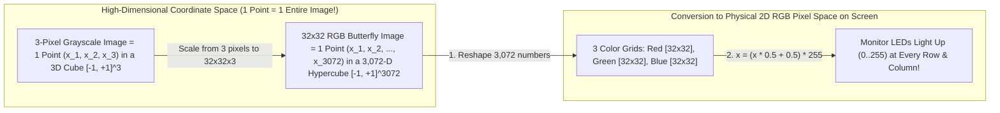
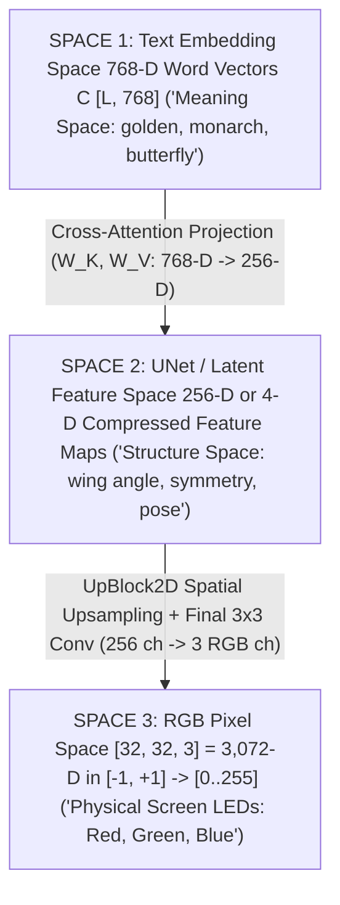
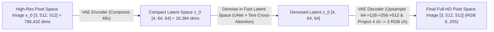

# What Is "Pixel Space" & How High Dimensions Convert into Visible RGB Pixels
### *Part of [Module 10: Introduction to Diffusion Models](file:///Users/damodhar/Documents/Workspace/Learnings/Vizuara%20-%20Minor%20in%20AI/01-class-notes/10-introduction-to-diffusion-models/README.md) | Companion to [`GenAI_Fundamentals_Introduction_to_diffusers.ipynb`](file:///Users/damodhar/Documents/Workspace/Learnings/Vizuara%20-%20Minor%20in%20AI/01-class-notes/10-introduction-to-diffusion-models/GenAI_Fundamentals_Introduction_to_diffusers.ipynb)*

---

## 🧠 1. Class X Sensory Intuition: How Can "One Point in 3,072-D Space" Be a Picture of a Butterfly?

When mathematicians say *"A $32 \times 32$ butterfly image is **one single point** inside a 3,072-dimensional space,"* how do we visualize that without our brain hurting?

### Start With a Tiny 3-Pixel Picture!
Imagine a microscopic black-and-white camera that takes pictures with **only 3 pixels in a row**:
$$\text{Image} = [\text{Pixel}_1, \, \text{Pixel}_2, \, \text{Pixel}_3]$$
Suppose each pixel's brightness is a number from **`-1.0` (Pitch Black)** to **`+1.0` (Bright White)**:
- **Example Picture A** (White on the sides, Black in the middle): `[+0.9, -0.8, +0.9]`
- **Example Picture B** (Dark on the sides, White in the middle): `[-0.9, +0.8, -0.9]`

Now look at those 3 numbers `[+0.9, -0.8, +0.9]`:
- Because there are **3 numbers**, you can plot the **entire 3-pixel picture** as **ONE SINGLE DOT $(x, y, z) = (+0.9, -0.8, +0.9)$** floating inside a regular 3D bedroom!
  - Axis 1 ($X$-axis) controls **only $\text{Pixel}_1$'s brightness**.
  - Axis 2 ($Y$-axis) controls **only $\text{Pixel}_2$'s brightness**.
  - Axis 3 ($Z$-axis) controls **only $\text{Pixel}_3$'s brightness**.
- When the dot moves through the 3D room from $(-0.9, +0.8, -0.9)$ to $(+0.9, -0.8, +0.9)$, the 3 pixels on your screen smoothly fade from Picture B into Picture A!



### Scaling Up to Our $32 \times 32$ Color Butterfly (`3,072` Dimensions)
In [`GenAI_Fundamentals_Introduction_to_diffusers.ipynb` (`Cell 19`)](file:///Users/damodhar/Documents/Workspace/Learnings/Vizuara%20-%20Minor%20in%20AI/01-class-notes/10-introduction-to-diffusion-models/GenAI_Fundamentals_Introduction_to_diffusers.ipynb#L492), each butterfly tensor has shape **`[3, 32, 32]`**:
- There are $32 \times 32 = 1,024$ pixel locations on the square canvas.
- Each pixel location needs **3 color knobs**: **Red ($R$)**, **Green ($G$)**, and **Blue ($B$)**.
- Total knobs (dimensions) $= 3 \times 32 \times 32 = \mathbf{3,072\text{ dimensions}}$!
- Moving a point $\mathbf{x}_t$ inside $\mathbb{R}^{3072}$ during the 1,000 reverse diffusion steps is literally **turning all 3,072 Red/Green/Blue dimmer switches simultaneously** until they settle on a butterfly!

---

## 🔬 2. How High-Dimensional Semantic Features Are Converted Into 3-Channel Pixel Space

In Diffusion models, there are **three distinct high-dimensional spaces** that must be converted down into **Pixel Space (`[H, W, 3]`)**. Let's trace all three!



---

### Conversion Stage 1: From 768-D Text Embedding Space $\longrightarrow$ UNet Feature Space
- When you type `"golden butterfly"`, the Text Transformer outputs a **768-dimensional semantic vector** $\mathbf{c}_i \in \mathbb{R}^{768}$ for each word.
- **Problem**: A 768-D word vector has **no height, no width, and no RGB pixels**!
- **How It Converts**: Inside the UNet's attention blocks, linear projection matrices $\mathbf{W}_K, \mathbf{W}_V \in \mathbb{R}^{768 \times d_{\text{channel}}}$ project the 768-D text vector to match the UNet's channel dimension (e.g., `256` channels), and **Cross-Attention** paints those 256 features onto specific $(r, c)$ spatial grid cells!

---

### Conversion Stage 2: From UNet High-Channel Space (`256` Channels at $2 \times 2$) $\longrightarrow$ RGB Tensor Space (`3` Channels at $32 \times 32$)

Look at [`UNet2DModel` in `Cell 33`](file:///Users/damodhar/Documents/Workspace/Learnings/Vizuara%20-%20Minor%20in%20AI/01-class-notes/10-introduction-to-diffusion-models/GenAI_Fundamentals_Introduction_to_diffusers.ipynb#L1043-L1062):
`block_out_channels = (64, 128, 128, 256)`
- At the deepest bottleneck of the UNet, the image has been shrunk spatially to a tiny **$2 \times 2$ grid**, but expanded in depth to **`256` high-level feature channels**!
  - Channel 14 might represent *"Are the wings open or closed?"*
  - Channel 89 might represent *"Is the background green leaves or blue sky?"*
  - Channel 201 might represent *"Where is the light source coming from?"*
- **How does the UNet convert `256` abstract channels back into `3` RGB channels?**
  It **trades Channel Depth for Spatial Resolution ($H \times W$)** step-by-step:

| UNet Stage (`Cell 33`) | Tensor Shape `[B, Channels, H, W]` | What Happens Geometrically |
| :--- | :--- | :--- |
| **Bottleneck** | `[B, 256, 2, 2]` | **High-Dimensional Semantic Code**: 256 abstract concept channels on a $2 \times 2$ coarse grid. |
| **`AttnUpBlock2D 1`** | `[B, 256, 4, 4]` | Doubles spatial grid ($2 \to 4$) + fuses skip connection from `AttnDownBlock2D 4`. |
| **`AttnUpBlock2D 2`** | `[B, 128, 8, 8]` | Compresses channels **`256 -> 128`** while doubling spatial grid ($4 \to 8$). |
| **`UpBlock2D 3`** | `[B, 128, 16, 16]` | Doubles spatial grid ($8 \to 16$) + fuses mid-level edge skip features. |
| **`UpBlock2D 4`** | `[B, 64, 32, 32]` | Compresses channels **`128 -> 64`** at full $32 \times 32$ spatial resolution. |
| **`conv_out` (`64 -> 3`)** | **`[B, 3, 32, 32]`** | A $3 \times 3$ convolution with 3 output filters takes a weighted linear combination of all **64 feature channels** at each pixel $(r, c)$ to output **3 numbers: `[Red, Green, Blue]`**! |

#### The Exact Equation of the Final Channel-to-RGB Projection (`conv_out`)
At every pixel coordinate $(r, c) \in \{0,\dots,31\}^2$, the final convolutional layer combines all $64$ feature channels $F_{0..63}(r, c)$ into the 3 RGB values:
$$\begin{bmatrix} R(r, c) \\ G(r, c) \\ B(r, c) \end{bmatrix}_{(3 \times 1)} = \sum_{u=-1}^{+1}\sum_{v=-1}^{+1} \mathbf{W}_{u,v}^{(3 \times 64)} \begin{bmatrix} F_0(r+u, c+v) \\ F_1(r+u, c+v) \\ \vdots \\ F_{63}(r+u, c+v) \end{bmatrix}_{(64 \times 1)} + \mathbf{b}_{(3 \times 1)}$$

---

### Conversion Stage 3: From Continuous Floating-Point Tensor (`[-1, +1]`) $\longrightarrow$ Screen Bytes (`[0..255]` `uint8`)

Look at [`show_images(x)` in `Cell 13`](file:///Users/damodhar/Documents/Workspace/Learnings/Vizuara%20-%20Minor%20in%20AI/01-class-notes/10-introduction-to-diffusion-models/GenAI_Fundamentals_Introduction_to_diffusers.ipynb#L232-L238) of the notebook:
```python
def show_images(x):
    x = x * 0.5 + 0.5                                         # 1. Shift [-1, +1] -> [0, 1]
    grid = torchvision.utils.make_grid(x)
    grid_im = grid.detach().cpu().permute(1, 2, 0).clip(0, 1) * 255  # 2. [C,H,W] -> [H,W,C] & scale to [0, 255]
    grid_im = Image.fromarray(np.array(grid_im).astype(np.uint8))    # 3. Cast to 8-bit integer bytes!
    return grid_im
```

Why are these 3 lines needed at the very end?
1. **Neural networks love zero-centered floats (`[-1.0, +1.0]`)**: During training (`Cell 17`), `transforms.Normalize([0.5], [0.5])` applied $x_{\text{norm}} = \frac{x_{[0,1]} - 0.5}{0.5} = 2x_{[0,1]} - 1 \in [-1, +1]$ so gradients have mean $0$.
2. **Computer monitors only understand 8-bit unsigned integers (`0` to `255`)**:
   - Multiply by $0.5$ and add $0.5$: maps $-1.0 \to 0.0$, $0.0 \to 0.5$, and $+1.0 \to 1.0$.
   - `.permute(1, 2, 0)`: PyTorch stores images as **Channel-First `[3, 32, 32]`** for fast GPU matrix math, whereas displays (`PIL` / `matplotlib`) expect **Channel-Last `[32, 32, 3]`** (where each pixel $(r, c)$ holds an `[R, G, B]` triplet).
   - Multiply by `255` and cast to `uint8`: converts continuous floats into hardware byte intensities!

```text
Concrete Single-Pixel Conversion Example (Royal Blue Butterfly Wing Pixel at row=10, col=12):
  1. Denoised Tensor x_0[:, 10, 12] in [-1, +1] :  [ R = -0.75,   G = -0.10,   B = +0.90 ]
  2. Shift to [0, 1] via (x * 0.5 + 0.5)        :  [ R =  0.125,  G =  0.450,  B =  0.950 ]
  3. Scale by 255 & cast to uint8 [0..255]      :  [ R = 31,      G = 114,     B = 242   ]  --> Royal Blue LED!
```

---

## 🚀 3. Bonus: How Modern "Latent Diffusion" (Stable Diffusion) Separates Latent Space from Pixel Space

In our notebook (`DDPMPipeline`), diffusion runs **directly in Pixel Space** (`[3, 32, 32]`).
When generating a high-resolution $512 \times 512 \times 3$ image ($786,432$ pixel values!), running 1,000 UNet steps directly in Pixel Space is too slow. **Latent Diffusion (Stable Diffusion)** adds a **Variational Autoencoder (VAE)** bridge:


- **During Denoising ($t = 1000 \to 0$)**: The UNet navigates high-probability clusters inside the **compressed 4-channel Latent Space (`[4, 64, 64]`)**—48x faster!
- **At the Final Step ($t = 0$)**: A **VAE Decoder** runs **once** to unpack those 4 abstract latent channels into the full $512 \times 512 \times 3$ **RGB Pixel Space**!
