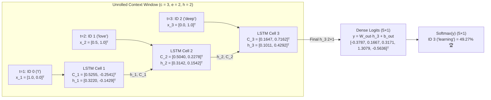

# Assignment 02: Handwritten LSTM for Next-Word Generation
### *End-to-End First-Principles Matrix Trace, Cell Internals, Teaching Script & Dual-Language Verification*

---

## 📦 Assignment Deliverables Package

| Deliverable | Purpose | File Link |
| :--- | :--- | :--- |
| **1. 7-Page Handwritten Master Guide** | Exact page-by-page blueprint (Pages 1–7) ready to copy onto A4 paper & scan as PDF, with every matrix multiplication and `(m × n)` dimension explicitly labeled. | [`notes/handwritten_pages_master_guide.md`](file:///Users/damodhar/Documents/Workspace/Learnings/Vizuara%20-%20Minor%20in%20AI/02-lecture-assignments/assignment-02-handwritten-lstm-next-word/notes/handwritten_pages_master_guide.md) |
| **2. Undergraduate Teaching Video Script** | Complete ~15-minute professor-style lecture transcript synced page-by-page with camera/pointer cues for Loom/Veed.io recording. | [`script/teaching_video_script.md`](file:///Users/damodhar/Documents/Workspace/Learnings/Vizuara%20-%20Minor%20in%20AI/02-lecture-assignments/assignment-02-handwritten-lstm-next-word/script/teaching_video_script.md) |
| **3. Python Precision Verification Script** | Zero-dependency Python script verifying every dot product, gate, cell state, logit, and Softmax value to 4-decimal calculator precision & 64-bit IEEE float. | [`code/lstm_handwritten_verification.py`](file:///Users/damodhar/Documents/Workspace/Learnings/Vizuara%20-%20Minor%20in%20AI/02-lecture-assignments/assignment-02-handwritten-lstm-next-word/code/lstm_handwritten_verification.py) |
| **4. Java 17+ Enterprise Verification** | Clean Java 17+ Record-based state-machine implementation executing the identical $(2 \times 4)$ LSTM forward pass and Softmax projection. | [`code/LSTMHandwrittenVerification.java`](file:///Users/damodhar/Documents/Workspace/Learnings/Vizuara%20-%20Minor%20in%20AI/02-lecture-assignments/assignment-02-handwritten-lstm-next-word/code/LSTMHandwrittenVerification.java) |
| **5. Original Assignment Prompt PDF** | Official Vizuara problem statement ($V=5, h=2, e=2, c=3$). | [`GenAI_Fundamentals_Take_home_Assignment.pdf`](file:///Users/damodhar/Documents/Workspace/Learnings/Vizuara%20-%20Minor%20in%20AI/02-lecture-assignments/GenAI_Fundamentals_Take_home_Assignment.pdf) |

---

## 🧠 Architectural & Visual Summary (6-Tier Cognitive Bridge)

### 1. Why Vanilla RNN Fails vs. How LSTM Solves It (Tier 1 & Tier 2)

- **Class X / Brain Intuition**: A Vanilla RNN is like a **goldfish brain** with only a single short-term memory buffer ($h_t$) that gets overwritten on every word. An LSTM acts like a **human reader with a Long-Term Notebook ($C_t$) and Working Memory ($h_t$)**—using three **Sigmoid dimmer-switch valves ($\in (0,1)$)** to selectively erase stale trivia ($f_t$), write important facts ($i_t$), and speak only what is relevant right now ($o_t$).
- **Staff Backend Architect Rosetta Stone**:
  - **Vanilla RNN ($h_t$)** $\longleftrightarrow$ **Mutable In-Memory Cache** overwritten in-place on every API call (state corruption + exponential BPTT gradient decay).
  - **LSTM Cell State ($C_t$)** $\longleftrightarrow$ **Append-Only Write-Ahead Log (WAL) / Event Stream** updated via linear addition ($+$), preserving gradients via the **Constant Error Carousel** ($\frac{\partial C_t}{\partial C_{t-1}} = f_t \approx 1$).
  - **Forget Gate ($f_t$)** $\longleftrightarrow$ **TTL / Kafka Topic Compaction Filter**.
  - **Input Gate ($i_t \odot \tilde{C}_t$)** $\longleftrightarrow$ **Validated Ingestion Appender**.
  - **Output Gate ($o_t \odot \tanh(C_t)$)** $\longleftrightarrow$ **CQRS Read-Model Projection** fed to the downstream Softmax load-balancer.

---

## ✅ Grading Rubric Verification Checklist

- [x] **Vocabulary $V = 5$, Hidden $h = 2$, Embedding $e = 2$, Context $c = 3$**: Exact match (`"I love deep"` $\to$ `"learning"`).
- [x] **Explicit Concatenated Gate Equations**: Uses the exact PDF equations $f_t, i_t, o_t, \tilde{C}_t, C_t, h_t$ with $[h_{t-1}, x_t] \in \mathbb{R}^{4 \times 1}$.
- [x] **Every Matrix Dimension Explicitly Labeled**: `(5×2)`, `(2×1)`, `(4×1)`, `(2×4)`, `(5×1)` written on every single step.
- [x] **Zero Assumptions / Full Arithmetic**: Every dot product, bias sum, $\sigma(\cdot)$, $\tanh(\cdot)$, Hadamard product ($\odot$), $e^{y_k}$, and division is shown explicitly.
- [x] **50% Handwritten PDF + 50% Video Explanation**: Both the 7-page handwriting blueprint and the full classroom teaching script are complete and cross-verified.
